# FinPilot AI: Member 3 Evaluation Guide

**Financial Intelligence and Privacy · Evaluation Tasks 3 to 8**

Member 3: Rahul Akshath Rajendran (3122235002095) · UIT2739 Full Stack Development Project · Department of
Information Technology, SSN College of Engineering · October 2026

> **How this guide was checked (18 Oct 2026).** Every error message below was captured from a running copy of the
> app, every SQL query was run against the current schema (migrations 0001 and 0002), the backend test suite passed
> (82 of 82), the browser suite passed (23 of 23), and the Android app passed its on-device check on an Android 15
> emulator (17 of 17). Code references point at the current source. Demo numbers change slightly each day, because
> the demo data is regenerated for the current date.
>
> **What changed since the 14 Oct version.** FinPilot now runs on real data: an Android app reads the bank SMS on
> the phone, a mailbox connection reads bank and shop email, and the laptop runs the server. Smart Picks (which
> crawled demo stores) was replaced by a real **Wishlist**. The simulators and every "sample inbox" button were
> removed; the demo is a separate, clearly labelled account. The previous guide is kept in `fsd/previous/`.
>
> **Legend:** ✅ handled · ⚠️ partly handled · ❌ not handled (an improvement to suggest)

## Contents

1. [Quick start and cheat sheet](#quick-start-and-cheat-sheet)
2. [Task 3: Individual contribution](#task-3-individual-contribution)
3. [Task 4: Backend files](#task-4-backend-files)
4. [Task 5: Exception handling and logging](#task-5-exception-handling-and-logging)
5. [Task 6: Database demonstration](#task-6-database-demonstration)
6. [Task 7: Code demonstration](#task-7-code-demonstration)
7. [Task 8: Edge cases](#task-8-edge-cases)
8. [Appendix A: ChatGPT conversation prompts (Task 1)](#appendix-a-chatgpt-conversation-prompts-task-1)

## Quick start and cheat sheet

### Start the app

1. From the project folder, run `python3 run.py` (on Windows, `py run.py`). Keep this terminal visible: the logs
   appear here. It also prints the address the phone uses and a QR code.
2. The browser opens at <http://localhost:8000>. Click **Explore the demo account (sample data)**, or sign in as
   `demo@finpilot.ai` with password `demo1234`.
3. If the demo data is older than today, it is rebuilt automatically when the app starts. While that happens,
   the login button reads "Preparing the demo account…" for about a minute.
4. **The phone app (to show real SMS).** With the phone on USB and USB debugging on, run
   `python3 run.py install-android`. Open **FinPilot AI**, scan the QR code (or type the address), create an
   account, and allow SMS. Phone and laptop must be on the same Wi-Fi, or the laptop on the phone's hotspot; on
   college Wi-Fi, start the server with `python3 run.py --tunnel`.

All API endpoints live under `/api/v1`. The interactive API docs are at <http://localhost:8000/api/docs>.

### My six features at a glance

| Feature | Where in the app | Main endpoints | Backend files |
|---|---|---|---|
| Forecasting and insights | **Forecast**, **Insights & coach**, Dashboard tiles | `GET /forecast`, `GET /forecast/whatif`, `GET /insights`, `POST /insights/{id}/dismiss`, `POST /coach/ask` | `api/v1/analysis.py`, `api/v1/dashboard.py`, `services/forecasting/`, `services/recurring.py`, `services/insights.py`, `services/coach.py` |
| Subscriptions | **Subscriptions** | `GET /subscriptions`, `POST /subscriptions/{id}/action` | `api/v1/analysis.py`, `services/subscriptions.py`, `services/recurring.py` |
| Tax | **Tax** | `GET /tax`, `PUT /tax/profile`, `GET /tax/export.csv`, `GET /tax/export.pdf` | `api/v1/analysis.py`, `services/tax.py`, `services/tax_export.py` |
| Wishlist and affordability | **Wishlist**, the dashboard tile "Safe to spend this month" | `GET` and `POST /wishlist`, `PATCH` and `DELETE /wishlist/{id}`, `POST /wishlist/{id}/refresh`, `POST /wishlist/{id}/goal`, `POST /afford/check` | `api/v1/wishlist.py`, `services/wishlist.py`, `services/affordability.py`, `services/price_fetch.py` |
| Authentication | Login, Register, **Sign out**; the phone app's **Connect** screen | `POST /auth/register`, `/auth/login`, `/auth/demo`, `/auth/refresh`, `/auth/logout`, `GET` and `PATCH /auth/me` | `api/v1/auth.py`, `core/security.py`, `core/deps.py`, `main.py` (CSRF and CORS), `frontend/src/lib/api.ts`, `frontend/src/lib/platform.ts` |
| Consent and privacy | Onboarding, **Connections**, **Settings**, the phone app | `/sources` (list, history, notice, grant, pause, resume, revoke, purposes, delete-data, `sms/sync-state`, `email/mailbox`, `email/sync`), `POST /ingest/sms/device`, `POST /ingest/{kind}/import`, `PATCH /auth/me`, `/settings/export`, `/settings/account` | `api/v1/sources.py`, `services/consent.py`, `api/v1/ingest.py`, `services/ingestion/device.py`, `services/ingestion/imap_sync.py`, `services/privacy.py`, `api/v1/settings.py`, the Android `SmsInboxPlugin.java` |

> **Where things actually live.** These locations differ from the task sheet:
>
> - The insights feed and the coach are served by `dashboard.py`, not `analysis.py`.
> - Settings such as the safety buffer and take-home pay are saved by `PATCH /auth/me` in `auth.py`.
> - `settings.py` handles data export, account deletion, the demo reset and the model-evaluation report.
> - The affordability rules (safety buffer, safe-to-spend, tiers) are in `services/affordability.py`, shared by
>   the Wishlist, the dashboard, the coach and the Forecast page.
> - Recurring-payment detection (`services/recurring.py`) is shared by forecasting, subscriptions, tax and
>   affordability.

### Checklist for the evaluation

- Start the app about two minutes early, and wait until **Explore the demo account (sample data)** is enabled.
- Open two terminals: one running the app (for the logs), and one with `sqlite3 data/finpilot.db` (for Task 6).
- Keep the browser's DevTools → **Network** tab open, so you can show status codes.
- If you show the phone: install the app beforehand, keep the phone on the laptop's Wi-Fi or hotspot, and keep the
  QR code from the terminal on screen.
- Don't enter wrong passwords ten times before demonstrating login. The rate limiter then blocks logins from
  that address for five minutes (see Task 8).
- When you are done, use **Settings → Reset the demo** to restore everything. It takes about a minute and signs
  you out.

## Task 3: Individual contribution

My area is **financial intelligence and privacy**. The four analysis features turn the user's transactions into
decisions. Authentication and consent decide who may see the data and what the data may be used for. Each
subsection below gives what the feature does, where it is, what is on screen, the demo steps and one line to say.

### 3.1 Forecasting and insights

**What it does**

- Projects the total savings-account balance 90 days ahead, with an 80% likely range.
- Checks a one-off purchase: "what if I spend ₹X?".
- Lists the payments scheduled for the next 30 days.
- Reports how accurate the forecast has been against two simpler baseline models.
- **Insights & coach** turns the same numbers into a ranked feed and answers questions in plain English.
- For a new user it says what it is doing: a simple model until there are 120 days of history ("you have N"), and
  accuracy figures once there are 400 days.

**Where:** sidebar → **Forecast** (`/forecast`) and **Insights & coach** (`/insights`), plus the dashboard
tiles "Safe to spend this month" and "Next 30 days".

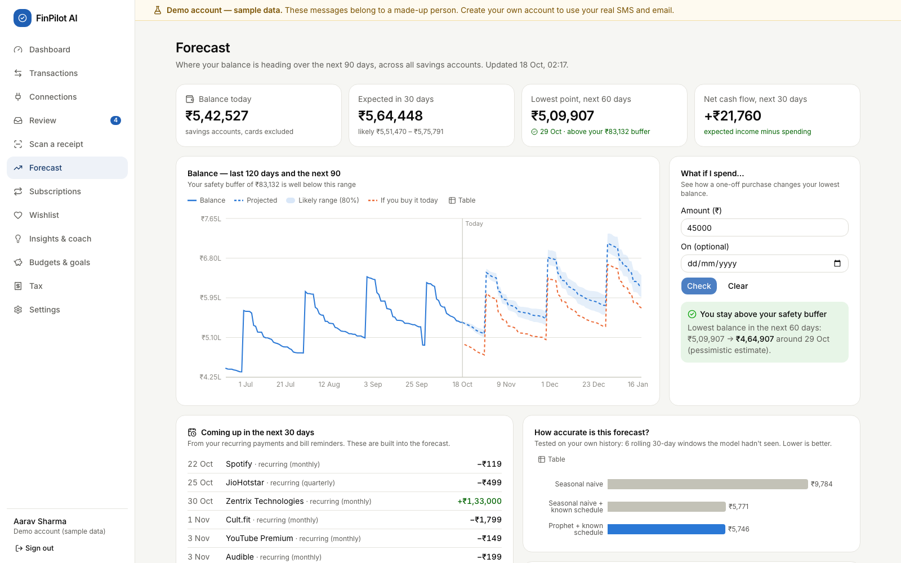

| Element on screen | Inputs and buttons | What it shows |
|---|---|---|
| Four stat tiles | none | Balance today; Expected in 30 days (with the likely range); Lowest point in the next 60 days (green or red against the safety buffer); Net cash flow for the next 30 days |
| Balance chart | **Table** toggle | The last 120 days, the next 90 days (dashed median), the 80% band, and an orange "If you buy it today" line after a what-if |
| **What if I spend…** | **Amount (₹)** (required), **On (optional)** date, **Check**, **Clear** | "You stay above your safety buffer" or "This would take you below your safety buffer", with the lowest balance before → after |
| **Coming up in the next 30 days** | none | Recurring payments and announced bills that the forecast already includes |
| **How accurate is this forecast?** and **Backtest details** | none | MAE, RMSE, WAPE and 30-day balance error for three models; the model **in use** is marked. Before 400 days of history: why there is no figure yet |
| **Known schedule** | none | Detected recurring income and payments |
| Coach (Insights page) | **Your question** (up to 500 characters), suggestion chips built from the user's own data, **Send**, **Clear** | An answer from the user's own data, with a chart or table, and "Understood as “…” · N% sure" |
| Insights list (Insights page) | **Open**, dismiss (**×**) | Observations ranked by severity |

**Demo steps**

1. Open **Forecast** and walk through the four tiles. On 18 Oct the demo showed:
   - balance ₹5,42,527;
   - in 30 days ₹5,64,448, likely between ₹5,51,470 and ₹5,75,791;
   - lowest point ₹5,09,907 on 29 Oct, above the ₹83,132 buffer;
   - net cash flow for the next 30 days +₹21,760.
2. Under **What if I spend…**, type `45000` and click **Check**. A green box appears: the lowest balance goes
   from ₹5,09,907 to ₹4,64,907, and an orange dashed line is added to the chart.
3. Type `450000` and click **Check**. The box turns red: "This would take you below your safety buffer" (the
   lowest balance would be ₹59,907).
4. Scroll to **Backtest details**. On 18 Oct the average daily error was:

   | Model | Error per day |
   |---|---|
   | Seasonal naive | ₹9,784 |
   | Seasonal naive + known schedule | ₹5,771 |
   | Prophet + known schedule | ₹5,746 |

5. Open **Insights & coach**, type **Can I afford a ₹60,000 laptop?** and send it. Point to "Understood as
   “Affordability Check”". The answer: "Not today without stretching. If you save ₹17,215/month for 2 month(s),
   you can buy something for ₹60,000 without touching your ₹83,132 buffer or your goals."
6. Type `what's the weather in Paris?`. The coach gives an honest fallback answer instead of making one up.
7. Dismiss an insight with **×**. It disappears and stays dismissed (shown in the database in Task 6).

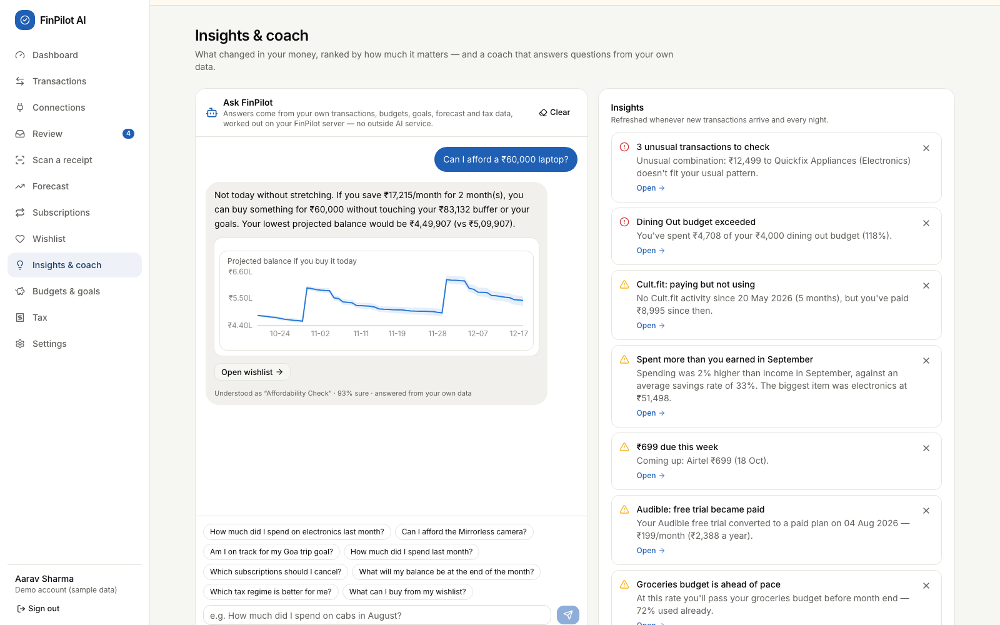

**What to say:** "The forecast is the known schedule (salary, rent, EMIs, SIPs, subscriptions, bills) plus
Prophet for the day-to-day spending. I report its error against two baselines using a rolling backtest, and each
backtest fold learns the schedule only from data before its own start date, so the test can't see the future. The
schedule alone cuts the error by about 41%; Prophet adds a little on top. If Prophet can't run, or the history is
under 120 days, the page uses the baseline and says so."

### 3.2 Subscription management

**What it does**

- Finds recurring charges from the interval and amount of the user's payments, including UPI AutoPay, e-mandate
  and standing-instruction debits whose merchant isn't a known subscription service.
- Uses emails as evidence to flag four kinds of waste:
  - a **price increase**;
  - a **dormant** subscription (paid for but not used);
  - a **free trial that became paid**;
  - **overlapping** services.
- Ranks the suggestions by ₹ saved per year, and totals the monthly and yearly cost.

**Where:** sidebar → **Subscriptions** (`/subscriptions`).

| Element | Inputs and buttons | What it shows |
|---|---|---|
| Four tiles | none | Active subscriptions (active or dormant, not ended), Per month, Per year, You could save …/yr |
| **Suggestions, biggest saving first** | **I'll cancel it**, **Keep it**, **See the email**, **Undo** | One finding per subscription, with "save ₹X/yr" (or "costs ₹X/yr more" for a price rise) |
| **Where the money goes** | **Table** toggle | Yearly cost per subscription |
| **All subscriptions** | none | Plan, since when, next charge, notes such as *Not used*, *Trial → paid*, *Overlaps*, *Price up* |

**Demo steps**

1. Open **Subscriptions**. The tiles read 9 subscriptions, ₹5,084 per month, ₹61,011 per year, and "You could
   save ₹28,899/yr".
2. Read the findings: "Cult.fit: Paying but not using" (₹21,588/yr), "Audible: Free trial became paid", "Netflix:
   Price went up 30%", "Spotify: Two music services", and two of three video services (JioHotstar, Amazon Prime).
3. On Netflix, click **See the email**. The price-change email opens with the extracted fields highlighted.
4. On Cult.fit, click **I'll cancel it**.
   - The toast reads "Marked to cancel — remember to cancel it with the provider".
   - The pill changes to "You plan to cancel".
   - Click **Undo**.
5. Click **Keep it** on another subscription. It leaves the suggestions list, and the toast reads "Got it — we
   won't suggest this again".

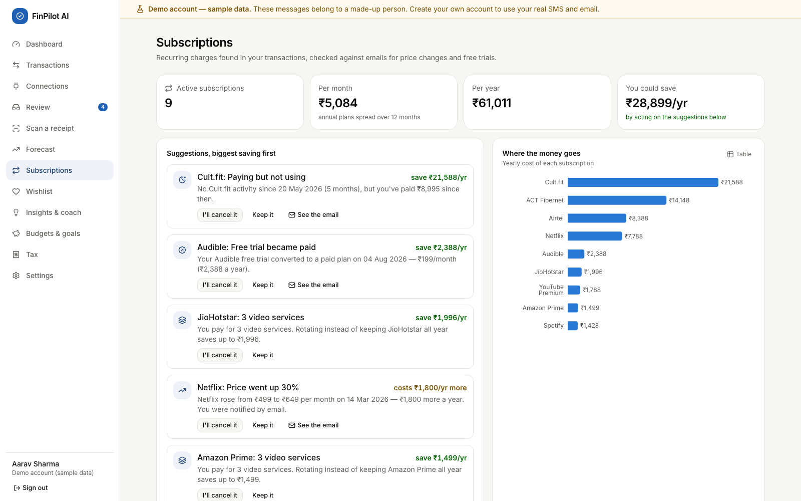

**What to say:** "Detection is purely algorithmic: the same merchant, a regular interval from weekly to annual,
and a stable recent amount. For real users I also count AutoPay and e-mandate debits, because an unknown merchant
on a mandate is almost always a subscription. Suggestions are ranked by money saved per year. A price rise is shown
as an extra cost and isn't added to the savings total. A 'Keep it' choice survives every recalculation."

### 3.3 Tax analysis

**What it does**

- Estimates income tax for two years: **FY 2025-26** (Income-tax Act, 1961) and **Tax Year 2026-27**
  (Income-tax Act, 2025).
- Compares the **old and new regimes**, including the 87A rebate, marginal relief, surcharge and 4% cess.
- Detects deductions from the user's transactions: 80C (s.123 from 2026-27), 80D, HRA and 80TTA, with 80E, 24(b),
  other 80C, NPS (80CCD(1B)) and parents' health insurance taken from the salary details.
- Works out HRA with the right metro list for each year: four metros for FY 2025-26, eight from Tax Year 2026-27
  (adding Bengaluru, Hyderabad, Pune and Ahmedabad), from the city the user enters.
- Shows the remaining headroom and, once the TDS is entered, the advance-tax schedule. Exports a CSV or PDF.

**Where:** sidebar → **Tax** (`/tax`).

| Element | Inputs and buttons | What it shows |
|---|---|---|
| Year tabs | **FY 2025-26**, **Tax Year 2026-27** | Switches the year |
| Recommendation banner | none | "The new regime costs ₹X less for you this year." For the current year it also shows "in progress", meaning figures to date plus scheduled payments |
| **New regime** and **Old regime** columns | none | Salary, deductions, taxable income, slab tax, rebate, cess, total, effective rate; "Better for you" pill |
| **Total tax**, **Advance tax** | none | A bar comparison; the instalments if more than ₹10,000 is due, or "Enter the TDS your employer deducts…" while TDS is unknown |
| **Section 80C / Section 123** card | none | A progress bar against the ₹1,50,000 limit, with the parts that make it up |
| **HRA exemption** card | none | HRA received, rent paid, the exempt amount, and headroom tips |
| **Evidence from your transactions** | click a row | The individual payments that were counted |
| **Your salary details** | **City you live in**, 12 number fields (gross, basic, HRA, rent, PF, professional tax, TDS, other 80C, NPS, parents' health insurance, education-loan and home-loan interest), the senior-parents switch, **Save and recalculate** | Form 16 inputs; a blank field clears the value |
| Header buttons | **CSV**, **PDF summary** | Downloads `finpilot-tax-<year>.csv` or `.pdf` (on the phone: Android's share sheet) |

**Demo steps**

1. Open **Tax**. The 2026-27 banner reads "The new regime costs ₹92,286 less for you this year · in progress".
2. Click **FY 2025-26**.
   - New regime ₹1,89,292 against old regime ₹2,72,126, so the new regime saves ₹82,834.
3. Explain **80C**: ₹1,79,040 was invested (PF ₹95,040 + ELSS ₹60,000 + LIC ₹24,000), so the ₹1,50,000 cap is
   **fully used**.
4. Explain **HRA** (city Chennai, a metro in both years). It is the least of three amounts:
   - HRA received: ₹3,96,000;
   - rent minus 10% of basic: ₹3,03,000 − ₹79,200 = ₹2,23,800;
   - 50% of basic: ₹3,96,000.

   So ₹2,23,800 is exempt.
5. Under **Evidence**, expand **ELSS SIPs** to show the 12 payments that were counted.
6. Click **PDF summary** (it downloads `finpilot-tax-2025-26.pdf`), then **CSV**.
7. Click **Tax Year 2026-27**. Under **Your salary details**, enter `150000` for **TDS deducted by your employer this
   year** and click **Save and recalculate**.
   - The toast reads "Tax details saved".
   - **Advance tax** now shows ₹80,861 still due, in instalments of ₹12,129 (15 Jun), ₹36,387 (15 Sep),
     ₹60,646 (15 Dec) and ₹80,861 (15 Mar), cumulative.
   - Clear the TDS field and save again: the card goes back to asking for TDS.

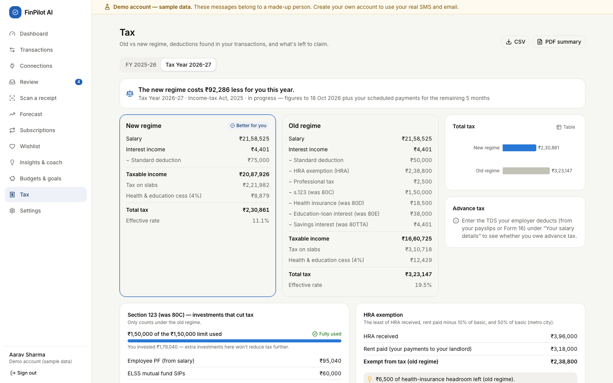

**What to say:**

- "All rates and limits live in one `YEARS` table and are unit-tested. For example, a taxable income of
  ₹12,10,000 under the new regime gives ₹10,400 because of marginal relief."
- "Without the TDS figure I don't guess whether advance tax is due; the page asks for it."
- "Every view says 'estimates for planning, not tax advice'."

### 3.4 Wishlist and affordability

**What it does**

- Works out how much the user can **safely** spend: never the safety buffer, the bills due before the next
  income, or the goal savings, and never below the pessimistic 60-day forecast.
- Keeps a **wishlist** of things the user wants, with a price or a product link. For a link, FinPilot reads the
  price when the store publishes it as structured data (schema.org JSON-LD, then price meta tags, then microdata)
  and its robots.txt allows it, and re-checks it daily with a price history. Otherwise the user enters the price.
- Puts every item in a tier with reasons: **Buy now**, **For your goals**, **Save up for** (with a monthly plan),
  **Not yet**, or **Needs a price**. Any item can become a goal.
- **Can I afford…?** checks any price the user types.
- It never recommends products: there is no catalogue, no affiliate link and no paid placement. (This replaced
  Smart Picks, which only crawled demo stores.)

**Where:** sidebar → **Wishlist** (`/wishlist`); the dashboard tile **Safe to spend this month**; the coach.

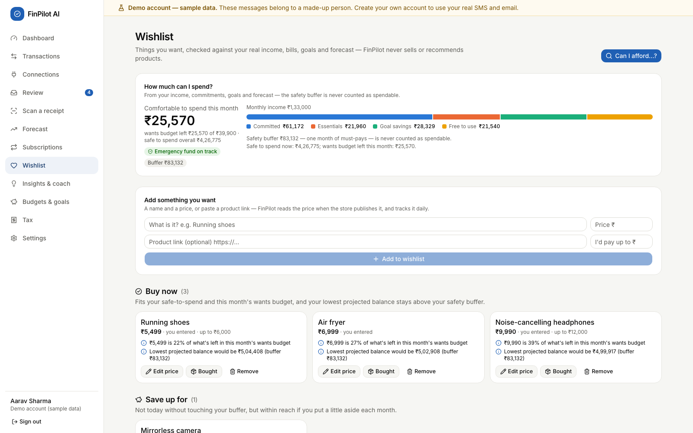

| Element | Inputs and buttons | What it shows |
|---|---|---|
| **How much can I spend?** | none | "Comfortable to spend this month" (safe to spend, capped by what's left of this month's wants budget when the income is known), the buffer, the emergency-fund pill, income split into Committed / Essentials / Goal savings / Free to use, and the explanation lines |
| **Add something you want** | **What is it?**, **Price ₹**, **Product link**, **I'd pay up to ₹**, **Add to wishlist** | The new item, placed in its tier; for a link, the store's price or why it couldn't be read |
| Tier sections and item cards | **Make it a goal** (Save up for / Not yet), **Edit price** / **Add price**, **Check price** (items with a link), **Bought**, **Remove**, the link icon | Price and where it came from, reasons, the lowest projected balance after buying it |
| **Can I afford…?** dialog | **What is it? (optional)**, **Price (₹)**, **Check** | The verdict, plus the lowest projected balance before → after |

**Demo steps**

1. Open **Wishlist**. On 18 Oct the card read:
   - "Comfortable to spend this month ₹25,570";
   - wants budget left ₹25,570 of ₹39,900;
   - safe to spend overall ₹4,26,775;
   - buffer ₹83,132, monthly income ₹1,33,000.
2. Walk through the tiers: **Buy now** (3): Running shoes ₹5,499 ("22% of what's left in this month's wants
   budget"), Air fryer ₹6,999, Noise-cancelling headphones ₹9,990. **Save up for** (1): Mirrorless camera ₹74,990,
   "Save ₹16,473/month for 3 month(s) to buy it without touching your buffer".
3. Click **Can I afford…?**, enter `60000` and click **Check**. The answer is "Save ₹17,215/month for 2 month(s)
   and you can buy it without touching your buffer."
4. Enter `5000000` and click **Check**. The answer is "Not right now — it would cut into money you need for bills,
   goals or your safety buffer."
5. On the Mirrorless camera, click **Make it a goal**. The toast gives the target month, and the item moves to
   **For your goals** ("₹0 of ₹74,990 saved, ₹24,997/month until Jan 2027"). The goal also appears under
   **Budgets & goals**.
6. Optional, with internet: add an item by pasting a product link. If the store publishes its price, it appears
   with the store's name; if not, the card says why ("…asks automated tools not to read this page
   (robots.txt). Enter the price yourself.") and offers **Add price**.

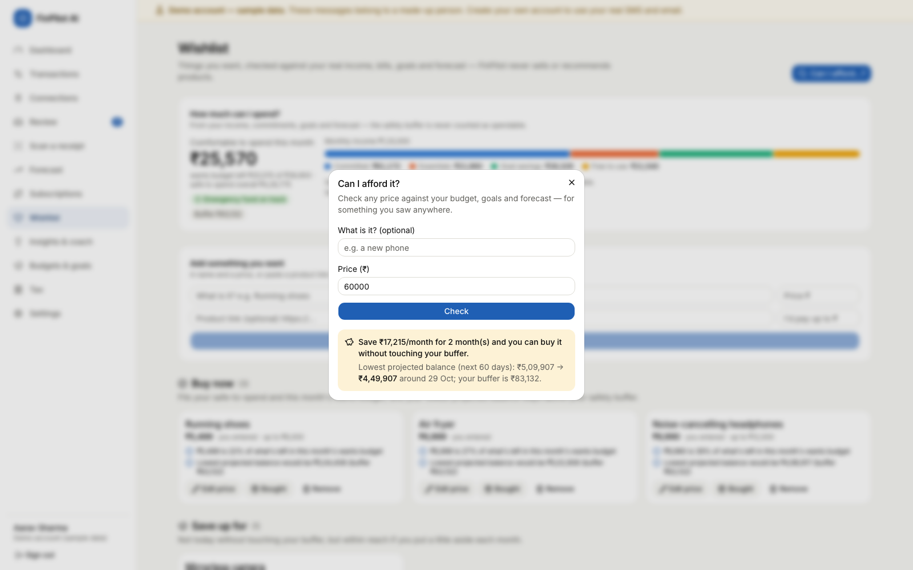

**What to say:**

- "The money that's safe to spend never touches the safety buffer, the dues before the next salary, or the goal
  savings. It also respects the pessimistic 60-day forecast. The buffer is the larger of the user's floor and one
  month of must-pay costs."
- "A property-based test with Hypothesis checks 300 random cases, and in every one 'Buy now' never breaks the
  buffer."
- "For a new user I never show a misleading ₹0: with no income known yet there is no wants budget, so
  safe-to-spend comes from the balance alone, and with no balance either the dashboard says 'Not known yet'."
- "Price checks are polite: one page per day, an honest user agent, robots.txt respected, and links to private or
  local addresses refused, including through redirects."

### 3.5 Authentication

**What it does**

- Registration, login and a one-click demo login (the labelled demo account).
- **In the browser**, sessions are kept in **httpOnly cookies**: a 30-minute access token and a 14-day refresh
  token. The refresh token is rotated every time it is used.
- **In the Android app**, there are no cookies. The app marks its requests with `X-FinPilot-Client: android`, so
  register, login and refresh return `{access_token, refresh_token, expires_in}` in the body. The app keeps them
  in its private storage and sends `Authorization: Bearer …`. The refresh token lasts 90 days and is rotated too.
- Logout revokes the refresh token. Failed logins are rate-limited.

**Where:**
- `/login` and `/register` (and, in the app, the **Connect** screen first, which stores the server address);
- **Sign out** at the bottom of the sidebar (on a phone: **More** → **Sign out**).

Every signed-in page goes through the `(app)` layout, which sends the user to `/login` if `/auth/me` fails, and to
`/onboarding` if they haven't finished onboarding yet. If the server can't be reached, it says so ("Can't reach your
FinPilot server at …") instead of signing the user out.

| Page | Inputs and buttons | Results |
|---|---|---|
| Login | **Explore the demo account (sample data)** (disabled and showing progress while the demo is prepared), **Email**, **Password**, **Sign in**, link **Create an account** | Goes to the dashboard, or shows a red error message |
| Register | **Name**, **Email**, **Password** (at least 8 characters, with the hint "At least 8 characters."), **Create account** | Goes to onboarding, or shows a red error message |
| Connect (phone app only) | **Scan the QR code**, **Or type the address**, **Connect** | Checks `/api/v1/health` and saves the address; a wrong address says what to check |

**Demo steps**

1. Click **Sign out**. On the login page, enter `demo@finpilot.ai` with a wrong password and click **Sign in**.
   - The page shows "Wrong email or password."
   - DevTools → Network shows **401**.
2. Click **Explore the demo account (sample data)** to reach the dashboard. Point to the yellow banner "Demo
   account — sample data."
3. Register a new account (name, a new email, a password of 8 or more characters). It opens **onboarding**.
4. Register the same email again: "An account with this email already exists. Sign in instead." (409)
5. Optional: in DevTools → Application → Cookies, show the two cookies.
   - `fp_at` has path `/` and `fp_rt` has path `/api/v1/auth`. Both are **HttpOnly**.
   - Point out that JavaScript cannot read them.
6. Optional, to show the phone path without a phone:

   ```bash
   curl -s -X POST localhost:8000/api/v1/auth/login -H 'X-FinPilot-Client: android' -H 'Content-Type: application/json' \
        -d '{"email":"demo@finpilot.ai","password":"demo1234"}' | python3 -m json.tool | grep -E 'token|expires'
   ```

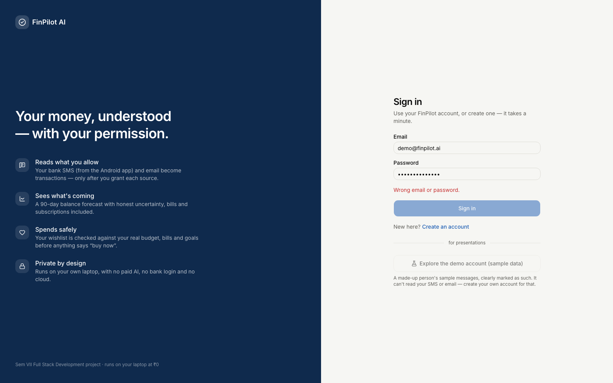

**What to say:**

- "Passwords are hashed with bcrypt at 12 rounds."
- "In the browser, tokens are HS256 JWTs in httpOnly, SameSite=Lax cookies, and every request that changes data
  must carry an `X-Requested-With` header, which guards against CSRF."
- "The phone uses Bearer tokens instead. A Bearer header is never sent automatically by a browser, so it can't be
  forged cross-site; CORS lets only the app's own origin call the API."
- "On a 401, `api.ts` silently refreshes the session once. Two refreshes with the same token can't both succeed,
  because the token is revoked with a conditional UPDATE."

### 3.6 Consent and privacy

**What it does**

- **SMS and email are separate sources.** Nothing is read until the user grants a source. The grant dialog lists:
  - what is read and what is never read;
  - what is stored;
  - what the app will never do;
  - the purpose, which must be ticked: *record my transactions… and use them for my balance, forecast, budgets,
    insights and affordability checks*;
  - a backfill window (default 12 months).
- **SMS are read on the phone, by the Android app.** After the consent dialog, Android's own permission dialog
  appears. The app reads the inbox month by month within the window, and **filters on the phone**: messages from
  personal numbers, promotional (`-P`) senders and OTPs never leave it. Only bank and payment alerts are uploaded.
  New SMS are picked up when the app opens, when it comes back to the front, and every minute while it is open.
  **Capture health** shows what the last sync read, skipped, created and sent to review.
- **Email is read from the user's mailbox** with an app password: only allowlisted senders (banks, cards, shops,
  billers) are opened, nothing is marked read, and the password is stored encrypted. Revoking email deletes it.
- **Files** (an SMS backup, `.eml`/`.mbox`, a bank statement) go through the same filters and consent checks.
- **Every change is logged.** Granting, pausing, resuming, revoking and deleting data all add a row to the consent
  history, with the notice version and its SHA-256 fingerprint.
- **The demo account can't connect real sources**: the SMS upload, mailbox and file imports refuse it (403).
- **Settings controls** cover how long the original message text is kept, the safety buffer, the emergency-fund
  months, take-home pay and payday, rent and landlord, the monthly wants budget, accounts and balances, extra
  email sender domains, exporting all data and deleting the account.

**Where:**
- **Onboarding**, shown on first login (About you → Bank SMS → Email → Done);
- **Connections** (`/connections`);
- **Settings** (`/settings`);
- the Android app (the same pages, plus the SMS permission and sync).

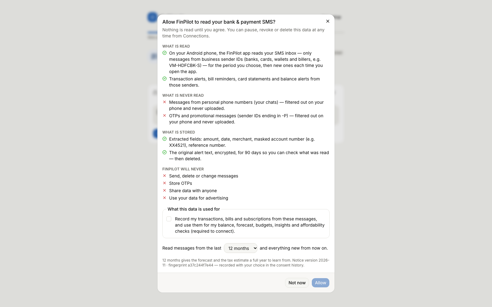

| Element | Inputs and buttons | What it shows |
|---|---|---|
| SMS card (Connections) | **Connect** / **Reconnect**, **Import a file**, **Pause**, **Resume**, **Revoke**, **Delete data**; in the app: **Allow SMS access**, **Sync now** | Status pill, Messages kept / Linked to payments / In review, when it was allowed, the backfill window; in the app, Capture health (read on phone, chats/OTPs/promos skipped, new transactions, sent to review) and help when Android restricts the permission |
| Email card (Connections) | **Connect**, **Connect mailbox** (email service, address, app password, IMAP server for others), **Sync now**, **Change password**, **Disconnect**, extra sender domains | When the mailbox was last read and what was found, or the last error |
| **Consent history** | none | When, source, event, purposes, notice version and fingerprint |
| **Preferences** (Settings) | **Safety buffer floor (₹)**, **Emergency fund target (months)**, **Keep original message text for (days)**, **Save preferences**; and, under your money details, take-home pay, payday, rent, landlord and **Monthly “wants” budget (₹)** | Saved preferences, confirmed by a toast |
| **Accounts** (Settings) | add an account, set **Balance today** | Accounts and where each balance came from |
| **Connect your phone** (Settings, browser) | none | A QR code and the addresses the phone can use |
| **Your data** (Settings) | **Export all my data (JSON)**, **Reset the demo** (demo account) / **Delete my account** (others) | A download, a reset, or a deleted account |

**Demo steps**

1. Grant consent as a new user, in the browser.
   - Register a new user and click **Get started**. Fill or skip **About you**.
   - On **Bank & payment SMS**, click **Review and allow**. Show that **Allow** stays disabled until the purpose is
     ticked. Tick it and click **Allow**.
   - Click **Import a file instead** and choose `samples/imports/sms_backup.xml`. The result reads "302 messages
     read: … new transactions · … OTPs, promos & non-financial messages ignored".
2. On the phone (if installed), do the same as a new account. After **Allow**, tap **Allow SMS access**: Android
   asks "Allow FinPilot AI to send and view SMS messages?". Tap **Allow**. The app shows a progress bar, then a line
   such as "5 alerts read: 4 new transactions, 0 linked to ones already recorded, 0 to review" and the Capture
   health counts.
3. Pause a source. On **Connections**, click **Pause** on the SMS card. New messages are now refused until you
   resume: the phone's next sync and any file import get 409. Click **Resume**.
4. Revoke and delete a source.
   - Click **Revoke** and confirm.
   - Click **Delete data** and confirm.
   - The toast gives the number of messages deleted, and how many transactions were kept because another source
     also confirms them. The history gains a *Data deleted* row with the counts.
5. Change and save preferences.
   - Under **Settings → Preferences**, set **Safety buffer floor** to `20000` and click **Save preferences**.
   - Try `3` for **Keep original message text for**. The browser blocks it (the minimum is 7), and the backend
     would also return 422 (see Task 5).
6. Click **Export all my data (JSON)**. It downloads `finpilot-export.json`.
7. As the demo user, open **Connections**: "The demo account holds a made-up person's sample messages and can't
   connect real ones." Finish with **Settings → Reset the demo**.

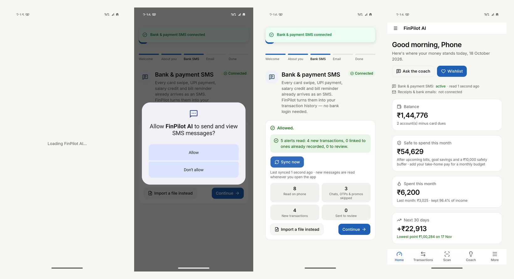

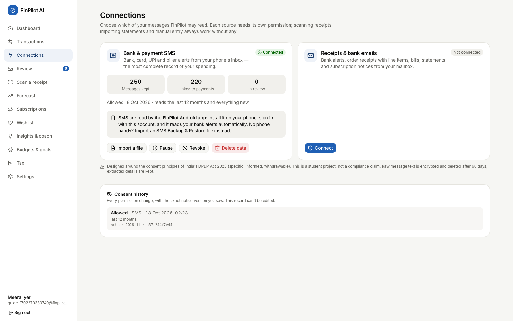

**What to say:**

- "Consent is per source, it can be withdrawn as easily as it was given, and every decision is audited."
- "Data minimisation happens on the phone: personal chats, OTPs and promotions are dropped before anything is
  sent, and messages older than the window the user chose are never even read."
- "The design follows the consent principles of India's DPDP Act 2023, but it doesn't claim compliance."
- "The original message text is encrypted with Fernet and deleted after the retention period. The extracted
  fields stay. The mailbox password is encrypted too, and deleted on revoke."

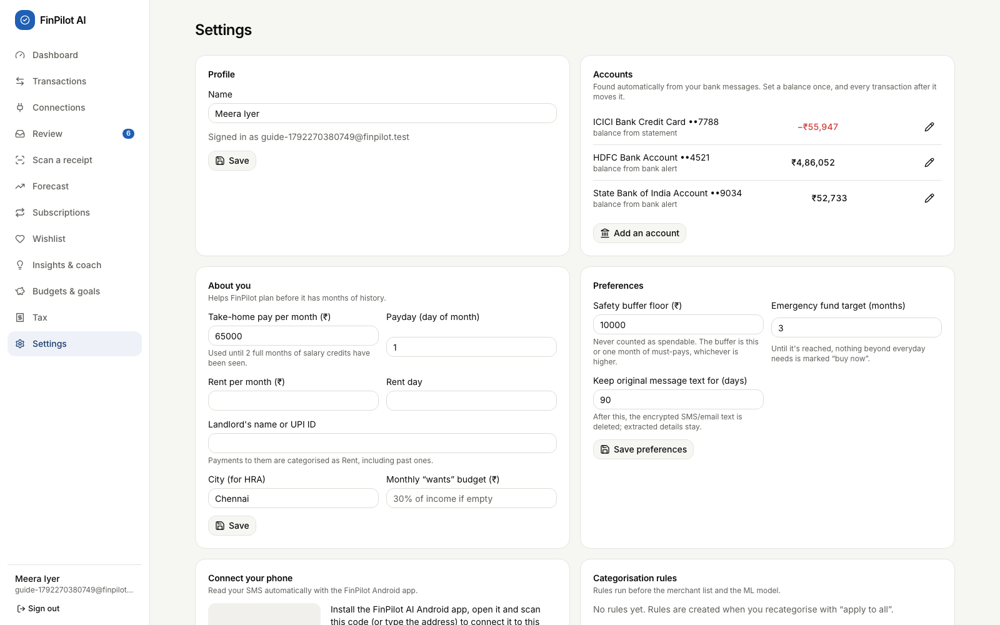

## Task 4: Backend files

### Request path (shared by every feature)

```text
Browser page (React 19 + TanStack Query)            Android app (the same pages, bundled in the APK by Capacitor 8)
 └─ frontend/src/lib/api.ts  same-origin fetch,      └─ frontend/src/lib/api.ts  fetch to the paired server address,
    cookies + X-Requested-With                          Authorization: Bearer + X-FinPilot-Client: android
     └─ backend/app/main.py           create_app(): CORS (app origins only), CSRF guard, exception handler, routers, static site
         └─ api/v1/router.py          mounts the feature routers under /api/v1
             └─ api/v1/<feature>.py   endpoint: Pydantic validation, ownership checks, HTTP errors
                 ├─ core/deps.py      CurrentUser (Bearer or cookie JWT → User) and DB (one session per request,
                 │                    committed before the response is sent)
                 └─ services/*.py     business logic (no HTTP), shared metrics, recurring detection, affordability
                     └─ models/*.py → SQLAlchemy 2 → db/session.py → SQLite (data/finpilot.db, WAL mode)
Background: jobs/runner.py (thread pool, `jobs` table) ← jobs/tasks.py (job functions) ← jobs/scheduler.py
Phone SMS: SmsInboxPlugin.java (READ_SMS, filters on the phone) → lib/native/sms.ts → POST /ingest/sms/device → job ingest_device
```

### Shared files I rely on

| File | Responsibility |
|---|---|
| [main.py](../backend/app/main.py#L49) | `create_app()`; the `csrf_guard` middleware (L60) for cookie requests; `CORSMiddleware` (L78) for the app's origins; the `unhandled` exception handler (L88); a lifespan (L24) that starts the job runner and the scheduler |
| [core/deps.py](../backend/app/core/deps.py#L35) | `bearer_token()` (L13) and `current_user()` read the Bearer header or the `fp_at` cookie, decode the JWT and load the `User`. `SESSION` (L24) makes the database session commit when the endpoint returns, before the response is sent; it also defines the `DB` and `CurrentUser` aliases |
| [core/security.py](../backend/app/core/security.py#L28) | bcrypt (`hash_password`, `verify_password`) and JWT (`create_access_token`, `create_refresh_token`, `decode_token`) |
| [db/session.py](../backend/app/db/session.py#L63) | `get_db()`: commits on success, rolls back on any exception, always closes; SQLite pragmas WAL, `foreign_keys=ON`, `busy_timeout` (L19) |
| [core/money.py](../backend/app/core/money.py#L41) | The `Money` column type (integer paise ↔ `Decimal` rupees) and `fmt_inr()` Indian digit grouping |
| [services/metrics.py](../backend/app/services/metrics.py#L52) | Shared figures (`rows`, `complete_months` (L80), `median_monthly` (L136), `goals_status` (L172)); income counts only months the user's records cover |
| [services/recurring.py](../backend/app/services/recurring.py#L75) | `detect_recurring()`, the `Recurring` class with `occurrences()` and `monthly_equivalent` |
| [services/affordability.py](../backend/app/services/affordability.py#L119) | `affordability()` builds the `Snapshot` (L45) used by the Wishlist, dashboard, coach and Forecast; `safety_buffer()` (L101) |
| [services/analytics.py](../backend/app/services/analytics.py#L13) | `run_user_analytics()`: isolated stages (anomalies → subscriptions → forecast → insights) |
| [jobs/runner.py](../backend/app/jobs/runner.py#L62), [tasks.py](../backend/app/jobs/tasks.py), [scheduler.py](../backend/app/jobs/scheduler.py#L27) | Background jobs (each one a row in `jobs`). The scheduler reads connected mailboxes every 30 minutes, re-checks wishlist prices every 24 h, and runs the nightly analytics and the retention purge |

### Forecasting and insights

| File | What it does | Key functions and endpoints |
|---|---|---|
| [api/v1/analysis.py](../backend/app/api/v1/analysis.py#L57) | Forecast endpoints | `get_forecast` (L57): the stored forecast + the lowest point in 60 days compared with the buffer + the backtest. If there is no forecast yet, it queues `user_analytics` and returns `{"status": "computing"}`. `forecast_whatif` (L77): `0 < amount < 1e9`; returns 409 if there is no forecast |
| [services/forecasting/engine.py](../backend/app/services/forecasting/engine.py#L208) | The model | `_declared` (L44, salary and rent the user entered), `build_series` (L90), `future_schedule` (L106), `baseline_forecast` (L132), `prophet_fit_predict` (L146), `backtest` (L169), `forecast` (L208), `lowest_point` (L267), `what_if` (L273) |
| [services/forecasting/service.py](../backend/app/services/forecasting/service.py#L15) | Saving and loading | `refresh_forecast` replaces the user's `forecasts` and `forecast_metrics` rows; `latest` |
| [services/forecasting/prophet_model.py](../backend/app/services/forecasting/prophet_model.py#L23) | Prophet wrapper | `load_prophet` (a lazy import), `tiny_fit` (capability check) |
| [services/system.py](../backend/app/services/system.py#L27) | Capability gate | `check_prophet` sets `CAPABILITIES["prophet"]["ok"]`, which decides whether to fall back |
| [api/v1/dashboard.py](../backend/app/api/v1/dashboard.py#L61) | Dashboard, insights and coach endpoints | `dashboard` (L61, with `safe_basis` at L105), `list_insights` (L129), `dismiss_insight` (L136), `coach_suggestions` (L161), `coach_history` (L166), `coach_ask` (L172), `clear_history` (L184) |
| [services/insights.py](../backend/app/services/insights.py#L35) | Insight rules | `generate`: rule groups for spending spikes, budgets, savings rate, the forecast warning (only when the balance is known, L95), bills due, anomalies, subscription waste, 50/30/20, goal pace, wishlist price drops, the review queue and tax season. `refresh_insights` (L190) keeps dismissed insights dismissed |
| [services/coach.py](../backend/app/services/coach.py#L183) | Coach | `Coach.ask` (L188): the intent model chooses a handler and falls back below 35% confidence. `suggestions_for` (L39) builds the chips from the user's own data. Slot parsers `parse_period` (L111), `parse_amount` (L149), `parse_category` (L169) |

### Subscriptions

| File | What it does | Key functions and endpoints |
|---|---|---|
| [api/v1/analysis.py](../backend/app/api/v1/analysis.py#L88) | Subscription endpoints | `list_subscriptions` (L88): the items, one suggestion per merchant (the largest saving), and the totals. `subscription_action` (L110): keep, cancel or `null`, after an ownership check |
| [services/subscriptions.py](../backend/app/services/subscriptions.py#L55) | Detection and findings | `refresh_subscriptions` rebuilds the rows and keeps `user_action`; AutoPay and e-mandate merchants count as evidence (L62). `_price_change` (L45), `_evidence` (L33) and the `MUSIC` / `VIDEO` sets (L28) |
| [services/recurring.py](../backend/app/services/recurring.py#L19) | Cadence rules | `CADENCES` (L19), `detect_recurring` (L75) |

### Tax

| File | What it does | Key functions and endpoints |
|---|---|---|
| [api/v1/analysis.py](../backend/app/api/v1/analysis.py#L119) | Tax endpoints | `get_tax` (L119), `update_tax_profile` (L126; an explicit `null` clears a value), `tax_csv` (L140), `tax_pdf` (L148). Any year not in `YEARS` returns 404. The `TaxProfile` model (L30) requires every number to be ≥ 0 |
| [services/tax.py](../backend/app/services/tax.py#L106) | Calculation | `METROS` per year (L31); `YEARS` (L39) holds the slabs and limits; `slab_tax` (L57); `compute` (L69) applies rebate, marginal relief, surcharge and cess; `tax_summary` (L106) works out deductions, evidence, HRA, headroom and advance tax (only with a known TDS, L225) |
| [services/tax_export.py](../backend/app/services/tax_export.py#L31) | Exports | `export_csv` (L31), `export_pdf` (L53, ReportLab) |

### Wishlist and affordability

| File | What it does | Key functions and endpoints |
|---|---|---|
| [api/v1/wishlist.py](../backend/app/api/v1/wishlist.py#L58) | Wishlist endpoints | `wishlist` (L58), `add_item` (L63), `update_item` (L90), `refresh_price` (L115), `delete_item` (L124), `item_to_goal` (L131), `check_price` (L154, `POST /afford/check`). `CheckBody` (L24) limits the price to `0 < price < 1e9` |
| [services/affordability.py](../backend/app/services/affordability.py#L119) | The rules | `Snapshot` (L45) and `spendable` (L70); `safety_buffer` (L101); `monthly_income` (L109); `affordability` (L119, `wants_known` at L149); `evaluate_price` (L191) decides the tier |
| [services/wishlist.py](../backend/app/services/wishlist.py#L125) | Tiers and reasons | `evaluate` (L125) places each item; `_reasons` (L79); `refresh_item` (L49) re-reads a price and keeps the history |
| [services/price_fetch.py](../backend/app/services/price_fetch.py#L172) | Reading a price from a link | `fetch_price` (L172): `validate_url` (L59) → `_public_host` (L47) → `_robots_allows` (L160) → `_get` (L145, redirects checked hop by hop) → `parse_price` (L98: JSON-LD, then meta tags, then microdata, rupees only) |
| [jobs/tasks.py](../backend/app/jobs/tasks.py#L35) | Jobs | `wishlist_prices` re-checks linked items once a day |

### Authentication

| File | What it does | Key functions and endpoints |
|---|---|---|
| [api/v1/auth.py](../backend/app/api/v1/auth.py#L162) | Auth endpoints | `register` (L147), `login` (L162), `demo_login` (L172), `refresh` (L182), `logout` (L202), `update_me` (L218). `is_native` (L117) spots the app; `start_session` (L121) returns cookies (browser) or tokens (app). `_check_limit` / `_count` (L106, L112) do the rate limiting |
| [core/security.py](../backend/app/core/security.py#L43) | Hashing and tokens | bcrypt through pwdlib (12 rounds); HS256 JWTs whose secret is generated on first run in `data/secret.json` |
| [core/deps.py](../backend/app/core/deps.py#L35) | Guard | `current_user` returns 401 "Not signed in" |
| [main.py](../backend/app/main.py#L60) | CSRF and CORS | Cookie requests need `X-Requested-With`; Bearer and app requests don't; CORS allows only `http://localhost`, `https://localhost` and `capacitor://localhost` |
| [services/users.py](../backend/app/services/users.py#L17) | Account creation | `create_user` sets neutral default preferences (`DEFAULT_PREFERENCES`, L10); a real account never inherits demo data |

### Consent and privacy

| File | What it does | Key functions and endpoints |
|---|---|---|
| [api/v1/sources.py](../backend/app/api/v1/sources.py#L85) | Consent centre API | `list_sources` (L85), `history` (L91), `get_notice` (L102), `grant` (L108), `pause` (L116), `resume` (L123), `revoke` (L130), `purposes` (L137), `delete_data` (L144), the phone's `sms/sync-state` (L153), and the mailbox: `get_mailbox` (L164), `connect_mailbox` (L169), `sync_mailbox` (L199), `disconnect_mailbox` (L209). `_check` (L43) returns 404 for an unknown source |
| [services/consent.py](../backend/app/services/consent.py#L89) | Consent rules | `NOTICE_VERSION` / `PURPOSES` / `NOTICES` (L22–27), `notice_hash` (L70), `_event` (L75), `grant` (L89), `backfill_start` / `within_backfill` (L108, L114), `require_active` (L119), `set_status` (L127), `update_purposes` (L146), `delete_source_data` (L158), `history` (L188) |
| [api/v1/ingest.py](../backend/app/api/v1/ingest.py#L44) | Consent enforcement | `refuse_demo` (L22); `upload_device_sms` (L44, the phone's SMS) and the file import (L70) call `consent.require_active` first |
| [services/ingestion/device.py](../backend/app/services/ingestion/device.py#L59) | Phone SMS | `append_chunk` (L33) stages each upload; `run_device_batch` (L59) applies the consent window, ingests, and saves the Capture health counts in `data_sources.sync_state` |
| [services/ingestion/imap_sync.py](../backend/app/services/ingestion/imap_sync.py#L199) | Mailbox | `PROVIDERS` (L25), `connect` (L73, friendly errors), `find_folder` (L102), `search_uids` (L138, Gmail `X-GM-RAW` at L144), `sync_user` (L199) |
| [services/privacy.py](../backend/app/services/privacy.py#L18) | Retention | `purge_expired_bodies` deletes raw message text older than `retention_days` (a daily job) |
| [api/v1/settings.py](../backend/app/api/v1/settings.py#L47) | Data controls | `export_all` (L47), `delete_account` (L87, also removes receipt files, staged uploads and the mailbox password), `reset_demo` (L114), `system_quality` (L121) |
| [api/v1/auth.py](../backend/app/api/v1/auth.py#L71) | Preferences | `PREF_RANGES` (L59), `ALLOWED_PREFS` (L65), `_clean_pref` (L71) |
| [core/crypto.py](../backend/app/core/crypto.py#L19) | Encryption | Fernet `encrypt_text` / `decrypt_text` for message bodies and the mailbox password |

### The phone app (frontend and Android)

| File | What it does |
|---|---|
| [SmsInboxPlugin.java](../frontend/android/app/src/main/java/ai/finpilot/app/SmsInboxPlugin.java#L136) | The native plugin: the `READ_SMS` permission, `read` (L136) of one time window, `senderKind` (L51) and `isOtpOnly` (L58) filter on the phone |
| [lib/native/sms.ts](../frontend/src/lib/native/sms.ts#L84) | `run` (L84): reads month by month from the consent window or the last cursor, uploads in chunks of 500, waits for the job; `syncSms` (L131) lets only one sync run at a time |
| [components/app-shell.tsx](../frontend/src/components/app-shell.tsx#L121) | `SmsAutoSync`: syncs on start, on resume and every minute while the app is open |
| [lib/platform.ts](../frontend/src/lib/platform.ts#L20) | The server address and tokens in the app's storage (Capacitor Preferences) |
| [lib/api.ts](../frontend/src/lib/api.ts#L98) | Absolute URLs and Bearer headers in the app; cookies in the browser (Task 7.1) |

### How the files work together

1. **Forecast**
   - New data arrives (the phone's SMS, a mailbox sync or a file import) → a `user_analytics` job →
     `run_user_analytics` → `refresh_forecast` → `engine.forecast`. The result is stored in `forecasts` and
     `forecast_metrics`.
   - Opening the page → `GET /forecast` → `latest` + `lowest_point` + `safety_buffer`.
   - A what-if → `GET /forecast/whatif` → `what_if` on the stored projection. Prophet is not re-fitted, so this is
     fast.
2. **Insights**
   - The last analytics stage → `refresh_insights` → `insights` table → `GET /insights`.
   - **×** → `POST /insights/{id}/dismiss` sets `dismissed=1`.
   - The coach: `POST /coach/ask` → `Coach.ask` → a handler that uses `metrics`, the forecast, tax and the
     affordability snapshot. Both the question and the answer are saved in `chat_messages`.
3. **Subscriptions**
   - Analytics stage 2 → `refresh_subscriptions` → the `subscriptions` table.
   - Opening the page → `GET /subscriptions`.
   - Keep or cancel → `POST /subscriptions/{id}/action` updates `user_action`, which is carried into every later
     refresh.
4. **Tax**
   - On each request, `tax_summary` reads `transactions` and `users.tax_profile`. No tax result is stored.
   - The exports call `tax_summary` again.
5. **Wishlist and affordability**
   - `GET /wishlist` → `affordability()` (the snapshot) → `evaluate()` puts each item in a tier.
   - Adding a link → `fetch_price` → `wishlist_items.price` and a `wishlist_price_points` row; the
     `wishlist_prices` job repeats it daily.
   - **Can I afford…?** → `POST /afford/check` → `evaluate_price` straight away.
   - **Make it a goal** → a `goals` row with `wishlist_item_id`, whose monthly saving the snapshot then reserves.
6. **Authentication**
   - Register or login → `start_session` (cookies, or tokens for the app, and a `refresh_tokens` row).
   - Every protected request → `current_user` (Bearer header or cookie).
   - A 401 → `api.ts` → `POST /auth/refresh`, which rotates the refresh token.
7. **Consent**
   - Grant, pause, resume, revoke → `services/consent.py` updates `data_sources` and appends to `consent_events`.
   - Every feed (the phone's SMS, the mailbox, file imports) calls `require_active` first and keeps only messages
     inside the consent window.
   - Delete data → removes the messages and the transactions that only that source supports → a `user_analytics`
     job.
   - The scheduler runs `retention_purge` daily.

## Task 5: Exception handling and logging

### 5.1 How errors are handled, layer by layer

| Layer | Mechanism | Code | What the client sees |
|---|---|---|---|
| Browser form | HTML validation: `required`, `type="email"`, `minLength={8}`, `min`/`max` on number fields | e.g. [register/page.tsx](../frontend/src/app/register/page.tsx#L52), [settings/page.tsx](../frontend/src/app/(app)/settings/page.tsx#L215) | The browser blocks the submit before any request is sent |
| CORS | Only the app's own origins may call the API cross-origin | [main.py:78](../backend/app/main.py#L78) | Another site's request fails in the browser |
| CSRF guard | Middleware rejects POST, PUT, PATCH and DELETE to `/api/` without `X-Requested-With: finpilot`, unless the request carries a Bearer token or comes from the app | [main.py:60](../backend/app/main.py#L60) | **403** "Missing X-Requested-With header" |
| Authentication | The `current_user` dependency (Bearer header or cookie) | [deps.py:35](../backend/app/core/deps.py#L35) | **401** "Not signed in" |
| Input validation | Pydantic `Field` and `Query` limits (for example `gt=0`, `ge=0`, `max_length`, `pattern`) | e.g. [analysis.py:30](../backend/app/api/v1/analysis.py#L30), [wishlist.py:24](../backend/app/api/v1/wishlist.py#L24), [auth.py:43](../backend/app/api/v1/auth.py#L43), [sources.py](../backend/app/api/v1/sources.py#L108) | **422** with a list of `{loc, msg}` items |
| Business rules | `raise HTTPException(status, "message")` | consent.py, auth.py, analysis.py, wishlist.py, sources.py, ingest.py, settings.py | **400 / 401 / 403 / 404 / 409 / 413 / 422 / 429 / 503** with a readable `detail` |
| Anything unexpected | `@app.exception_handler(Exception)` writes the traceback with `log.exception` and returns a generic message | [main.py:88](../backend/app/main.py#L88) | **500** "Something went wrong on the server. Check the terminal log." No stack trace reaches the browser |
| Database | `get_db()` commits only if the request succeeds, otherwise it rolls back. It commits **before** the response is sent, so a client acting on the response at once (the next page load, a sign-out right after deleting the account) sees the change | [session.py:63](../backend/app/db/session.py#L63), [deps.py:24](../backend/app/core/deps.py#L24) | No half-written rows after a failure |
| Background jobs | `JobRunner` catches the exception, logs it, and stores the traceback | [runner.py:151](../backend/app/jobs/runner.py#L151) | The `jobs` row gets `status='failed'` and `error` = the traceback. The UI polls `/jobs/{id}` |
| App restart | Jobs that were running are marked `interrupted` | [runner.py:77](../backend/app/jobs/runner.py#L77) | `message` = "App was restarted" |
| Analytics pipeline | Each stage has its own try/except and its own DB session | [analytics.py:33](../backend/app/services/analytics.py#L33) | The other stages still run; the failed stage's result is `{"error": …}` |
| Forecast model | Under 120 days of history, or if Prophet is missing or fails, the baseline is used and the page says why | [engine.py:220](../backend/app/services/forecasting/engine.py#L220), [L231](../backend/app/services/forecasting/engine.py#L231) | "Using a simple model … you have N." or "Prophet couldn't run on your FinPilot server, so the seasonal baseline is shown." |
| Mailbox sync | Wrong password, unreachable server and timeouts become friendly messages; each sync failure is logged and kept | [imap_sync.py:73](../backend/app/services/ingestion/imap_sync.py#L73) | 422 with the reason on connect; `mailbox_connections.last_error` shown on the card |
| Price reading | Invalid links, private addresses (also through redirects), robots.txt, blocking and missing prices each become a status and a note | [price_fetch.py:172](../backend/app/services/price_fetch.py#L172) | `wishlist_items.fetch_status` and `fetch_note`, shown on the item card |
| Tokens and crypto | `decode_token` returns `None` on any JWT error; `verify_password` returns `False` for a malformed hash; `decrypt_text` returns `None` on `InvalidToken` | [security.py:60](../backend/app/core/security.py#L60), [crypto.py:19](../backend/app/core/crypto.py#L19) | Treated as "not signed in", "wrong password" or "text no longer available", never as a crash |
| Frontend | `ApiError(status, message)` takes the message from `detail` (a string, or a list joined with "; "). A 401 triggers a refresh, a retry, then a sign-out event. A network failure is reported as "Can't reach your FinPilot server at …" (status 0), not as signed out | [api.ts:98](../frontend/src/lib/api.ts#L98) | `onError` shows a toast (sonner) or red text; the app shows a "can't reach the server" screen with **Try again** |

### 5.2 Error responses for my endpoints

These were all captured from a running copy on 18 Oct 2026. Pydantic 422 responses carry a list, and the table
shows each item's `msg`.

**Forecasting and insights**

| Request | Condition | Status | `detail` |
|---|---|---|---|
| `GET /forecast/whatif?amount=0` | amount ≤ 0 | 422 | Input should be greater than 0 |
| `GET /forecast/whatif?amount=abc` | not a number | 422 | Input should be a valid number, unable to parse string as a number |
| `GET /forecast/whatif?amount=45000&on=2026-13-01` | invalid date | 422 | Input should be a valid date or datetime, month value is outside expected range of 1-12 |
| `GET /forecast/whatif?amount=45000` | user has no forecast yet | 409 | The forecast is still being computed. |
| `GET /forecast` | user has no forecast yet | 200 | `{"status": "computing"}`, and a job is queued |
| `POST /coach/ask` with `""` | empty question | 422 | String should have at least 1 character |
| `POST /coach/ask` with 501 characters | too long | 422 | String should have at most 500 characters |
| `POST /coach/ask` with "what's the weather in Paris?" | out of scope | 200 | `intent: "fallback"` with the honest fallback text |
| `POST /insights/999999/dismiss` | doesn't exist or belongs to someone else | 404 | Insight not found |

**Subscriptions and tax**

| Request | Condition | Status | `detail` |
|---|---|---|---|
| `POST /subscriptions/999999/action` | doesn't exist or belongs to someone else | 404 | Subscription not found |
| `POST /subscriptions/{id}/action` with `{"action": "delete"}` | not keep, cancel or null | 422 | String should match pattern '^(keep\|cancel)$' |
| `GET /tax?year=2030-31` (also `export.csv` and `export.pdf`) | unsupported year | 404 | Unsupported year |
| `PUT /tax/profile` with `{"gross_salary": -5}` (or a negative TDS) | negative amount | 422 | Input should be greater than or equal to 0 |
| `PUT /tax/profile` with a 61-character city | too long | 422 | String should have at most 60 characters |

**Wishlist and affordability**

| Request | Condition | Status | `detail` |
|---|---|---|---|
| `POST /afford/check` with `{"price": 0}` | price ≤ 0 | 422 | Input should be greater than 0 |
| `POST /afford/check` with `{"price": 1e9}` | too large | 422 | Input should be less than 1000000000 |
| `POST /wishlist` with `{"text": " "}` | neither a name nor a link | 422 | Say what you want, or paste a product link. |
| `POST /wishlist` with `{"text": "Phone", "price": -1}` | price ≤ 0 | 422 | Input should be greater than 0 |
| `POST /wishlist` with `{"url": "ftp://example.com/x"}` | not a web link | 422 | Paste a full product link starting with https:// |
| `POST /wishlist` with `{"url": "http://127.0.0.1:8123/"}` | a private or local address | 200 | Added without fetching: `fetch.status "invalid"`, "That link points to a private or local address." |
| `PATCH` or `DELETE /wishlist/999999` | not found | 404 | Wishlist item not found |
| `POST /wishlist/{id}/goal` | the item has no price | 422 | Add a price first, so the goal knows how much to save. |
| `POST /wishlist/{id}/refresh` | the item has no link | 422 | This item has no product link to check. |

**Authentication and preferences**

| Request | Condition | Status | `detail` |
|---|---|---|---|
| `POST /auth/register` | invalid email | 422 | Enter a valid email address. |
| `POST /auth/register` | password shorter than 8 characters | 422 | Use a password with at least 8 characters. |
| `POST /auth/register` | empty name | 422 | String should have at least 1 character |
| `POST /auth/register` | email already exists | 409 | An account with this email already exists. Sign in instead. |
| `POST /auth/login` | wrong password or unknown email | 401 | Wrong email or password. |
| `POST /auth/login` | 11th failed attempt in 5 minutes from one address | 429 | Too many attempts. Please wait a few minutes. |
| `POST /auth/demo` | demo still being generated (from the code, not triggered here) | 503 | The demo is still being prepared — this takes about a minute on first start. |
| `POST /auth/refresh` | refresh token missing, expired or already used | 401 | Session expired — please sign in again. |
| `GET /auth/me` | no session cookie or Bearer token | 401 | Not signed in |
| any POST with a cookie but without `X-Requested-With` | CSRF guard | 403 | Missing X-Requested-With header |
| `PATCH /auth/me` with a Bearer token and no `X-Requested-With` | the phone app | 200 | (allowed: a Bearer header can't be forged cross-site) |
| `OPTIONS /api/v1/auth/me` from `https://evil.example` | CORS preflight | 200 | no `Access-Control-Allow-Origin` header, so the browser blocks the call (`http://localhost` gets one) |
| `PATCH /auth/me` with `emergency_months: 99` | out of range | 422 | emergency_months must be a number between 1 and 12 |
| `PATCH /auth/me` with `retention_days: 3` | out of range | 422 | retention_days must be a number between 7 and 365 |
| `PATCH /auth/me` with `buffer_floor: -1` | out of range | 422 | buffer_floor must be a number between 0 and 1e+08 |
| `PATCH /auth/me` with `payday: 40` | out of range | 422 | payday must be a number between 1 and 31 |

**Consent and privacy**

| Request | Condition | Status | `detail` |
|---|---|---|---|
| `POST /sources/whatsapp/grant` | unknown source | 404 | Unknown source |
| `POST /sources/sms/grant` with `{"purposes": []}` | required purpose missing | 400 | The 'record transactions' purpose is required to connect this source. |
| `POST /sources/sms/grant` with `backfill_months: 36` | more than 24 | 422 | Input should be less than or equal to 24 |
| `POST /sources/sms/pause` | source never connected | 404 | Source not connected |
| `PUT /sources/sms/purposes` with `[]` | removing the purpose | 400 | To stop recording transactions, pause or revoke the source instead. |
| `POST /sources/sms/resume` | after a revoke | 409 | This source was revoked — grant permission again to reconnect. |
| `POST /ingest/sms/device` (the phone's upload) | source not connected | 409 | Bank & payment SMS is not connected. Grant permission on the Connections page first. |
| `POST /ingest/sms/device` | source paused | 409 | Bank & payment SMS is paused. Grant permission on the Connections page first. |
| `POST /ingest/sms/device` | as the demo user | 403 | The demo account only holds sample data. Create your own account to connect your real SMS and email. |
| `POST /sources/email/mailbox` | email not allowed yet | 409 | Receipts & bank emails is not connected. Grant permission on the Connections page first. |
| `POST /sources/email/mailbox` with an `@outlook.com` address | not supported | 422 | Outlook.com and Hotmail no longer allow app passwords for IMAP (Microsoft requires its own sign-in). Forward bank emails to a Gmail address, or import them as .eml/.mbox files. |
| `POST /sources/email/mailbox` with an unreachable server | network | 422 | Couldn't reach 127.0.0.1 — check that the computer running FinPilot is online, then try again. |
| `POST /sources/email/mailbox` with provider `custom` and no server | missing input | 422 | Enter your mail server's IMAP address (for example imap.example.com). |
| `POST /sources/email/sync` | no mailbox connected | 404 | No mailbox connected yet. |
| `DELETE /settings/account` with `confirm: "nope"` | not confirmed | 422 | Type DELETE to confirm. |
| `DELETE /settings/account` | as the demo user | 409 | The demo account can be reset, not deleted. |
| `POST /settings/reset-demo` | as a normal user | 403 | Only the demo account can be reset. |

### 5.3 Logging

**Setup:**
- Logging is configured in [server.py `_configure_logging()`](../backend/app/server.py#L62):

  ```python
  logging.basicConfig(level=logging.INFO, format="%(asctime)s %(levelname)-7s %(name)s: %(message)s", datefmt="%H:%M:%S")
  for noisy in ("uvicorn.error", "uvicorn.access", "httpx", "cmdstanpy", "prophet", "alembic"):
      logging.getLogger(noisy).setLevel(logging.WARNING)
  ```

- The logs are written to the **terminal** that runs `python3 run.py`. **The app does not write a log file.**
- It uses named loggers: `finpilot`, `finpilot.jobs`, `finpilot.analytics`, `finpilot.forecast`,
  `finpilot.imap`, `finpilot.wishlist`, `finpilot.network`, `finpilot.scheduler`, `finpilot.system`,
  `finpilot.quality`, `finpilot.settings`, `finpilot.demo` and `finpilot.ml`.

| Event | Level and logger | Example line |
|---|---|---|
| Models trained at start-up | INFO `finpilot.ml` | `23:16:11 INFO    finpilot.ml: trained coach_intents in 0.1s: {… 'intents': 13, 'heldout_accuracy': 0.8462 …}` |
| Demo data ready | INFO `finpilot.demo` | `02:17:15 INFO    finpilot.demo: demo ready: {'sms': {'total': 2169, …}}` |
| Mailbox read | INFO `finpilot.imap` | `mailbox sync for user 7 (imap.gmail.com, [Gmail]/All Mail): {'emails': 41, 'transactions': 3, …}` |
| Mailbox failure | WARNING `finpilot.imap` | `mailbox sync for user 7 (imap.gmail.com) failed: Gmail didn't accept that password. …` |
| Cloudflare tunnel | INFO / WARNING `finpilot.network` | `tunnel ready: https://….trycloudflare.com → http://127.0.0.1:8000` |
| Wishlist price check failure | ERROR `finpilot.wishlist`, with traceback | `price check failed for wishlist item 12` |
| Forecast fallback | WARNING `finpilot.forecast` | `forecast falling back to baseline: …` |
| Prophet missing | WARNING `finpilot.system` | `prophet unavailable: …` |
| Job failure | ERROR `finpilot.jobs`, with traceback | `job 42 (imap_sync) failed` |
| Analytics stage failure | ERROR `finpilot.analytics`, with traceback | `analytics stage forecast failed` |
| Unhandled request error | ERROR `finpilot`, with traceback | `unhandled error on /api/v1/…` |

**Lasting records in the database.** These survive a restart, so they work as the app's log tables:

- `jobs`: every background job, with its status (queued, running, done, failed or interrupted), progress,
  message, result, and `error` (the last 4,000 characters of the traceback).
- `consent_events`: the append-only audit trail of consent decisions.
- `data_sources.sync_state`: the phone's last SMS sync (read, skipped, uploaded, became transactions, review) and
  running totals.
- `mailbox_connections`: `last_synced_at`, `last_counts` and `last_error` for the mailbox.
- `import_batches`: every file import and phone upload, with its counts.
- `wishlist_items.fetch_status` / `fetch_note` and `wishlist_price_points`: every price check.

### 5.4 How to demonstrate it

1. **Errors in the UI**
   - A wrong password shows red text, and the Network tab shows 401 with `{"detail": "Wrong email or
     password."}`.
   - On **Wishlist**, **Can I afford…?** with a price of 0 is blocked by the form; the API would return 422.
   - **Connect mailbox** with provider *Other (IMAP)*, server `127.0.0.1` and port `9` shows "Couldn't reach
     127.0.0.1 — …", and the terminal shows nothing alarming because the error was handled.
2. **Backend validation without the UI.** Run this in terminal 2. `-w` prints the status code.

   ```bash
   B=http://localhost:8000/api/v1; H='X-Requested-With: finpilot'; J='Content-Type: application/json'
   # CSRF guard: a cookie-style request without X-Requested-With -> 403
   curl -s -w '  -> %{http_code}\n' -X POST $B/auth/login -H "$J" -d '{"email":"demo@finpilot.ai","password":"demo1234"}'
   # sign in as the demo user and keep the session cookies in a file
   curl -s -o /dev/null -c /tmp/fp.txt -X POST $B/auth/demo -H "$H"
   curl -s -w '  -> %{http_code}\n' -b /tmp/fp.txt "$B/forecast/whatif?amount=0"
   curl -s -w '  -> %{http_code}\n' -b /tmp/fp.txt "$B/tax?year=2030-31"
   curl -s -w '  -> %{http_code}\n' -b /tmp/fp.txt -X POST $B/afford/check -H "$H" -H "$J" -d '{"price":0}'
   curl -s -w '  -> %{http_code}\n' -b /tmp/fp.txt -X PATCH $B/auth/me -H "$H" -H "$J" -d '{"preferences":{"emergency_months":99}}'
   # the demo can't upload real SMS -> 403
   curl -s -w '  -> %{http_code}\n' -b /tmp/fp.txt -X POST $B/ingest/sms/device -H "$H" -H "$J" -d '{"session":"demo-check-1","messages":[],"final":false}'
   ```

   You can also open the API docs at `/api/docs`.
   - GET requests work from "Try it out".
   - POST, PUT, PATCH and DELETE requests return **403**, because Swagger doesn't send the `X-Requested-With`
     header.
3. **Logs**
   - Import a file on **Connections** (or sync the phone) and point to the job appearing in `jobs`.
   - Then show the stored traces in `sqlite3`:

     ```sql
     SELECT id, kind, status, progress, substr(coalesce(error,''),1,60) AS error, created_at FROM jobs ORDER BY id DESC LIMIT 8;
     SELECT kind, filename, status, total, imported, duplicates, ignored FROM import_batches ORDER BY id DESC LIMIT 4;
     ```

4. **If an examiner asks for a log file**
   - Explain that logs go to the terminal and that the lasting traces are the tables above.
   - Optionally, start the app with `python3 run.py 2>&1 | tee fsd/demo-run.log` to keep a copy. This is the
     terminal output captured by the shell, not a feature of the app.

### 5.5 Improvements (not implemented)

- Write logs to a rotating file, for example by adding a `logging.handlers.RotatingFileHandler` for
  `data/logs/finpilot.log` in `_configure_logging()`.
- Add a request ID to every log line, and log each 4xx and 5xx with the user ID and path.
- Store the rate-limit counters in the database, so a restart doesn't clear them, and count per account too.
- Turn Pydantic's raw messages (for example "Input should be greater than 0") into friendlier text before they
  reach the UI.
- Ask the user to consent again when the notice version changes: the API already reports `notice_current`, but
  the UI doesn't act on it.

## Task 6: Database demonstration

### 6.1 Facts to know

- **Storage and schema**
  - SQLite file `data/finpilot.db` in WAL mode (you will also see `-wal` and `-shm` files).
  - The schema comes from the Alembic migrations
    [0001_initial_schema.py](../backend/alembic/versions/0001_initial_schema.py) and
    [0002_real_data.py](../backend/alembic/versions/0002_real_data.py), and has **29 tables**. 0002 dropped the six
    Smart Picks tables and added the mailbox, wishlist price history, the phone's sync state and balance sources.
  - Access goes through the SQLAlchemy models in [backend/app/models/](../backend/app/models/).
- **Money is stored as integer paise**, so ₹1,799.00 is stored as `179900`. Divide by 100 in SQL.
- **JSON columns** (`preferences`, `tax_profile`, `purposes`, `findings`, `payload`, `sync_state`, `last_counts`) are
  stored as text. Read them with `json_extract()`.
- **Booleans** are stored as `0`/`1`. **Timestamps** are UTC with no time zone; India is UTC+5:30. Transaction dates
  are Indian local dates.
- **Cascading deletes:** every table that belongs to a user has `user_id … ON DELETE CASCADE`, so deleting a user
  removes all of their rows.
- **The demo user is recreated** when the demo is regenerated, so its ID changes. Always look it up by email.

### 6.2 Tables used by my features

| Feature | Table (key columns) | Created, updated or deleted by | Read by |
|---|---|---|---|
| Forecast | `forecasts` (model, horizon_days, payload JSON with history, projection p10/p50/p90, events, recurring, metrics, note, history_days) | DELETE + INSERT in `refresh_forecast` (the `user_analytics` job) | `GET /forecast`, what-if, dashboard, insights, affordability |
| Forecast | `forecast_metrics` (model, mae, rmse, wape, folds) | DELETE + INSERT when a backtest runs | `GET /forecast`, `/system/quality` |
| Insights | `insights` (kind, key, severity, title, body, link, dismissed) | DELETE (except dismissed) + INSERT in `refresh_insights`; UPDATE `dismissed=1` on dismiss | `GET /insights`, dashboard |
| Coach | `chat_messages` (role, text, intent, data) | INSERT 2 rows per question; DELETE on **Clear** | `GET /coach/history` |
| Subscriptions | `subscriptions` (merchant_name, cadence, amount, annual_cost, status, flags, findings, evidence, user_action) | DELETE + INSERT in `refresh_subscriptions`, keeping `user_action`; UPDATE `user_action` | `GET /subscriptions`, insights, coach |
| Tax | `users.tax_profile` (city, gross_salary, basic_salary, hra_received, rent_monthly, employee_pf, tds_deducted, …) | UPDATE through `PUT /tax/profile` (a null removes a key) | `GET /tax`, exports. The `transactions` table is only read; no tax result is stored |
| Wishlist | `wishlist_items` (text, price, price_source, url, store, fetch_status, fetch_note, last_checked_at, max_price, active, bought_at) | INSERT through `POST /wishlist`; UPDATE through `PATCH`, price checks and **Bought**; DELETE through **Remove** | `GET /wishlist`, the coach, insights |
| Wishlist | `wishlist_price_points` (item_id, price, observed_on, source) | INSERT when a price is entered or read from the link | the item's price history, price-drop insights |
| Wishlist | `goals` (name, target, saved, target_date, wishlist_item_id) | INSERT through **Make it a goal** (`POST /wishlist/{id}/goal`) | affordability (goal savings) |
| Affordability | `accounts`, `balance_snapshots` (balance, as_of, source: alert, statement or manual) | INSERT from "Avl Bal" in alerts, statement balance columns, and **Balance today** in Settings | the balance, safe-to-spend, the forecast's starting point |
| Authentication | `users` (email, name, password_hash, is_demo, onboarded, preferences) | INSERT on register; UPDATE through `PATCH /auth/me`; DELETE through `DELETE /settings/account` | everything |
| Authentication | `refresh_tokens` (jti, expires_at, revoked_at) | INSERT on login and refresh (14 days in the browser, 90 days in the app); UPDATE `revoked_at` on refresh (rotation) and logout | `POST /auth/refresh` |
| Consent | `data_sources` (kind, status, purposes, backfill_months, granted_at, paused_at, revoked_at, sync_state) | INSERT/UPDATE on grant; UPDATE on pause, resume and revoke; `sync_state` after each phone sync | every ingestion (`require_active`) |
| Consent | `consent_events` (event, purposes, notice_version, notice_hash, details, ip, user_agent) | **INSERT only** (append-only) | Consent history, export |
| Consent | `mailbox_connections` (provider, host, username, secret_enc, folder, uidvalidity, last_uid, last_synced_at, last_error, last_counts) | INSERT on **Connect mailbox**; UPDATE after each sync; DELETE on **Disconnect**, on revoke and with the account | the mailbox sync job |
| Privacy | `ingested_messages` (body_enc, body_purged_at, status, transaction_id) | DELETE on **Delete data**; UPDATE `body_enc=NULL` in the retention purge | Connections counts, evidence |
| Privacy | `transactions`, `transaction_items` | DELETE the transactions that only that source supported; DELETE email line items | all analysis |

### 6.3 Open the database (terminal 2)

```bash
sqlite3 data/finpilot.db        # run from the project folder; reading while the app runs is fine (WAL mode)
```

```sql
.headers on
.mode box
.parameter set @uid "(SELECT id FROM users WHERE email='demo@finpilot.ai')"
SELECT @uid AS demo_user_id;
SELECT count(*) AS tables FROM sqlite_master WHERE type='table' AND name NOT LIKE 'sqlite_%' AND name <> 'alembic_version';
```

`.parameter set` saves the demo user's ID once, so every query below can use `@uid`. Run it again after
**Reset the demo**. The second query should return **29**. For a real account (for example the one on your phone),
set `@me` the same way with that email.

### 6.4 Before and after, one feature at a time

For each one, run the query, do the action in the browser, then run the query again.

**A. Consent (the best one to show)** — use a real account, because the demo can't change its sources:

```sql
.parameter set @me "(SELECT id FROM users WHERE email='YOUR-EMAIL')"
SELECT kind, status, purposes, backfill_months, granted_at, paused_at, revoked_at FROM data_sources WHERE user_id=@me;
SELECT id, source_kind, event, purposes, substr(notice_hash,1,12) AS notice, details, created_at
FROM consent_events WHERE user_id=@me ORDER BY id DESC LIMIT 5;
```

1. On **Connections**, click **Pause** on the SMS card.
2. Run the queries again: the status is `paused`, `paused_at` is filled in, and a `paused` event appears.
3. Click **Resume** to restore the source (a `resumed` event).

To demonstrate deleting data, run this before and after **Revoke** and **Delete data** on a source:

```sql
SELECT channel, count(*) AS messages FROM ingested_messages WHERE user_id=@me GROUP BY channel;
SELECT origin, count(*) AS transactions FROM transactions WHERE user_id=@me GROUP BY origin;
```

The messages disappear, the transactions that existed only because of them go too, and the `data_deleted` event
stores the counts in `details`.

**B. The phone's SMS sync**

```sql
SELECT json_extract(sync_state,'$.last') AS last_sync, json_extract(sync_state,'$.last_sync_at') AS at,
       json_extract(sync_state,'$.device') AS phone
FROM data_sources WHERE user_id=@me AND kind='sms';
```

After a sync, `last_sync` holds what the phone read and skipped (`read`, `skipped_personal`, `skipped_otp`,
`skipped_promo`) and what the server did (`uploaded`, `transactions`, `linked`, `review`). On the emulator check it
was read 8, skipped 1 + 1 + 1, uploaded 5, transactions 4.

**C. Settings (privacy and money preferences)**

```sql
SELECT json_extract(preferences,'$.buffer_floor') AS buffer_floor, json_extract(preferences,'$.retention_days') AS retention_days,
       json_extract(preferences,'$.take_home_monthly') AS take_home, json_extract(preferences,'$.payday') AS payday FROM users WHERE id=@uid;
```

Under **Settings → Preferences**, set **Safety buffer floor** to `20000` and click **Save preferences**. Run the query again:
`buffer_floor` is now `20000`.

To see the retention policy at work, look at how many message bodies are still encrypted and how many have been
purged:

```sql
SELECT channel, SUM(body_enc IS NOT NULL) AS encrypted_bodies, SUM(body_purged_at IS NOT NULL) AS purged
FROM ingested_messages WHERE user_id=@uid GROUP BY channel;
```

**D. Authentication**

```sql
SELECT id, email, name, is_demo, onboarded, substr(password_hash,1,7) AS hash_prefix, created_at FROM users ORDER BY id DESC LIMIT 3;
SELECT id, user_id, substr(jti,1,8) AS jti, expires_at, revoked_at FROM refresh_tokens ORDER BY id DESC LIMIT 4;
```

1. Register a new user.
   - A new `users` row appears. Its hash starts with `$2b$12$` (bcrypt), and the plain password is never
     stored.
   - A new `refresh_tokens` row appears, expiring in 14 days (90 days for a phone sign-in).
2. Click **Sign out**. That token's `revoked_at` is now filled in.

**E. Subscriptions**

```sql
SELECT id, merchant_name, cadence, amount/100.0 AS amount_rs, annual_cost/100.0 AS annual_rs, status, flags, user_action
FROM subscriptions WHERE user_id=@uid ORDER BY annual_cost DESC;
```

Click **I'll cancel it** on Cult.fit: `user_action` becomes `cancel`. Click **Undo** and it returns to empty
(NULL).

**F. Tax**

```sql
SELECT json_extract(tax_profile,'$.city') AS city, json_extract(tax_profile,'$.hra_received') AS hra_received,
       json_extract(tax_profile,'$.tds_deducted') AS tds FROM users WHERE id=@uid;
SELECT c.name AS category, t.merchant_name, count(*) AS payments, sum(t.amount)/100.0 AS total_rs
FROM transactions t JOIN categories c ON c.id = t.category_id
WHERE t.user_id=@uid AND t.txn_date BETWEEN '2025-04-01' AND '2026-03-31' AND c.name IN ('Investments','Insurance','Rent')
GROUP BY 1, 2;
```

1. Enter a TDS figure and click **Save and recalculate**: `tds` changes. Clear it and save: the key disappears.
2. Compare the second query with the **Evidence** card.
   - The ELSS SIPs total ₹60,000, LIC ₹24,000 and rent ₹3,03,000.
   - The Nifty 50 index SIP is listed but does **not** count for 80C, because only ELSS or tax-saver schemes are
     counted.

**G. Wishlist**

```sql
SELECT id, text, price/100.0 AS price_rs, price_source, store, fetch_status, substr(fetch_note,1,40) AS note
FROM wishlist_items WHERE user_id=@uid AND active=1;
SELECT p.item_id, p.observed_on, p.price/100.0 AS price_rs, p.source
FROM wishlist_price_points p JOIN wishlist_items w ON w.id = p.item_id WHERE w.user_id=@uid ORDER BY p.id DESC LIMIT 5;
SELECT id, name, target/100.0 AS target_rs, saved/100.0 AS saved_rs, target_date, wishlist_item_id FROM goals WHERE user_id=@uid;
```

Each action changes a different table:

- **Add** "Bike helmet" at ₹2,499: a new `wishlist_items` row and its first `wishlist_price_points` row.
- **Edit price**: the item's `price` changes and another price point is added.
- **Make it a goal** on the camera: a new `goals` row, with `wishlist_item_id` filled in.
- **Bought**: `active` becomes `0` and `bought_at` is filled in.

**H. Forecast and insights**

```sql
SELECT id, model, horizon_days, generated_at, note FROM forecasts WHERE user_id=@uid;
SELECT model, round(mae,2) AS mae, round(rmse,2) AS rmse, round(wape,3) AS wape, folds FROM forecast_metrics WHERE user_id=@uid;
SELECT id, kind, severity, substr(title,1,40) AS title, dismissed FROM insights WHERE user_id=@uid ORDER BY severity DESC LIMIT 6;
SELECT id, role, intent, substr(text,1,50) AS text FROM chat_messages WHERE user_id=@uid ORDER BY id DESC LIMIT 4;
```

- **Ask the coach** a question: two new `chat_messages` rows, the user's question and the assistant's answer
  with its intent.
- **Dismiss an insight**: `dismissed` becomes `1`, and the insight stays dismissed after the next refresh.
- **Refresh the forecast:**
  - On **Transactions**, click **Add manually** and add a payment.
  - The new transaction queues `user_analytics`.
  - The `forecasts` row is replaced by one with a new `id` and a new `generated_at`.

## Task 7: Code demonstration

### 7.1 The shared API client: `frontend/src/lib/api.ts`

Every page, in the browser and in the phone app, talks to the backend through this file
([api.ts](../frontend/src/lib/api.ts#L98)):

```ts
function authHeaders(): Record<string, string> {
  if (!isNative()) return { "X-Requested-With": "finpilot" };
  const token = accessToken();
  return { "X-FinPilot-Client": "android", ...(token ? { Authorization: `Bearer ${token}` } : {}) };
}

export async function apiFetch(path: string, opts: Options = {}): Promise<Response> {
  await loadNativeState();
  const { body, params, headers, timeoutMs, noRedirect, ...rest } = opts;
  const isForm = typeof FormData !== "undefined" && body instanceof FormData;
  const build = (): RequestInit => ({
    credentials: isNative() ? "omit" : "same-origin",
    ...rest,
    headers: { ...authHeaders(), ...(body !== undefined && !isForm ? { "Content-Type": "application/json" } : {}), ...(headers || {}) },
    body: body === undefined ? undefined : isForm ? (body as FormData) : JSON.stringify(body),
  });
  const url = apiUrl(path, params);
  let res = await send(url, build(), timeoutMs ?? (isForm ? 120_000 : DEFAULT_TIMEOUT));
  if (res.status === 401 && !path.startsWith("/auth/")) {
    if (await refreshSession()) res = await send(url, build(), timeoutMs ?? DEFAULT_TIMEOUT);
  }
  if (res.status === 401 && !noRedirect && !path.startsWith("/auth/")) {
    await clearTokens();
    authEvents?.dispatchEvent(new Event("signed-out"));
    throw new ApiError(401, "Not signed in");
  }
  return res;
}

export async function api<T = unknown>(path: string, opts: Options = {}): Promise<T> {
  const res = await apiFetch(path, opts);
  const text = await res.text();
  const data = text ? safeJson(text) : null;
  if (!res.ok) {
    const detail = (data as { detail?: unknown })?.detail;
    const message = typeof detail === "string" ? detail : Array.isArray(detail) ? detail.map((d) => d.msg).join("; ") : res.statusText;
    throw new ApiError(res.status, message || `Request failed (${res.status})`, data);
  }
  return data as T;
}
```

Points to explain:

1. **Two ways in.** In the browser, FastAPI serves both the site and `/api/v1`, so requests are same-origin and the
   session lives in httpOnly cookies, sent automatically. In the app, `apiUrl` (L31) builds an absolute URL to the
   paired server, cookies are omitted, and the Bearer token is added from the app's storage.
2. **CSRF.** Browser requests carry `X-Requested-With: finpilot`; the backend rejects state-changing cookie requests
   without it. App requests carry `X-FinPilot-Client: android` and a Bearer token instead.
3. **Body handling.** Objects are sent as JSON with `Content-Type: application/json`. `FormData` (file uploads) is
   passed through untouched, so the browser can set the multipart boundary itself.
4. **Silent refresh.** A 401 calls `refreshSession()` (L69), which sends `POST /auth/refresh` (cookie in the
   browser, the refresh token in the body in the app) and retries once. Several 401s at the same moment share one
   refresh promise (`refreshing`).
5. **Signing out without a reload.** If the request still fails, a `signed-out` event sends the user to `/login/`
   through the router. A full page load is avoided because the phone app serves the same `index.html` for every
   path.
6. **Unreachable server.** `send` turns a network failure or timeout into `ApiError(0, "Can't reach your FinPilot
   server at …")`, so a laptop that is asleep is never mistaken for a signed-out user.
7. **Errors.** FastAPI sends `{"detail": "…"}`, or a list of `{msg}` for 422. The client turns either into
   `ApiError(status, message)`. Pages show `error.message` in a toast or on the form.
8. **Helpers.** `get`, `post`, `put`, `patch` and `del` are one-line wrappers; `startSession` (L148) stores the app's
   tokens after login, and `endSession` (L156) revokes them.
9. **With TanStack Query**
   - Reads use `useQuery({queryKey, queryFn: () => get(...)})`. Writes use `useMutation({mutationFn: () => post(...)})`.
   - After a write, the page calls `invalidateQueries`, so the data is fetched again.
   - Background jobs are polled with `useJob` ([hooks.ts](../frontend/src/lib/hooks.ts#L31)) every 0.8 s until
     `done`, `failed` or `interrupted`.

### 7.2 Forecasting: a what-if from start to finish

**Frontend:**
[forecast/page.tsx](../frontend/src/app/(app)/forecast/page.tsx#L45) loads `GET /forecast`. While the status is
`computing`, it polls every 3 s.

The what-if form only sets `submitted`. A second query then runs:

```ts
const wi = useQuery({
  queryKey: ["whatif", submitted],
  queryFn: () => get<WhatIf>("/forecast/whatif", { amount: submitted!.amount, on: submitted!.on || undefined }),
  enabled: submitted !== null,
});
```

**Endpoint:** [analysis.py:77](../backend/app/api/v1/analysis.py#L77) validates `amount` (`gt=0, lt=1e9`) and
`on` (a date). It returns 409 if there is no forecast. Otherwise it calls `what_if` and compares the result with
`safety_buffer()`.

**Model:** [engine.py `forecast`](../backend/app/services/forecasting/engine.py#L208) does the heavy work in a
background job:

```python
resid = series.daily - series.scheduled            # remove salary, rent, EMIs, SIPs, subscriptions, bills
if len(resid) < MIN_PROPHET_DAYS:                  # 120 days
    model_name = "baseline"
    note = (f"Using a simple model (recent averages plus your known schedule) until there are {MIN_PROPHET_DAYS} days of "
            f"history — you have {len(resid)}. Prophet takes over after that.")
    yhat = baseline_forecast(resid, HORIZON)
else:
    try:
        if not prophet_available:
            raise RuntimeError("Prophet unavailable")
        yhat, samples = prophet_fit_predict(resid, HORIZON, samples=300)
    except Exception as exc:  # fallback keeps the page working on any machine
        log.warning("forecast falling back to baseline: %s", exc)
        model_name, note = "baseline", "Prophet couldn't run on your FinPilot server, so the seasonal baseline is shown."
        yhat = baseline_forecast(resid, HORIZON)
...
paths = balance_now + np.cumsum(sched_future.to_numpy()[:, None] + samples, axis=0)
p10, p50, p90 = (np.percentile(paths, q, axis=1) for q in (10, 50, 90))
```

How to explain it:

- **Splitting the cash flow**
  - The daily net cash flow is split into the **known schedule**, which comes from `detect_recurring` (plus the
    salary and rent the user entered, until they have been seen three times), and a **residual**, the day-to-day
    spending.
  - Prophet models only the residual, with weekly seasonality, yearly seasonality once there are 400 or more
    days, and Indian holidays.
- **The likely range**
  - 300 sampled futures are added to today's balance day by day.
  - The 10th, 50th and 90th percentiles of those paths give the band. It gets wider the further ahead it looks.
- **The fallback**
  - Under 120 days of history, or if Prophet is missing, a seasonal-naive baseline is used, and the note says so.
  - Its band comes from resampling the user's own past residuals.
- **The backtest** ([L169](../backend/app/services/forecasting/engine.py#L169))
  - Six rolling 30-day windows the model hadn't seen, once there are 400 days of history.
  - In each fold the schedule is detected from the training window only, so the test never sees future payments:

    ```python
    known = [r for r in detect_recurring(db, user_id, origin_day, until=origin_day) if r.cadence != "weekly"]
    ```

  - It reports MAE, RMSE, **WAPE** and the end-of-period error. WAPE replaces MAPE, which divides by the actual
    value, and daily net cash flow is often zero.

The what-if itself is simple and needs no new model fit
([engine.py:273](../backend/app/services/forecasting/engine.py#L273)):

```python
shifted = [{**p, "p10": p["p10"] - amount, "p50": p["p50"] - amount, "p90": p["p90"] - amount} if p["date"] >= on_iso else p
           for p in projection]
before = lowest_point(projection, days)      # lowest p10 in the next 60 days (pessimistic)
after = lowest_point(shifted, days)
```

**The full flow:**
1. Typing `45000` and clicking **Check** → `GET /api/v1/forecast/whatif?amount=45000`.
2. `forecast_whatif` → `latest()` reads `forecasts.payload`.
3. `what_if()` shifts the projection → `safety_buffer()` → JSON.
4. The green or red box appears and the orange line is drawn.

**Insights and coach**
- [insights.py `generate`](../backend/app/services/insights.py#L35) builds the ranked list from the same metric
  functions as the dashboard. The low-balance warning is raised only when the balance is actually known.
- [`refresh_insights`](../backend/app/services/insights.py#L190) remembers dismissed keys.
- [coach.py `Coach.ask`](../backend/app/services/coach.py#L188):
  - a TF-IDF + logistic-regression model predicts one of 13 intents;
  - below 35% confidence, or for `out_of_scope`, it gives the honest fallback;
  - otherwise the matching method answers from the user's own data, and the UI shows the intent and the
    confidence. The suggestion chips come from the user's own top category last month, a wishlist item and the
    nearest goal.

### 7.3 Subscriptions: from payments to findings

[recurring.py `detect_recurring`](../backend/app/services/recurring.py#L75) groups posted, non-transfer payments
by merchant and direction, then:

```python
med = statistics.median(intervals)
cad = _classify(med)                       # weekly 7±2, monthly 30.4±4, bimonthly, quarterly 91.3±8, annual 365.2±12
...
regular = sum(1 for iv in intervals if abs(iv - period) <= tol or abs(iv - 2 * period) <= tol)
needed = 2 if name == "annual" else min_count            # min_count = 3
if len(items) < needed or regular < 0.75 * len(intervals):
    continue
recent = amounts[-4:]
spread = (max(recent) - min(recent)) / max(Decimal(1), statistics.median(recent))
if spread > Decimal("0.15"):
    continue
```

[subscriptions.py `refresh_subscriptions`](../backend/app/services/subscriptions.py#L55) keeps the recurring
debits in the subscription-like categories, plus any merchant paid by UPI AutoPay or e-mandate:

```python
autopay = set(db.scalars(select(Transaction.merchant_name).where(Transaction.user_id == user_id,
                                                               Transaction.notes == AUTOPAY_NOTE).distinct()).all())
recs = [r for r in detect_recurring(db, user_id, today) if r.direction == "debit" and (
    r.category in SUBSCRIPTION_CATEGORIES or (r.merchant in autopay and r.category not in NOT_SUBSCRIPTIONS))]
```

It computes `annual = amount × factor` (×12 for monthly) and adds findings:

- **price_increase.** `_price_change` (L45) checks that the last change was upward and that the higher amount has
  stuck. It links the price-change email when there is one.
- **dormant.** There are usage emails, but none in the last 60 or more days. The status becomes `dormant`.
- **trial_converted.** A trial notice email arrived just before the first charge.
- **overlap.** Two or more music services, or three or more video services. The most expensive one is kept and
  the rest are flagged.

The endpoint ([analysis.py:88](../backend/app/api/v1/analysis.py#L88)):

- keeps the **largest** finding per merchant;
- hides subscriptions the user chose to keep;
- adds up the totals over `active` and `dormant` subscriptions (the page's tile counts the same ones);
- leaves price increases out of `potential_saving`.

**The full flow:**
1. Clicking **I'll cancel it** → `POST /subscriptions/{id}/action {"action":"cancel"}`.
2. Ownership is checked → `user_action` is saved.
3. `invalidateQueries(["subscriptions"])` → the list is fetched again.
4. Because `refresh_subscriptions` copies `user_action` back by merchant name, the choice survives every
   recalculation.

### 7.4 Tax: from slabs to total

[tax.py `compute`](../backend/app/services/tax.py#L69):

```python
base = slab_tax(taxable, r["slabs"])
rebate = Decimal(0)
if taxable <= r["rebate_limit"]:
    rebate = min(base, Decimal(r["rebate_max"]))                    # 87A rebate
elif regime == "new" and base > taxable - r["rebate_limit"]:
    rebate = base - (taxable - r["rebate_limit"])                   # marginal relief just above ₹12 lakh
after_rebate = base - rebate
... surcharge by income band (capped at 25% new / 37% old) ...
cess = ((after_rebate + surcharge) * Decimal(cfg["cess"]) / 100).quantize(Decimal("1"), ROUND_HALF_UP)
```

An example to say out loud:
- A taxable income of ₹12,10,000 under the new regime gives a slab tax of ₹61,000. Marginal relief caps it at the
  income above ₹12 lakh, which is ₹10,000.
- With 4% cess, the total is ₹10,400. This is a unit test in
  [test_tax.py](../backend/tests/test_tax.py#L15).

[`tax_summary`](../backend/app/services/tax.py#L106) builds everything else:

- **Deductions from transactions:** ELSS = Investments whose merchant or scheme name has an ELSS or tax-saver word;
  life insurance = Insurance with a life insurer's name (LIC, HDFC Life, SBI Life, …); health insurance = Insurance
  with a health insurer's name (Star Health, Niva Bupa, …); rent = Rent debits; savings interest = Interest credits.
- **Years still in progress:** the remaining scheduled SIPs, premiums and rent are projected to 31 March, and the
  interest is annualised.
- **Salary:** taken from the profile. If it's missing, it is estimated by grossing up the net salary credits by
  ÷ 0.74 and flagged as estimated.
- **HRA:** the least of HRA received, rent − 10% of basic, and 50% (metro) or 40% of basic. Whether the city is a
  metro depends on the year (`METROS`, L31).
- **Caps:** 80C ₹1.5 L, 80D ₹25 k (₹50 k for senior parents), 80CCD(1B) ₹50 k, 24(b) ₹2 L, 80TTA ₹10 k,
  professional tax ₹2.5 k.
- **Recommendation:** the regime with the lower total. **Headroom tips** suggest a monthly ELSS SIP to fill 80C.
- **Advance tax:** only when the TDS is known (L225); otherwise the page asks for it instead of assuming.

**Exports:** [tax_export.py](../backend/app/services/tax_export.py#L53) reuses `tax_summary`. The PDF is built with
ReportLab and swaps "₹" for "Rs ", because the standard PDF fonts have no rupee glyph. On the phone, the file is
downloaded with the app's sign-in and handed to Android's share sheet.

**The full flow:**
1. A year tab → `GET /tax?year=2025-26` (TanStack Query key `["tax", year]`) → `tax_summary` → the columns and
   cards.
2. The salary form → `PUT /tax/profile`, which sets the fields that were sent, and removes those sent as `null`
   ([tax/page.tsx](../frontend/src/app/(app)/tax/page.tsx#L51)) → `invalidateQueries(["tax"])` → the page
   recalculates.

### 7.5 Wishlist and affordability

[affordability.py `affordability`](../backend/app/services/affordability.py#L119) works out what the user can
spend:

```python
income, income_source, months = monthly_income(db, user, today)   # complete months of records, else the take-home pay entered
...
surplus = income - committed - essential - goals
must_pay = committed + essential
buffer = max(_floor(user), must_pay)                             # the user's floor (₹10,000 by default) or one month of must-pays
...
wants_known = bool(prefs.get("wants_budget")) or income > 0
wants_budget = Decimal(str(prefs["wants_budget"])) if prefs.get("wants_budget") else (income * Decimal("0.30")).quantize(Decimal("1"))
...
if known:                                                        # a balance from an alert, a statement or the user
    safe_a = liquid - buffer - dues - goals
    safe = max(Decimal(0), min(safe_a, f_low - buffer) if f_low is not None else safe_a)
else:
    safe = wants_left  # no balance yet: the monthly wants budget is the only honest limit
```

and the one figure every screen uses ([`Snapshot.spendable`](../backend/app/services/affordability.py#L70)):

```python
@property
def spendable(self) -> Decimal:
    return min(self.safe_to_spend, self.wants_left) if self.wants_known else self.safe_to_spend
```

[`evaluate_price`](../backend/app/services/affordability.py#L191) decides the tier:

```python
limit = snap.spendable
... stays = lowest projected balance after the purchase >= buffer ...
if price <= limit and stays and (snap.emergency_ok or replenish or not snap.balance_known):
    return {"tier": "buy_now", ...}
capacity = max(snap.surplus, Decimal(0))
gap = max(price - limit, Decimal(0))
if capacity > 0:
    months = max(1, math.ceil(gap / capacity))
    if months <= 12:
        return {"tier": "save_up", "months": months, "monthly": float((gap / months).quantize(Decimal("1"))), ...}
return {"tier": "not_now", ...}
```

The ₹60,000 check on 18 Oct, worked through:

1. limit = min(₹4,26,775 safe overall, ₹25,570 wants left) = ₹25,570.
2. gap = ₹60,000 − ₹25,570 = ₹34,430. With a surplus of ₹21,540 a month, that takes 2 months.
3. ₹34,430 ÷ 2 = **₹17,215/month**, which is the number shown on screen.

[wishlist.py `evaluate`](../backend/app/services/wishlist.py#L125) applies this to every item: an item linked to a
goal goes to **For your goals**, one with no price to **Needs a price**, the rest by `evaluate_price`. `_reasons`
(L79) writes the lines on each card.

**Reading a price from a link** ([price_fetch.py `fetch_price`](../backend/app/services/price_fetch.py#L172)):

1. `validate_url` accepts only `http(s)` links.
2. `_public_host` refuses private, loopback and link-local addresses, so a link can't make the laptop reach
   devices on the home network.
3. robots.txt is read with Protego; a disallowed page is never fetched.
4. `_get` follows redirects one hop at a time and refuses a redirect to a private address before requesting it.
5. `parse_price` reads schema.org `Product`/`Offer` JSON-LD, then `product:price:amount` / `og:price:amount` meta
   tags, then microdata, accepting rupee prices only.

**The property test** ([test_wishlist.py](../backend/tests/test_wishlist.py#L118)): Hypothesis generates 300
random combinations of price, safe-to-spend, wants budget, surplus, buffer and forecast path, and checks that a
"Buy now" verdict never takes the projected balance below the buffer.

**The full flow for Can I afford…?:**
1. The dialog → `post("/afford/check", {price, label})`
   ([wishlist/page.tsx:57](../frontend/src/app/(app)/wishlist/page.tsx#L57)).
2. → [`check_price`](../backend/app/api/v1/wishlist.py#L154) → `affordability()` + `snapshot_projection()` +
   `evaluate_price()` → `verdict_text()`.
3. → The `VerdictBox` component shows green (buy now), amber (save up) or red (not now).

### 7.6 Authentication

[auth.py](../backend/app/api/v1/auth.py#L162):

```python
@router.post("/login")
def login(body: Credentials, response: Response, request: Request, db: DB) -> dict:
    _check_limit("login_failed", request)  # only failed attempts count, so a typo-prone user isn't locked out
    user = db.scalar(select(User).where(User.email == body.email.lower().strip()))
    if user is None or not verify_password(body.password, user.password_hash):
        _count("login_failed", request)
        raise HTTPException(401, "Wrong email or password.")
    return user_out(user) | start_session(response, db, user, is_native(request))
```

**Sessions** ([`start_session`](../backend/app/api/v1/auth.py#L121)) issue two tokens:

```python
access, _ = create_access_token(user.id)
refresh, jti, exp = create_refresh_token(user.id, settings.native_refresh_ttl_days if native else None)
db.add(RefreshToken(user_id=user.id, jti=jti, expires_at=exp.astimezone(timezone.utc).replace(tzinfo=None)))
if native:
    return {"access_token": access, "refresh_token": refresh, "expires_in": settings.access_ttl_minutes * 60}
response.set_cookie(ACCESS_COOKIE, access, httponly=True, samesite="lax", secure=False,
                    max_age=settings.access_ttl_minutes * 60, path="/")
response.set_cookie(REFRESH_COOKIE, refresh, httponly=True, samesite="lax", secure=False,
                    max_age=settings.refresh_ttl_days * 86400, path="/api/v1/auth")
```

- In the browser: an access JWT valid for 30 minutes in the `fp_at` cookie (path `/`), and a refresh JWT with a
  unique `jti` (also stored in `refresh_tokens`) valid for 14 days in the `fp_rt` cookie (path `/api/v1/auth`).
- In the app: the same two tokens in the response body; the refresh token lasts 90 days.

**Rotation** ([`refresh`](../backend/app/api/v1/auth.py#L182)) works like this:

```python
used = db.execute(update(RefreshToken).where(RefreshToken.id == row.id, RefreshToken.revoked_at.is_(None))
                  .values(revoked_at=utcnow())).rowcount
if used != 1:
    raise HTTPException(401, "Session expired — please sign in again.")
```

- The stored `jti` must exist, must not be revoked and must not be expired.
- It is then revoked with a conditional UPDATE, and a new pair of tokens is issued. A stolen refresh token works
  at most once, and two simultaneous refreshes with the same token can't both succeed.

**The guard** ([deps.py:35](../backend/app/core/deps.py#L35)): every protected endpoint declares
`user: CurrentUser`. `current_user` reads the `Authorization: Bearer …` header first, then the cookie. A missing or
invalid token, the wrong token type, or a deleted user gives 401.

**Frontend:**
- [login/page.tsx](../frontend/src/app/login/page.tsx#L40) calls `startSession`, clears the query cache and goes to
  `/dashboard/`. In the app, `startSession` also stores the tokens.
- [(app)/layout.tsx](../frontend/src/app/(app)/layout.tsx#L10) guards every page with `useMe()`.

### 7.7 Consent and privacy

[consent.py](../backend/app/services/consent.py#L89):

```python
def grant(db, user, kind, purposes, backfill_months, request=None):
    purposes = [p for p in purposes if p in PURPOSES]                 # unknown purposes dropped
    if "transactions" not in purposes:
        raise HTTPException(400, "The 'record transactions' purpose is required to connect this source.")
    ...
    _event(db, user, src, kind, "granted", purposes, request, {"backfill_months": backfill_months})

def within_backfill(source, messages):                               # every feed keeps only the consented window
    start = backfill_start(source)
    return [m for m in messages if m.received_at.date() >= start]

def require_active(db, user, kind):                                   # called before ANY ingestion
    src = get_source(db, user, kind)
    if src is None or src.status != "active":
        state = "not connected" if src is None else src.status
        raise HTTPException(409, f"{NOTICES[kind]['title']} is {state}. Grant permission on the Connections page first.")
    return src
```

**On the phone, before anything is sent** ([SmsInboxPlugin.java](../frontend/android/app/src/main/java/ai/finpilot/app/SmsInboxPlugin.java#L51)):

```java
static String senderKind(String address) {           // "business" | "personal" | "promo"; only business senders are read
    String a = address == null ? "" : address.trim().toUpperCase();
    if (a.isEmpty() || !hasLetter(a)) return "personal";
    if (PROMO.matcher(a).matches()) return "promo";
    return "business";
}

static boolean isOtpOnly(String body) {               // an OTP, unless the message also reports a completed payment
    return OTP.matcher(body).find() && !MOVED.matcher(body).find();
}
```

**The upload endpoint** ([ingest.py:44](../backend/app/api/v1/ingest.py#L44)):

```python
@router.post("/sms/device")
def upload_device_sms(body: DeviceUpload, db: DB, user: CurrentUser) -> dict:
    """The FinPilot Android app uploads financial SMS read from the phone's inbox (already filtered on the phone)."""
    refuse_demo(user)
    consent.require_active(db, user, "sms")
    ...
```

Points to explain:

- **`_event`** (L75) appends a `ConsentEvent` holding the purposes, `NOTICE_VERSION`, the notice's SHA-256
  `notice_hash` (L70), the IP address and the user agent. Nothing updates or deletes these rows.
- **`set_status`** (L127) handles pause, resume and revoke. A revoked source can't be resumed: the user must grant
  again and see the notice again. Revoking email also deletes the stored mailbox password.
- **The phone reads only the consented window.** The app asks the server for the window's start and its last
  cursor, reads month by month from there, uploads in chunks of 500 and finishes with one job; the server applies
  the window again (`within_backfill`), so a file or mailbox can't bring in older messages either.
- **`delete_source_data`** (L158)
  - For each linked transaction, it checks whether a message from another source also supports it.
  - If not, and the transaction came from this source, it is deleted.
  - Otherwise it is kept, and only its email line items are removed.
  - Finally the source's messages are deleted and a `data_deleted` event records the counts.
- **Retention** ([privacy.py](../backend/app/services/privacy.py#L18)): a daily job nulls `body_enc` for
  messages older than each user's `retention_days`.
- **Preferences** ([auth.py:71](../backend/app/api/v1/auth.py#L71)): only `ALLOWED_PREFS` are saved, each
  validated against `PREF_RANGES`. Changing a money preference re-runs the analytics.

**Frontend:**
- [sources.tsx `ConsentDialog`](../frontend/src/components/sources.tsx#L63) fetches the notice from the server.
  The purpose starts **unticked**. **Allow** is `disabled={!purposes.transactions}` (L108).
- [sources.tsx `SmsPhoneSync`](../frontend/src/components/sources.tsx#L226) asks for Android's permission, explains
  "restricted settings" and Xiaomi's hidden SMS when needed, runs the sync and shows Capture health.
- [connections/page.tsx](../frontend/src/app/(app)/connections/page.tsx#L66) posts
  `/sources/{kind}/{pause|resume|revoke|delete-data}`. After each call it invalidates the sources, history,
  transactions and dashboard queries.

**The full flow for Pause:**
1. Clicking **Pause** → `POST /sources/sms/pause`.
2. `set_status` sets `data_sources.status='paused'` and `paused_at`, and appends a `paused` event.
3. On the phone's next sync (or a file import), `require_active` → 409, and nothing is read until **Resume**.

## Task 8: Edge cases

Status: ✅ handled · ⚠️ partly handled · ❌ not handled (improvement). The "Demo" column says how to show it.

### 8.1 Forecasting and insights

| Edge case | How it is handled | Status | Demo |
|---|---|---|---|
| User has no forecast yet | `GET /forecast` returns `computing`, queues the job, and the page polls every 3 s; the what-if returns 409 ([analysis.py:57](../backend/app/api/v1/analysis.py#L57)) | ✅ | New user → **Forecast** shows "Building your forecast…" |
| Prophet missing or failing | The baseline is used, and a note is shown ([engine.py:231](../backend/app/services/forecasting/engine.py#L231)); a test covers it | ✅ | `test_baseline_fallback_when_prophet_unavailable` |
| Under 120 days of history (every new user) | The baseline is used and the note says "you have N" ([engine.py:220](../backend/app/services/forecasting/engine.py#L220)); tested | ✅ | A new account |
| Under 400 days of history | The backtest is skipped, and the page explains that accuracy needs 400 days and how many there are | ✅ | A new account → **How accurate is this forecast?** |
| A new user's salary not seen three times yet | The take-home pay and payday (and rent) from onboarding seed the schedule until it is detected ([engine.py:44](../backend/app/services/forecasting/engine.py#L44)) | ✅ | "Salary (you told us)" in **Known schedule** |
| Daily net flow crosses zero | WAPE is used instead of MAPE, with a denominator of `max(1, Σ\|actual\|)` | ✅ | Explain it with the backtest table |
| What-if amount ≤ 0, not a number, or ≥ ₹1e9; invalid date | 422 from `Query(gt=0, lt=1e9)` and the date type | ✅ | curl in Task 5 |
| What-if dated after day 60 | Accepted, but the "lowest in 60 days" can't change. `on` isn't checked against the projection range; the date picker limits it to 90 days | ⚠️ | Pick a date 75 days ahead: no change |
| Pessimistic buffer check | The low point uses p10, not the median ([engine.py:267](../backend/app/services/forecasting/engine.py#L267)) | ✅ | Explain the "(pessimistic estimate)" note |
| Balance not known yet | No "balance could run low" alarm until a balance exists ([insights.py:95](../backend/app/services/insights.py#L95)); tested | ✅ | A new account with no balance |
| Question outside the coach's scope, or low confidence | Honest fallback below 35%; tested | ✅ | Ask "what's the weather in Paris?" |
| Ambiguous wording | "may I buy" is not read as the month of May; "last 3 months" is not ₹3; years aren't amounts; tested | ✅ | `test_coach.py` |
| Empty question, or more than 500 characters | 422; the UI disables **Send** and limits the input to 500 characters | ✅ | Try to send an empty box |
| Dismissed insight | Its key is remembered and it is skipped on refresh ([insights.py:190](../backend/app/services/insights.py#L190)). Many keys include the month, so a similar insight can come back next month (by design) | ✅ | Dismiss, then import a file |
| Noisy "spending spike" alerts | Only from day 7 of the month, a usual spend ≥ ₹1,000, ≥ 1.5×, and ≥ ₹2,000 above usual ([insights.py:54](../backend/app/services/insights.py#L54)) | ✅ | Explain it |
| Another user's insight | 404 "Insight not found" | ✅ | curl |

### 8.2 Subscriptions

| Edge case | How it is handled | Status | Demo |
|---|---|---|---|
| No subscriptions | Empty state: "No subscriptions found yet"; the API returns zero totals | ✅ | New user |
| Irregular repeat purchases | 3 or more charges needed (2 for annual), 75% regular intervals, and recent amounts within 15% ([recurring.py:110](../backend/app/services/recurring.py#L110)) | ✅ | Groceries are not listed |
| An unknown merchant paid by AutoPay or e-mandate | Counted as a subscription even outside the usual categories ([subscriptions.py:62](../backend/app/services/subscriptions.py#L62)) | ✅ | A real user's "UPI-Mandate" debit |
| A plan that got more expensive | Only the last 4 amounts must be stable, so the plan is still detected and flagged ([subscriptions.py:45](../backend/app/services/subscriptions.py#L45)) | ✅ | Netflix +30% |
| A subscription that stopped | No charge for 1.5 periods → `ended`; no next date; left out of the totals and of the "Active subscriptions" tile ([subscriptions/page.tsx:68](../frontend/src/app/(app)/subscriptions/page.tsx#L68)) | ✅ | API totals |
| User choice after recalculation | `user_action` is copied back by merchant name | ✅ | Keep, then import a file (re-analysis) |
| Two music or three video services | The most expensive one is kept; the others are flagged as overlaps | ✅ | Spotify flagged, YouTube Premium kept |
| Dormant or trial findings without emails | They need usage or trial emails as evidence; with SMS only, they are simply not shown | ⚠️ | By design |
| Evidence email already purged | The dialog says the text was deleted under the retention setting | ✅ | Set retention to 7 days and wait for the purge |
| "I'll cancel it" | Only records intent; the app can't cancel with the provider (the toast says so) | ⚠️ | By design |
| Invalid action, or another user's subscription | 422 / 404 | ✅ | curl |

### 8.3 Tax

| Edge case | How it is handled | Status | Demo |
|---|---|---|---|
| Unsupported year | 404 for the page and both exports | ✅ | `?year=2030-31` |
| Negative numbers, overlong city | 422 (`ge=0`, `max_length=60`) | ✅ | curl |
| No Form 16 figures | Gross salary estimated from salary credits (÷ 0.74) and flagged on screen | ✅ | Banner: "salary estimated from your take-home pay" |
| No salary at all | Taxable income is never below 0, and the effective rate guards against division by 0 | ✅ | New user → **Tax** |
| Income just above ₹12 lakh (new regime) | Marginal relief; tested | ✅ | ₹12,10,000 → ₹10,400 |
| Deduction limits | 80C ₹1.5 L, 80D ₹25 k (₹50 k senior parents), 80CCD(1B) ₹50 k, 24(b) ₹2 L, 80TTA ₹10 k, PT ₹2.5 k | ✅ | 80C ₹1,79,040 → ₹1,50,000 |
| Year still in progress | The remaining scheduled payments are projected and interest is annualised | ✅ | 2026-27 banner "in progress" |
| A city that became a metro (Bengaluru, Hyderabad, Pune, Ahmedabad) | 40% of basic in FY 2025-26, 50% from Tax Year 2026-27 (`METROS`, [tax.py:31](../backend/app/services/tax.py#L31)) | ✅ | Set the city to Bengaluru and switch years |
| TDS unknown | Advance tax is not assumed: the card asks for the TDS ([tax.py:225](../backend/app/services/tax.py#L225)) | ✅ | **Advance tax** card |
| No rupee glyph in the PDF fonts | ₹ is replaced with "Rs " | ✅ | Open the PDF |
| Clearing a salary field | A blank field is sent as `null`, which removes the value ([analysis.py:126](../backend/app/api/v1/analysis.py#L126)) | ✅ | Clear **TDS** and save |
| Surcharge just above ₹50 lakh and other thresholds | The surcharge applies in full; there is no marginal relief on surcharge | ❌ | Improvement for high incomes |
| Deduction detection | Depends on the category plus fund and insurer names. A fund whose name has no ELSS or tax-saver word would be missed unless recategorised | ⚠️ | The Nifty SIP is correctly left out |

### 8.4 Wishlist and affordability

| Edge case | How it is handled | Status | Demo |
|---|---|---|---|
| **Buy now could break the buffer** | Never above `spendable`, the forecast must stay above the buffer, and the emergency fund must be in place (unless it is a replenishment). A Hypothesis property test runs 300 cases ([test_wishlist.py:118](../backend/tests/test_wishlist.py#L118)) | ✅ | Explain the test |
| A new user whose income isn't known yet | There is no wants budget to cap with, so safe-to-spend comes from the balance alone ([affordability.py:149](../backend/app/services/affordability.py#L149)); tested | ✅ | A new account with SMS but no take-home pay |
| No balance known yet | Only the wants budget limits spending, and the card says so | ✅ | A new account with take-home pay but no balance |
| Neither a balance nor an income | The dashboard says "Not known yet" and links to Settings, never ₹0 | ✅ | A brand-new account |
| Price ≤ 0 or ≥ ₹1e9 | 422 | ✅ | curl |
| Too expensive for 12 months, or no surplus | `not_now`: "Not right now — …" | ✅ | Check ₹50,00,000 |
| An item with no name and no link | 422 "Say what you want, or paste a product link." | ✅ | curl |
| A link that isn't http(s) | 422 "Paste a full product link starting with https://" | ✅ | curl |
| A link to a private or local address, or a redirect to one | Never fetched: "That link points to (or redirects to) a private or local address." ([price_fetch.py:145](../backend/app/services/price_fetch.py#L145)); tested | ✅ | Add `http://127.0.0.1:8000/` |
| robots.txt disallows the page | Not fetched: "… asks automated tools not to read this page (robots.txt). Enter the price yourself."; tested | ✅ | Explain it |
| The store blocks bots or hides its price | "didn't let FinPilot read the page" / "doesn't publish its price in a form FinPilot can read"; the user enters the price | ✅ | A large marketplace link |
| A price in another currency | Not used: "The page lists the price in USD, not rupees." | ✅ | Explain it |
| Making a goal from an item with no price | 422 "Add a price first, so the goal knows how much to save." | ✅ | curl |
| A price that drops | Kept in the price history; an insight flags it (more strongly when it becomes affordable) | ✅ | Edit a price down |

### 8.5 Authentication

| Edge case | How it is handled | Status | Demo |
|---|---|---|---|
| Invalid email, short password, empty name | 422 with clear messages (also blocked in the browser) | ✅ | Register page |
| Duplicate email (any letter case) | Emails are lower-cased and trimmed → 409 | ✅ | Register twice |
| Unknown email and wrong password | The same message for both, so attackers can't find which emails exist | ✅ | Try both |
| Brute force | 10 failed logins per address per 5 minutes → 429; tested | ✅ | (Avoid during the demo) |
| Behaviour after the limit is hit | **Even the correct password gets 429** for up to 5 minutes. The counter is in memory, so a restart resets it, and it is per IP | ⚠️ | Improvement: store it, and count per account as well |
| Expired access token | `api.ts` refreshes once and retries; simultaneous 401s share one refresh | ✅ | Wait 30 minutes, then navigate |
| Refresh token reused, expired, or used twice at once | 401; the conditional UPDATE lets only one use succeed | ✅ | Explain rotation |
| Signing out right after deleting the account | Harmless: logout skips a token that no longer exists; tested | ✅ | Delete an account |
| Deleted user with a valid token | `current_user` returns 401 | ✅ | Explain it |
| Tampered JWT or wrong token type | `decode_token` returns `None` → 401 | ✅ | Edit the cookie in DevTools |
| Cross-site form post | 403 without `X-Requested-With`; CORS blocks other origins; tested | ✅ | curl |
| The laptop is off or unreachable (phone) | "Can't reach your FinPilot server at …" with **Try again**; the user stays signed in | ✅ | Stop the server, reopen the app |
| Tokens on the phone | Kept in the app's private storage, readable only by the app (not httpOnly, unlike cookies) | ⚠️ | Explain the trade-off |
| Demo login before the data is ready | 503; the button is disabled with progress shown | ✅ | First start |
| After logout | The refresh token is revoked, but an already-issued access token stays valid until it expires (≤ 30 minutes), because JWTs are stateless | ⚠️ | Explain it |
| Password strength, email verification, password reset, `Secure` cookies | Not implemented: only the 8-character minimum, and cookies use `secure=False` for local HTTP | ❌ | Improvements for a hosted version |

### 8.6 Consent and privacy

| Edge case | How it is handled | Status | Demo |
|---|---|---|---|
| Reading without consent | `require_active` → 409 before any ingestion (phone, mailbox, files); tested | ✅ | curl in Task 5 |
| The demo account and real sources | 403 for the phone upload, mailbox and file imports | ✅ | curl in Task 5 |
| Granting without the required purpose | 400; **Allow** is disabled until it is ticked | ✅ | Consent dialog |
| Personal chats, OTPs and promotions on the phone | Dropped on the phone before upload ([SmsInboxPlugin.java:51](../frontend/android/app/src/main/java/ai/finpilot/app/SmsInboxPlugin.java#L51)); the server drops OTPs again as a safety net; checked on the emulator | ✅ | Capture health "Chats, OTPs & promos skipped" |
| Messages older than the consent window | Never read on the phone; dropped on the server for files and mail ([consent.py:114](../backend/app/services/consent.py#L114)) | ✅ | Emulator check: the 14-month-old alert is not read |
| Android refuses the permission (Android 13+ "restricted settings", or "don't ask again") | The app explains **App info → ⋮ → Allow restricted settings → Permissions → SMS**, with **Open app settings** | ⚠️ | Can't be done by the app itself |
| Phone makers that hide bank SMS (Xiaomi, Redmi, POCO) | Detected (permission granted but no business senders visible); the app shows where to allow "notification SMS" | ⚠️ | Explain it |
| Backfill outside 0–24 months | 422 | ✅ | curl |
| Paused or revoked source | Every message is refused (409), including the phone's sync | ✅ | **Pause**, then sync |
| Resuming a revoked source | 409, so the user must grant again and see the notice again | ✅ | **Revoke** → API resume |
| Revoking email | The stored mailbox password is deleted at once | ✅ | `SELECT count(*) FROM mailbox_connections WHERE user_id=@me;` |
| Deleting data that another source also supports | Only transactions that exist solely because of this source are deleted; others are kept, without their email line items; tested | ✅ | **Delete data** |
| Audit trail | Every decision is appended with the notice version, SHA-256 fingerprint, IP and user agent. It is append-only by API design (no edit or delete endpoint), not enforced by database triggers, and deleting the account removes it (by design) | ⚠️ | Consent history |
| Notice text changes | The API returns `notice_current`, but the UI never asks the user to consent again | ⚠️ | Improvement |
| Invalid preference values | 422 with the allowed range; unknown keys are silently ignored | ✅ | curl |
| Original text past the retention period | A daily purge nulls `body_enc` and sets `body_purged_at`; the extracted fields stay | ✅ | SQL in 6.4 C |
| Deleting the account | The user must type `DELETE`. It also removes receipt files, staged uploads and the mailbox password. The demo can't be deleted (409), and a normal user can't reset the demo (403) | ✅ | Settings |

## Appendix A: ChatGPT conversation prompts (Task 1)

Use **one new ChatGPT conversation per block**. Paste the file or function named in brackets where shown. The
prompts go from understanding the code, to edge cases, to practising answers.

### Conversation 1: Forecasting and insights

1. Hi! I'm getting ready for my full-stack project review. One of my parts is a cash-flow forecast for a personal
   finance app. I'll paste the main function. Can you walk me through it step by step, like you're explaining it
   to a classmate? [paste `forecast()` from `backend/app/services/forecasting/engine.py`]
2. Why would we take out the "known schedule" (salary, rent, EMIs, SIPs) before fitting Prophet? Why not just fit
   Prophet on the raw daily cash flow?
3. I don't fully get the p10/p50/p90 part. How do 300 predictive samples turn into an 80% range for the balance,
   and why does it get wider further out?
4. Here's our backtest code [paste `backtest()` and `_metrics()`]. What's a rolling-origin backtest, why must the
   schedule be detected only from each fold's training window, and why is WAPE better than MAPE when the daily net
   cash flow is sometimes zero?
5. This is the what-if function [paste `what_if()`]. Is it actually correct to subtract the purchase from p10,
   p50 and p90 for every day after the purchase? Explain why.
6. My examiner might ask what happens if Prophet isn't installed, or if a user only has a few weeks of data. Here's
   the code [paste the `MIN_PROPHET_DAYS` check and the try/except in `forecast()`]. How should I answer?
7. Can you give me 5 tricky viva questions about this forecasting approach, with short honest answers?

### Conversation 2: Subscription detection

1. I built subscription detection from bank transactions. Can you explain what this function does and why each
   rule exists? [paste `detect_recurring()` from `backend/app/services/recurring.py`]
2. Why use the *median* interval and a tolerance per cadence (like monthly = 30.4 ± 4 days)? Why not just check
   whether the dates are exactly a month apart?
3. Here's how we flag price rises, dormant subscriptions, trials that became paid, and overlaps [paste
   `refresh_subscriptions()` and `_price_change()`]. Walk me through each finding with an example. Why does a UPI
   AutoPay or e-mandate debit count as evidence?
4. What edge cases could break this? For example, a price change, a paused subscription, two charges on the same
   day, or annual plans with only two charges so far.
5. Our "potential saving" total leaves out price increases [paste `list_subscriptions()` from
   `backend/app/api/v1/analysis.py`]. How would I explain that design choice?
6. Quiz me with 5 questions an examiner might ask about this feature, and check my answers.

### Conversation 3: Tax analysis

1. I'm explaining an Indian income-tax estimator in my project review. Can you explain this code line by line,
   especially the rebate and marginal relief part? [paste `slab_tax()` and `compute()` from
   `backend/app/services/tax.py`]
2. Work through an example with me: a taxable income of ₹12,10,000 under the new regime. Why does it come to
   ₹10,400 and not ₹61,000 + cess?
3. Here's how deductions are detected from transactions [paste the deduction part of `tax_summary()`]. How does the
   HRA least-of rule work? Can you check it with HRA ₹3,96,000, rent ₹3,03,000 and basic ₹7,92,000? Why does the
   metro list depend on the year?
4. What are the limitations of detecting 80C/80D from merchant names and categories, and what would make it more
   reliable?
5. Our surcharge has no marginal relief. Explain simply what surcharge marginal relief is and why it matters for
   incomes just above ₹50 lakh.
6. What questions could an examiner ask about the tax module, and what's a good honest answer to "is this tax
   advice?" and "why don't you assume the employer withholds the full tax?"

### Conversation 4: Wishlist and affordability

1. My feature decides whether a user can afford something on their wishlist. Here's the affordability code. Can you
   explain each number (income, committed, essential, goals, buffer, safe to spend, wants budget)? [paste
   `affordability()` and `Snapshot.spendable` from `backend/app/services/affordability.py`]
2. Now here's how the tier is decided [paste `evaluate_price()`]. Work through it for a price of ₹60,000 with
   safe-to-spend ₹4,26,775, wants budget left ₹25,570, and a surplus of ₹21,540 a month.
3. Why take the minimum of "liquid − buffer − dues − goals" and "lowest forecast − buffer"? What would go wrong if
   we used only one of them? And why must a new user with an unknown income not get a wants budget of ₹0?
4. We test "buy now never breaks the buffer" with Hypothesis [paste `test_buy_now_never_breaks_the_buffer`]. What
   is property-based testing, and why is it a good fit here?
5. Here's how we read a price from a product link [paste `fetch_price()`, `_get()` and `_public_host()` from
   `backend/app/services/price_fetch.py`]. How does it respect robots.txt, why read JSON-LD instead of CSS
   selectors, and what is SSRF and how does checking every redirect prevent it?
6. Give me 5 viva questions on this feature, including ethics (no affiliate links, no urgency wording, no
   recommendations), with short answers.

### Conversation 5: Authentication

1. Can you review our FastAPI login and registration code and explain the flow end to end? [paste
   `backend/app/api/v1/auth.py` up to `logout`]
2. In the browser we keep JWTs in httpOnly cookies instead of localStorage. What attacks does that help with, and
   why do we *also* need the `X-Requested-With` header check? [paste the `csrf_guard` middleware from `main.py`]
3. Our Android app can't use those cookies, so it gets the tokens in the response body and sends a Bearer header
   [paste `start_session()` and `bearer_token()`]. Why is a Bearer request safe from CSRF, and what does our CORS
   setting add?
4. Explain refresh-token rotation using our code [paste `refresh()`]. What happens if someone steals and reuses an
   old refresh token, and why do we revoke it with a conditional UPDATE?
5. Our rate limiter counts failed logins per IP in memory [paste `_check_limit` and `_count`]. What are its
   weaknesses, and how would I improve it?
6. Ask me 5 security questions an examiner might ask about this login system.

### Conversation 6: Consent and privacy

1. Our app reads bank SMS and emails only after per-source consent. Explain this service and the design ideas
   behind it. [paste `backend/app/services/consent.py`]
2. Why store a SHA-256 hash of the notice with every consent event? What does an append-only audit log protect
   against?
3. The Android app filters SMS on the phone before uploading them [paste `senderKind()`, `isOtpOnly()` and `read()`
   from `SmsInboxPlugin.java`]. Why is filtering on the device better for privacy than filtering on the server? What
   could it get wrong?
4. Walk me through `delete_source_data()`. Why don't we delete a transaction that another source (like a bank SMS)
   also confirms?
5. Here's how ingestion checks consent [paste `require_active()`, `within_backfill()` and the `upload_device_sms`
   endpoint from `ingest.py`]. What happens when a source is paused or revoked, or a message is older than the
   window the user chose?
6. We encrypt raw message text and the mailbox app password with Fernet, and purge message text after 90 days
   [paste `crypto.py` and `privacy.py`]. Explain what Fernet gives us, and why we keep the extracted fields but
   delete the raw text.
7. How does this relate to India's DPDP Act 2023 principles? I want to describe it honestly, without claiming
   compliance. Then give me likely viva questions on privacy and consent, with short answers.

### Conversation 7: The shared API client (`api.ts`)

1. This is our frontend's fetch wrapper, used by both the website and our Android app. Can you explain every part
   of it? [paste `frontend/src/lib/api.ts`]
2. How does the "refresh once and retry" logic work, and why is there a shared `refreshing` promise? What would
   happen without it if three requests got a 401 at the same time?
3. Why does it send the user to the login page through a router event instead of a full page load
   (`window.location.href`)? (Hint: the Android app serves the same `index.html` for every path.)
4. Why does it treat "can't reach the server" differently from "signed out"?
5. Show me how a page would use this with TanStack Query's `useQuery` and `useMutation`, including
   `invalidateQueries` after a change.
6. What questions might an examiner ask about this file?
