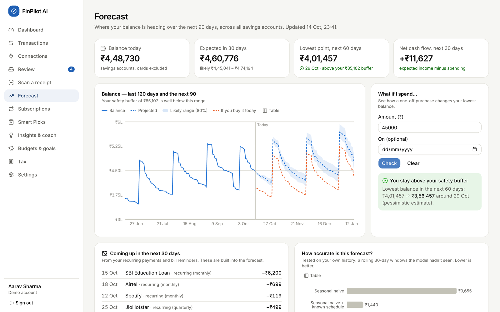
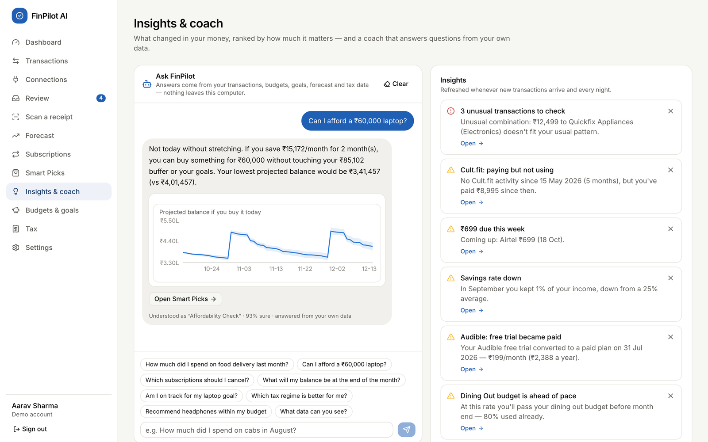
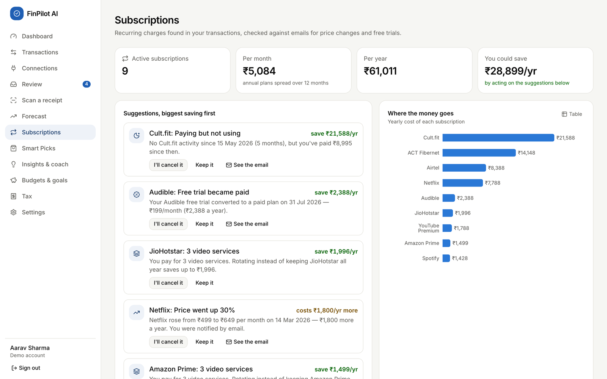
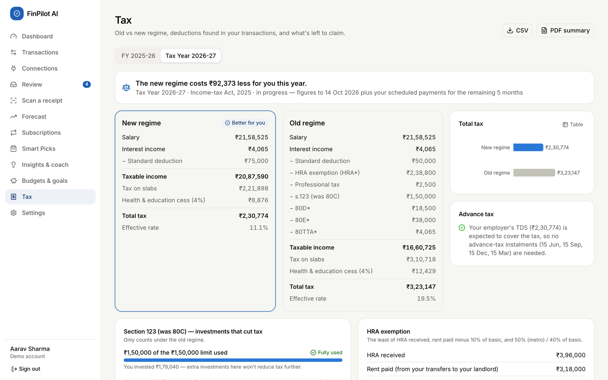
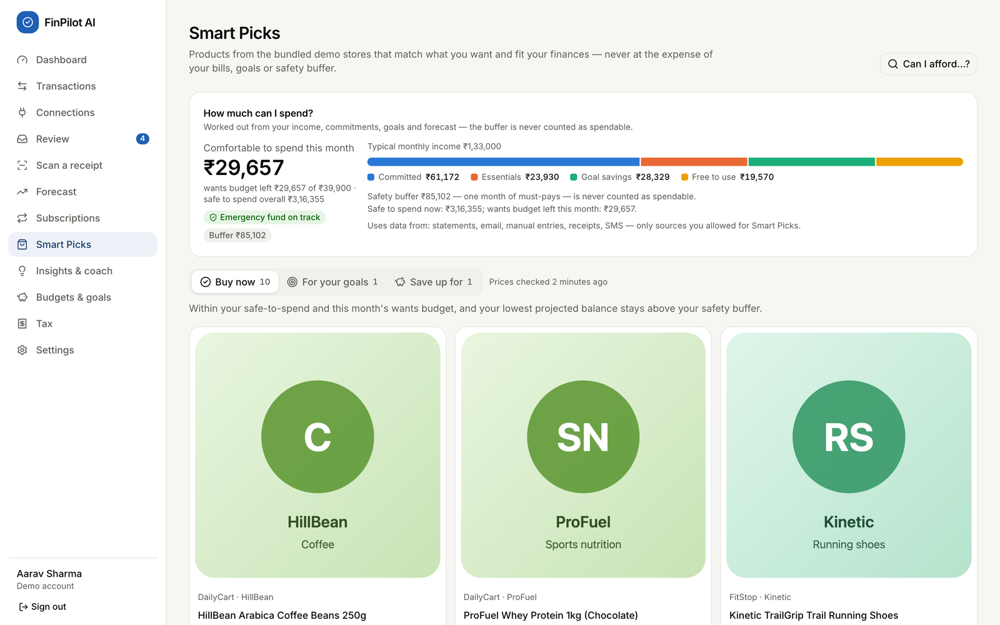
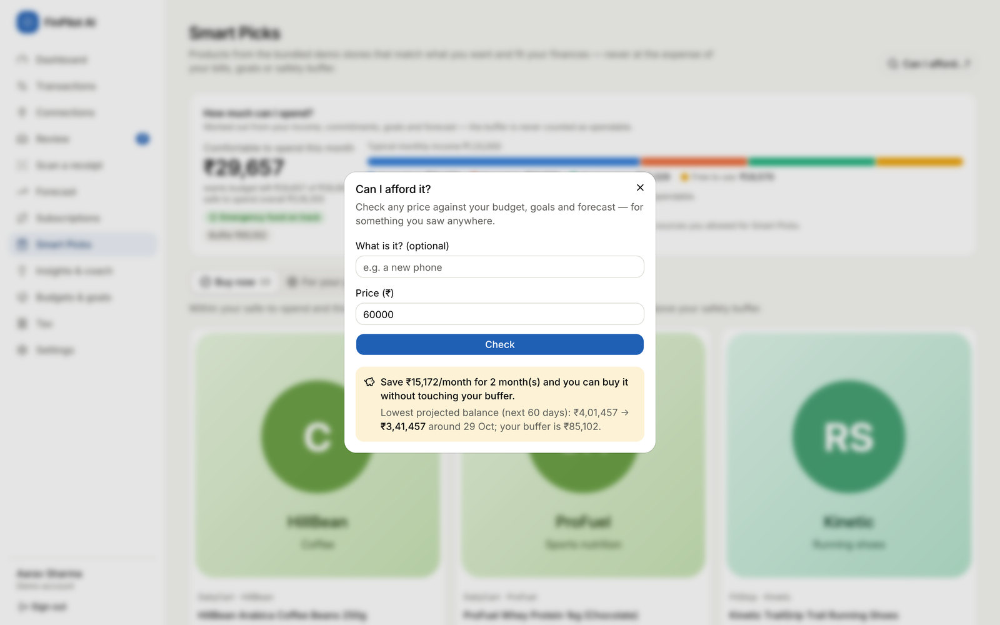
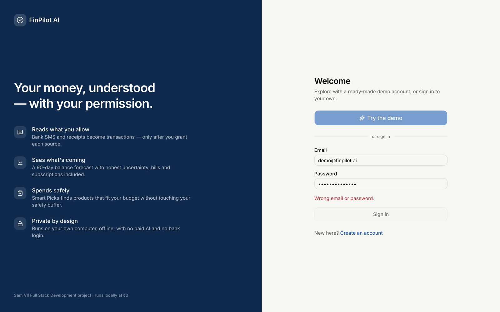
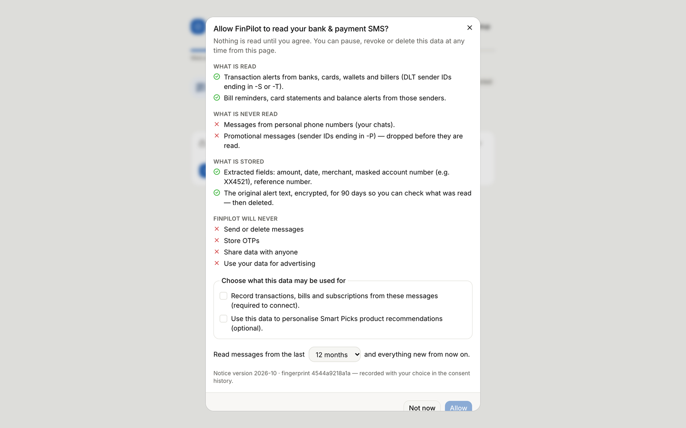
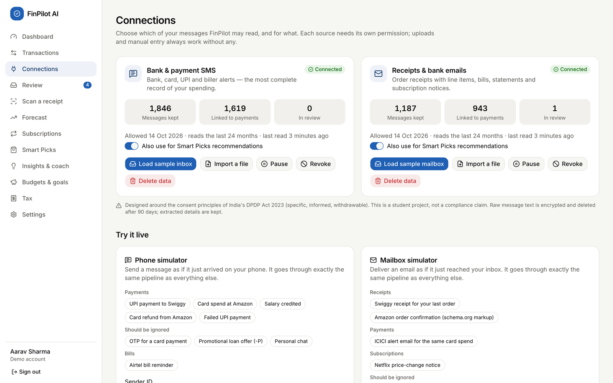
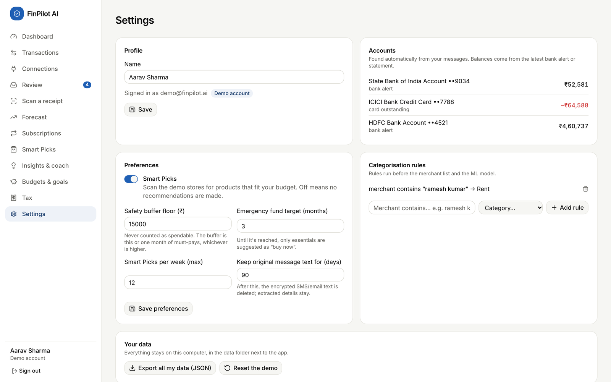

# FinPilot AI: Member 3 Evaluation Guide

**Financial Intelligence and Privacy · Evaluation Tasks 3 to 8**

Member 3: Rahul Akshath Rajendran (3122235002095) · UIT2739 Full Stack Development Project · Department of
Information Technology, SSN College of Engineering · October 2026

> **How this guide was checked (14 Oct 2026).** Every error message below was captured from a running copy of the
> app, every SQL query was run against the real schema, and the backend test suite passed (59 of 59). Code
> references point at the current source. Demo numbers change slightly each day, because the demo data is
> regenerated for the current date.
>
> **Legend:** ✅ handled · ⚠️ partly handled · ❌ not handled (an improvement to suggest)

## Contents

1. [Quick start and cheat sheet](#quick-start-and-cheat-sheet)
2. [Task 3: Individual contribution](#task-3-individual-contribution)
3. [Task 4: Backend files](#task-4-backend-files)
4. [Task 5: Exception handling and logging](#task-5-exception-handling-and-logging)
5. [Task 6: Database demonstration](#task-6-database-demonstration)
6. [Task 7: Code demonstration](#task-7-code-demonstration)
7. [Task 8: Edge cases](#task-8-edge-cases)
8. [Appendix A: ChatGPT conversation prompts (Task 1)](#appendix-a-chatgpt-conversation-prompts-task-1)

## Quick start and cheat sheet

### Start the app

1. From the project folder, run `python3 run.py` (on Windows, `py run.py`). Keep this terminal visible: the
   logs appear here.
2. The browser opens at <http://localhost:8000>. Click **Try the demo**, or sign in as `demo@finpilot.ai` with
   password `demo1234`.
3. If the demo data is older than today, it is rebuilt automatically when the app starts. While that happens,
   the login page shows "Preparing demo data…" for about a minute.

All API endpoints live under `/api/v1`. The interactive API docs are at <http://localhost:8000/api/docs>.

### My six features at a glance

| Feature | Where in the app | Main endpoints | Backend files |
|-----------------------------|---------------------------|----------------------------------------------------|----------------------------------------------------|
| Forecasting and insights | **Forecast**, **Insights & coach**, Dashboard tiles | `GET /forecast`, `GET /forecast/whatif`, `GET /insights`, `POST /insights/{id}/dismiss`, `POST /coach/ask` | `api/v1/analysis.py`, `api/v1/dashboard.py`, `services/forecasting/`, `services/recurring.py`, `services/insights.py`, `services/coach.py` |
| Subscriptions | **Subscriptions** | `GET /subscriptions`, `POST /subscriptions/{id}/action` | `api/v1/analysis.py`, `services/subscriptions.py`, `services/recurring.py` |
| Tax | **Tax** | `GET /tax`, `PUT /tax/profile`, `GET /tax/export.csv`, `GET /tax/export.pdf` | `api/v1/analysis.py`, `services/tax.py`, `services/tax_export.py` |
| Smart Picks and affordability | **Smart Picks** | `GET /picks`, `POST /picks/check`, `GET /picks/products/{id}`, `POST /picks/{id}/status`, `POST /picks/{id}/goal`, `/wishlist`, `GET /picks/stores`, `POST /picks/crawl` | `api/v1/picks.py`, `services/picks.py`, `services/scraper.py`, `services/metrics.py` |
| Authentication | Login, Register, **Sign out** | `POST /auth/register`, `/auth/login`, `/auth/demo`, `/auth/refresh`, `/auth/logout`, `GET` and `PATCH /auth/me` | `api/v1/auth.py`, `core/security.py`, `core/deps.py` |
| Consent and privacy | Onboarding, **Connections**, **Settings** | `/sources` (list, history, notice, grant, pause, resume, revoke, purposes, delete-data), `PATCH /auth/me` (preferences), `/settings/export`, `/settings/account` | `api/v1/sources.py`, `services/consent.py`, `services/privacy.py`, `api/v1/settings.py`, `api/v1/auth.py` |

> **Where things actually live.** These locations differ from the task sheet:
>
> - The insights feed and the coach are served by `dashboard.py`, not `analysis.py`.
> - Settings such as the safety buffer are saved by `PATCH /auth/me` in `auth.py`.
> - `settings.py` handles data export, account deletion, the demo reset and the model-quality report.
> - Recurring-payment detection (`services/recurring.py`) is shared by forecasting, subscriptions, tax and
>   Smart Picks.

### Checklist for the evaluation

- Start the app about two minutes early, and wait until **Try the demo** is enabled.
- Open two terminals: one running the app (for the logs), and one with `sqlite3 data/finpilot.db` (for Task 6).
- Keep the browser's DevTools → **Network** tab open, so you can show status codes.
- Don't enter wrong passwords ten times before demonstrating login. The rate limiter then blocks logins from
  that address for five minutes (see Task 8).
- When you are done, use **Settings → Reset the demo** to restore everything. It takes about a minute and signs
  you out.

## Task 3: Individual contribution

My area is **financial intelligence and privacy**. The four analysis features turn the user's transactions into
decisions. Authentication and consent decide who may see the data and what the data may be used for. Each
subsection below gives what the feature does, where it is, what is on screen, the demo steps and one line to say.

### 3.1 Forecasting and insights

**What it does**

- Projects the total savings-account balance 90 days ahead, with an 80% likely range.
- Checks a one-off purchase: "what if I spend ₹X?".
- Lists the payments scheduled for the next 30 days.
- Reports how accurate the forecast has been against two simpler baseline models.
- **Insights & coach** turns the same numbers into a ranked feed and answers questions in plain English.

**Where:** sidebar → **Forecast** (`/forecast`) and **Insights & coach** (`/insights`), plus the dashboard
tiles "Safe to spend this month" and "Next 30 days".



| Element on screen | Inputs and buttons | What it shows |
|---------------------------------|-----------------------------|--------------------------------------------------------------------------------------------------|
| Four stat tiles | none | Balance today; Expected in 30 days (with the likely range); Lowest point in the next 60 days (green or red against the safety buffer); Net cash flow for the next 30 days |
| Balance chart | **Table** toggle | The last 120 days, the next 90 days (dashed median), the 80% band, and an orange "If you buy it today" line after a what-if |
| **What if I spend…** | **Amount (₹)** (required), **On (optional)** date, **Check**, **Clear** | "You stay above your safety buffer" or "This would take you below your safety buffer", with the lowest balance before → after |
| **Coming up in the next 30 days** | none | Recurring payments and announced bills that the forecast already includes |
| **How accurate is this forecast?** and **Backtest details** | none | MAE, RMSE, WAPE and 30-day balance error for three models; the model **in use** is marked |
| **Known schedule** | none | Detected recurring income and payments |
| Coach (Insights page) | **Your question** (up to 500 characters), suggestion chips, **Send**, **Clear** | An answer from the user's own data, with a chart or table, and "Understood as “…” · N% sure" |
| Insights list (Insights page) | **Open**, dismiss (**×**) | Observations ranked by severity |

**Demo steps**

1. Open **Forecast** and walk through the four tiles. On 14 Oct the demo showed:
   - balance ₹4,48,730;
   - in 30 days ₹4,60,776, likely between ₹4,45,041 and ₹4,74,194;
   - lowest point ₹4,01,457 on 29 Oct, above the ₹85,102 buffer.
2. Under **What if I spend…**, type `45000` and click **Check**. A green box appears: the lowest balance goes
   from ₹4,01,457 to ₹3,56,457, and an orange dashed line is added to the chart.
3. Type `450000` and click **Check**. The box turns red: "This would take you below your safety buffer".
4. Scroll to **Backtest details**. On 14 Oct the average daily error was:

   | Model | Error per day |
   |---|---|
   | Seasonal naive | ₹9,655 |
   | Seasonal naive + known schedule | ₹1,440 |
   | Prophet + known schedule | ₹1,329 |

5. Open **Insights & coach** and click the chip **Can I afford a ₹60,000 laptop?**. Point to "Understood as
   “Affordability Check”".
6. Type `what's the weather in Paris?`. The coach gives an honest fallback answer instead of making one up.
7. Dismiss an insight with **×**. It disappears and stays dismissed (shown in the database in Task 6).



**What to say:** "The forecast is the known schedule (salary, rent, EMIs, SIPs, subscriptions, bills) plus
Prophet for the day-to-day spending. I report its error against two baselines using a rolling backtest. If
Prophet can't run, the page automatically uses the baseline and says so."

### 3.2 Subscription management

**What it does**

- Finds recurring charges from the interval and amount of the user's payments.
- Uses emails as evidence to flag four kinds of waste:
  - a **price increase**;
  - a **dormant** subscription (paid for but not used);
  - a **free trial that became paid**;
  - **overlapping** services.
- Ranks the suggestions by ₹ saved per year, and totals the monthly and yearly cost.

**Where:** sidebar → **Subscriptions** (`/subscriptions`).

| Element | Inputs and buttons | What it shows |
|-------------------------------|----------------------------|------------------------------------------------------------------------------------------------------|
| Four tiles | none | Active subscriptions, Per month, Per year, You could save …/yr |
| **Suggestions, biggest saving first** | **I'll cancel it**, **Keep it**, **See the email**, **Undo** | One finding per subscription, with "save ₹X/yr" (or "costs ₹X/yr more" for a price rise) |
| **Where the money goes** | **Table** toggle | Yearly cost per subscription |
| **All subscriptions** | none | Plan, since when, next charge, notes such as *Not used*, *Trial → paid*, *Overlaps*, *Price up* |

**Demo steps**

1. Open **Subscriptions**. The tiles read 9 subscriptions, ₹5,084 per month, ₹61,011 per year, and "You could
   save ₹28,899/yr".
2. Read the findings: "Cult.fit: Paying but not using", "Audible: Free trial became paid", "Netflix: Price went up
   30%" and "Spotify: Two music services".
3. On Netflix, click **See the email**. The price-change email opens with the extracted fields highlighted.
4. On Cult.fit, click **I'll cancel it**.
   - The toast reads "Marked to cancel — remember to cancel it with the provider".
   - The pill changes to "You plan to cancel".
   - Click **Undo**.
5. Click **Keep it** on another subscription. It leaves the suggestions list, and the toast reads "Got it — we
   won't suggest this again".



**What to say:** "Detection is purely algorithmic: the same merchant, a regular interval from weekly to annual,
and a stable recent amount. Suggestions are ranked by money saved per year. A price rise is shown as an extra
cost and isn't added to the savings total. A 'Keep it' choice survives every recalculation."

### 3.3 Tax analysis

**What it does**

- Estimates income tax for two years: **FY 2025-26** (Income-tax Act, 1961) and **Tax Year 2026-27**
  (Income-tax Act, 2025).
- Compares the **old and new regimes**, including the 87A rebate, marginal relief, surcharge and 4% cess.
- Detects deductions from the user's transactions: 80C (s.123 from 2026-27), 80D, HRA and 80TTA, with 80E and
  24(b) taken from the salary profile.
- Shows the remaining headroom and the advance-tax schedule, and exports a CSV or PDF.

**Where:** sidebar → **Tax** (`/tax`).

| Element | Inputs and buttons | What it shows |
|----------------------------------|----------------------------|--------------------------------------------------------------------------------------------------|
| Year tabs | **FY 2025-26**, **Tax Year 2026-27** | Switches the year |
| Recommendation banner | none | "The new regime costs ₹X less for you this year." For the current year it also shows "in progress", meaning figures to date plus scheduled payments |
| **New regime** and **Old regime** columns | none | Salary, deductions, taxable income, slab tax, rebate, cess, total, effective rate; "Better for you" pill |
| **Total tax**, **Advance tax** | none | A bar comparison, and the instalments if more than ₹10,000 is due |
| **Section 80C / Section 123** card | none | A progress bar against the ₹1,50,000 limit, with the parts that make it up |
| **HRA exemption** card | none | HRA received, rent paid, the exempt amount, and headroom tips |
| **Evidence from your transactions** | click a row | The individual payments that were counted |
| **Your salary details** | 8 number fields, the metro switch, **Save and recalculate** | Form 16 inputs |
| Header buttons | **CSV**, **PDF summary** | Downloads `finpilot-tax-<year>.csv` or `.pdf` |

**Demo steps**

1. Open **Tax**. The 2026-27 banner reads "The new regime costs ₹92,373 less for you this year · in progress".
2. Click **FY 2025-26**.
   - New regime ₹1,89,277 against old regime ₹2,72,126, so the new regime saves ₹82,849.
3. Explain **80C**: ₹1,79,040 was invested (PF ₹95,040 + ELSS ₹60,000 + LIC ₹24,000), so the ₹1,50,000 cap is
   **fully used**.
4. Explain **HRA**. It is the least of three amounts:
   - HRA received: ₹3,96,000;
   - rent minus 10% of basic: ₹3,03,000 − ₹79,200 = ₹2,23,800;
   - 50% of basic: ₹3,96,000.

   So ₹2,23,800 is exempt.
5. Under **Evidence**, expand **ELSS SIPs** to show the 12 payments that were counted.
6. Click **PDF summary** (it downloads `finpilot-tax-2025-26.pdf`), then **CSV**.
7. Under **Your salary details**, set **HRA received** to `300000` and click **Save and recalculate**.
   - The toast reads "Tax details saved" and the figures change.
   - Change the value back to `396000`.



**What to say:**

- "All rates and limits live in one `YEARS` table and are unit-tested. For example, a taxable income of
  ₹12,10,000 under the new regime gives ₹10,400 because of marginal relief."
- "Every view says 'estimates for planning, not tax advice'."

### 3.4 Smart Picks and affordability

**What it does**

- Works out how much the user can **safely** spend.
- Crawls the bundled demo stores politely: it obeys robots.txt and reads the sitemap and JSON-LD.
- Recommends products in three tiers: **Buy now**, **For your goals** and **Save up for**. Every product is
  checked against the safety buffer and the forecast.
- **Can I afford…?** checks any price the user types.

**Where:**
- sidebar → **Smart Picks** (`/picks`);
- the Smart Picks switch in **Settings**;
- "Also use for Smart Picks recommendations" on **Connections**.



| Element | Inputs and buttons | What it shows |
|----------------------|--------------------------------------------|-----------------------------------------------------------------------------------------------|
| **How much can I spend?** | none | "Comfortable to spend this month" (= min(safe to spend, wants budget left)), buffer, emergency-fund pill, income split into Committed / Essentials / Goal savings / Free to use, and which sources were used |
| Tier tabs | **Buy now**, **For your goals**, **Save up for** (with counts) | Pick cards: price, rating, 30-day sparkline, reasons, impact on the lowest balance |
| Pick card buttons | **Make it a goal** (Save up tier), **Save**, **Not for me** | Saves, hides, or creates a goal |
| Product dialog | click a card; **Open in <store>** | A 90-day price chart, the verdict, and "Why it was picked for you" |
| **Can I afford…?** dialog | **What is it?**, **Price (₹)**, **Check** | Verdict text, plus the lowest projected balance before → after |
| **Your wishlist** | text, **Max ₹**, **Add**, trash icon | Items the crawler looks for |
| **Stores & crawling** | **Crawl now**, a crawl row to expand its log | robots.txt status per store, and the recent crawls |

**Demo steps**

1. Open **Smart Picks**. On 14 Oct the card read:
   - "Comfortable to spend this month ₹29,657";
   - safe to spend overall ₹3,16,355;
   - wants budget left ₹29,657;
   - buffer ₹85,102.
2. Click **Can I afford…?**, enter `60000` and click **Check**. The answer is "Save ₹15,172/month for 2 month(s)
   and you can buy it without touching your buffer."
3. Enter `5000000` and click **Check**. The answer is "Not right now — …".
4. Walk through the tabs: **Buy now** (10), **For your goals** (1, the laptop goal) and **Save up for** (1, the
   mirrorless camera). Open one card to show its price history and verdict.
5. Click **Crawl now**. The progress bar fills.
   - In *Recent crawls*, BlockedMart shows "robots.txt disallows — skipped".
   - Expand the run to see its log.
6. To show purpose limitation:
   - On **Connections**, switch off "Also use for Smart Picks recommendations" for SMS.
   - Back on Smart Picks, a warning appears and **Buy now** is empty.
   - Switch it back on.



**What to say:**

- "The money that's safe to spend never touches the safety buffer, the dues before the next salary, or the
  goal savings. It also respects the pessimistic 60-day forecast. The buffer is the larger of the user's floor
  and one month of must-pay costs."
- "A property-based test with Hypothesis checks 300 random cases, and in every one 'Buy now' never breaks the
  buffer."

### 3.5 Authentication

**What it does**

- Registration, login and a one-click demo login.
- Sessions are kept in **httpOnly cookies**: a 30-minute access token and a 14-day refresh token. The refresh
  token is rotated every time it is used.
- Logout.
- Failed logins are rate-limited.

**Where:**
- `/login` and `/register`;
- **Sign out** at the bottom of the sidebar.

Every signed-in page goes through the `(app)` layout, which sends the user to `/login` if `/auth/me` fails, and to
`/onboarding` if they haven't finished onboarding yet.

| Page | Inputs and buttons | Results |
|------------------|-----------------------------------------------------------------------------------|-----------------------------------------------------------|
| Login | **Try the demo** (disabled and showing progress while the demo is prepared), **Email**, **Password**, **Sign in**, link **Create an account** | Goes to the dashboard, or shows a red error message |
| Register | **Name**, **Email**, **Password** (at least 8 characters, with the hint "At least 8 characters."), **Create account** | Goes to onboarding, or shows a red error message |

**Demo steps**

1. Click **Sign out**. On the login page, enter `demo@finpilot.ai` with a wrong password and click **Sign in**.
   - The page shows "Wrong email or password."
   - DevTools → Network shows **401**.
2. Click **Try the demo** to reach the dashboard.
3. Register a new account (name, a new email, a password of 8 or more characters). It opens **onboarding**.
4. Register the same email again: "An account with this email already exists. Sign in instead." (409)
5. Optional: in DevTools → Application → Cookies, show the two cookies.
   - `fp_at` has path `/` and `fp_rt` has path `/api/v1/auth`. Both are **HttpOnly**.
   - Point out that JavaScript cannot read them.



**What to say:**

- "Passwords are hashed with bcrypt at 12 rounds."
- "Tokens are HS256 JWTs in httpOnly, SameSite=Lax cookies."
- "Every request that changes data must also carry an `X-Requested-With` header, which guards against CSRF."
- "On a 401, `api.ts` silently refreshes the session once before sending the user to the login page."

### 3.6 Consent and privacy

**What it does**

- **SMS and email are separate sources.** Nothing is read until the user grants a source. The grant dialog
  lists:
  - what is read and what is never read;
  - what is stored;
  - what the app will never do;
  - two unticked purposes: *record transactions* (required) and *Smart Picks* (optional);
  - a backfill window.
- **Every change is logged.** Pause, resume, revoke, changing purposes and deleting data all add a row to the
  consent history, with the notice version and its SHA-256 fingerprint.
- **Settings controls** cover:
  - how long the original message text is kept;
  - Smart Picks on or off;
  - the safety buffer, emergency-fund months and picks per week;
  - exporting all data and deleting the account.

**Where:**
- **Onboarding**, shown on first login;
- **Connections** (`/connections`);
- **Settings** (`/settings`).



| Element | Inputs and buttons | What it shows |
|---------------------------|------------------------------------------------------------------|------------------------------------------------------------------|
| Source card (Connections) | **Connect** / **Reconnect**, **Load sample inbox** / **Load sample mailbox**, **Import a file**, **Pause**, **Resume**, **Revoke**, **Delete data**, and the switch "Also use for Smart Picks recommendations" | Status pill, Messages kept / Linked to payments / In review, when it was allowed, the backfill window, when it was last read |
| Phone and Mailbox simulators | template chips, **Send SMS**, **Deliver email** | The outcome: created / duplicate / enriched / ignored / dropped. A paused or revoked source refuses every message |
| **Consent history** | none | When, source, event, purposes, notice version and fingerprint |
| **Preferences** (Settings) | Smart Picks switch, **Safety buffer floor (₹)**, **Emergency fund target (months)**, **Smart Picks per week (max)**, **Keep original message text for (days)**, **Save preferences** | Saved preferences, confirmed by the "Saved" toast |
| **Your data** (Settings) | **Export all my data (JSON)**, **Reset the demo** (demo account) / **Delete my account** (others) | A download, a reset, or a deleted account |

**Demo steps**

1. Grant consent as a new user.
   - Register a new user and click **Get started** → **Review and allow**.
   - Show that **Allow** stays disabled until "Record transactions…" is ticked.
   - Tick it, click **Allow**, then click **Use the sample inbox**.
2. Pause a source as the demo user.
   - On **Connections**, click **Pause** on the SMS card.
   - The Phone simulator now says that a paused source refuses every message, including simulated ones.
   - Click **Resume**.
3. Switch "Also use for Smart Picks recommendations" off and on again. Each change adds a *Purposes changed* row
   to the **Consent history**.
4. Revoke and delete a source.
   - On the email card, click **Revoke** and confirm.
   - Click **Delete data** and confirm.
   - The toast gives the number of messages deleted, and how many transactions were kept because another source
     also confirms them. The history gains a *Data deleted* row with the counts.
5. Change and save preferences.
   - Under **Settings → Preferences**, set **Safety buffer floor** to `20000` and click **Save preferences**.
   - Try `3` for **Keep original message text for**. The browser blocks it (the minimum is 7), and the backend
     would also return 422 (see Task 5).
6. Click **Export all my data (JSON)**. It downloads `finpilot-export-<date>.json`.
7. Finish with **Reset the demo**.



**What to say:**

- "Consent is per source and per purpose, it can be withdrawn as easily as it was given, and every decision is
  audited."
- "The design follows the consent principles of India's DPDP Act 2023, but it doesn't claim compliance."
- "The original message text is encrypted with Fernet and deleted after the retention period. The extracted
  fields stay."



## Task 4: Backend files

### Request path (shared by every feature)

```text
Browser page (React 19 + TanStack Query)
 └─ frontend/src/lib/api.ts          fetch('/api/v1/…') with cookies + X-Requested-With header
     └─ backend/app/main.py           create_app(): CSRF middleware, global exception handler, routers, static site
         └─ api/v1/router.py          mounts the 15 feature routers under /api/v1
             └─ api/v1/<feature>.py   endpoint: Pydantic validation, ownership checks, HTTP errors
                 ├─ core/deps.py      CurrentUser (cookie JWT → User) and DB (one session per request)
                 └─ services/*.py     business logic (no HTTP), shared metrics and recurring detection
                     └─ models/*.py → SQLAlchemy 2 → db/session.py → SQLite (data/finpilot.db, WAL mode)
Background: jobs/runner.py (thread pool, `jobs` table) ← jobs/tasks.py (job functions) ← jobs/scheduler.py
```

### Shared files I rely on

| File | Responsibility |
|------------------------------------------|----------------------------------------------------------------------------------------------------------------------|
| [main.py](../backend/app/main.py#L48) | `create_app()`; the `csrf_guard` middleware (L58); the `unhandled` exception handler (L70); a lifespan that starts the job runner and the scheduler |
| [core/deps.py](../backend/app/core/deps.py#L13) | `current_user()` reads the `fp_at` cookie, decodes the JWT and loads the `User`; it also defines the `DB` and `CurrentUser` dependency aliases |
| [core/security.py](../backend/app/core/security.py#L28) | bcrypt (`hash_password`, `verify_password`) and JWT (`create_access_token`, `create_refresh_token`, `decode_token`) |
| [db/session.py](../backend/app/db/session.py#L63) | `get_db()`: commits on success, rolls back on any exception, always closes; SQLite pragmas WAL, `foreign_keys=ON`, `busy_timeout` (L17) |
| [core/money.py](../backend/app/core/money.py#L41) | The `Money` column type (integer paise ↔ `Decimal` rupees) and `fmt_inr()` Indian digit grouping |
| [services/metrics.py](../backend/app/services/metrics.py#L40) | Shared figures (rows, spend, income, `median_monthly`, `goals_status`), plus `picks_origins()` for purpose limitation (L56) |
| [services/recurring.py](../backend/app/services/recurring.py#L75) | `detect_recurring()`, the `Recurring` class with `occurrences()` and `monthly_equivalent` |
| [services/analytics.py](../backend/app/services/analytics.py#L13) | `run_user_analytics()`: five isolated stages (anomalies → subscriptions → forecast → picks → insights) |
| [jobs/runner.py](../backend/app/jobs/runner.py#L62), [tasks.py](../backend/app/jobs/tasks.py), [scheduler.py](../backend/app/jobs/scheduler.py#L27) | Background jobs (each one a row in `jobs`). The scheduler crawls every 6 h, and runs the nightly analytics and the retention purge every 24 h |

### Forecasting and insights

| File | What it does | Key functions and endpoints |
|----------------------------------------------------------|----------------------|--------------------------------------------------------------------------------|
| [api/v1/analysis.py](../backend/app/api/v1/analysis.py#L51) | Forecast endpoints | `get_forecast` (L52): the stored forecast + the lowest point in 60 days compared with the buffer + the backtest. If there is no forecast yet, it queues `user_analytics` and returns `{"status": "computing"}`. `forecast_whatif` (L72): `0 < amount < 1e9`; returns 409 if there is no forecast |
| [services/forecasting/engine.py](../backend/app/services/forecasting/engine.py#L155) | The model | `build_series` (L41), `future_schedule` (L62), `baseline_forecast` (L88), `prophet_fit_predict` (L102), `backtest` (L125), `forecast` (L155), `lowest_point` (L206), `what_if` (L212) |
| [services/forecasting/service.py](../backend/app/services/forecasting/service.py#L15) | Saving and loading | `refresh_forecast` replaces the user's `forecasts` and `forecast_metrics` rows; `latest` |
| [services/forecasting/prophet_model.py](../backend/app/services/forecasting/prophet_model.py#L23) | Prophet wrapper | `load_prophet` (a lazy import), `tiny_fit` (capability check) |
| [services/system.py](../backend/app/services/system.py#L27) | Capability gate | `check_prophet` sets `CAPABILITIES["prophet"]["ok"]`, which decides whether to fall back |
| [api/v1/dashboard.py](../backend/app/api/v1/dashboard.py#L110) | Insights and coach endpoints | `dashboard` (L58), `list_insights` (L111), `dismiss_insight` (L118), `coach_suggestions` (L143), `coach_history` (L148), `coach_ask` (L154), `clear_history` (L166) |
| [services/insights.py](../backend/app/services/insights.py#L35) | Insight rules | `generate`: 12 rule groups (spending spikes, budgets, savings rate, forecast warning, bills due, anomalies, subscription waste, 50/30/20, goal pace, price drops, review queue, tax season). `refresh_insights` (L187) keeps dismissed insights dismissed |
| [services/coach.py](../backend/app/services/coach.py#L161) | Coach | `Coach.ask`: the intent model chooses a handler and falls back below 35% confidence. Slot parsers `parse_period` (L84), `parse_amount` (L122), `parse_category` (L142). There are 12 handlers plus the fallback (13 intents in total) |

### Subscriptions

| File | What it does | Key functions and endpoints |
|-------------------------------------------------|-------------------------|-------------------------------------------------------------------------------------|
| [api/v1/analysis.py](../backend/app/api/v1/analysis.py#L82) | Subscription endpoints | `list_subscriptions` (L83): the items, one suggestion per merchant (the largest saving), and the totals. `subscription_action` (L105): keep, cancel or `null`, after an ownership check |
| [services/subscriptions.py](../backend/app/services/subscriptions.py#L53) | Detection and findings | `refresh_subscriptions` rebuilds the rows and keeps `user_action`. `_price_change` (L43), `_evidence` (L31) and the `MUSIC` / `VIDEO` sets (L26–27) |
| [services/recurring.py](../backend/app/services/recurring.py#L19) | Cadence rules | `CADENCES` (L19), `detect_recurring` (L75) |

### Tax

| File | What it does | Key functions and endpoints |
|--------------------------------------------|------------------------|---------------------------------------------------------------------------------------------|
| [api/v1/analysis.py](../backend/app/api/v1/analysis.py#L113) | Tax endpoints | `get_tax` (L114), `update_tax_profile` (L121), `tax_csv` (L131), `tax_pdf` (L139). Any year not in `YEARS` returns 404. The `TaxProfile` model (L30) requires every number to be ≥ 0 |
| [services/tax.py](../backend/app/services/tax.py#L91) | Calculation | `YEARS` (L30) holds the slabs and limits; `slab_tax` (L42); `compute` (L54) applies rebate, marginal relief, surcharge and cess; `tax_summary` (L91) works out deductions, evidence, HRA, headroom and advance tax |
| [services/tax_export.py](../backend/app/services/tax_export.py#L31) | Exports | `export_csv` (L31), `export_pdf` (L53, ReportLab), `category_totals` (L22) |

### Smart Picks and affordability

| File | What it does | Key functions and endpoints |
|--------------------------------------|---------------------------|-----------------------------------------------------------------------------------------------|
| [api/v1/picks.py](../backend/app/api/v1/picks.py#L61) | Picks endpoints | `get_picks` (L62), `set_status` (L82), `pick_to_goal` (L91), `product_detail` (L107), `check_price` (L117), `stores` (L125), `crawl_now` (L141), `search_products` (L146), wishlist (L152–174) |
| [services/picks.py](../backend/app/services/picks.py#L110) | Affordability and ranking | `Snapshot` (L65), `safety_buffer` (L104), `affordability` (L110), `snapshot_projection` (L163), `interests` (L187), `evaluate_price` (L237), `refresh_picks` (L257) |
| [services/scraper.py](../backend/app/services/scraper.py#L95) | Polite crawler | `Crawl.get` (L73): retries and backoff. `Crawl.run` (L95): robots.txt → sitemaps → JSON-LD. `_upsert` (L150) records price history. `run_crawl` (L206), `backfill_history` (L232) |
| [jobs/tasks.py](../backend/app/jobs/tasks.py#L23) | Jobs | `crawl_all` (L24) then refreshes picks for each user; `refresh_picks_job` (L41) |

### Authentication

| File | What it does | Key functions and endpoints |
|---------------------------------|--------------------|-----------------------------------------------------------------------------------------------------------|
| [api/v1/auth.py](../backend/app/api/v1/auth.py#L114) | Auth endpoints | `register` (L115), `login` (L131), `demo_login` (L142), `refresh` (L152), `logout` (L168), `me` (L180), `update_me` (L185). `start_session` (L98) sets the cookies. `_check_limit` / `_count` (L87, L93) do the rate limiting |
| [core/security.py](../backend/app/core/security.py#L43) | Hashing and tokens | bcrypt through pwdlib (12 rounds); HS256 JWTs whose secret is generated on first run in `data/secret.json` |
| [core/deps.py](../backend/app/core/deps.py#L13) | Guard | `current_user` returns 401 "Not signed in" |
| [services/demo.py](../backend/app/services/demo.py#L24) | Account creation | `create_user` sets the default preferences; Smart Picks is off for new users |

### Consent and privacy

| File | What it does | Key functions and endpoints |
|--------------------------------------|------------------------|--------------------------------------------------------------------------------------------------|
| [api/v1/sources.py](../backend/app/api/v1/sources.py#L47) | Consent centre API | `list_sources` (L48), `history` (L53), `get_notice` (L59), `grant` (L65), `pause` (L72), `resume` (L79), `revoke` (L86), `purposes` (L93), `delete_data` (L102). `_check` (L27) returns 404 for an unknown source |
| [services/consent.py](../backend/app/services/consent.py#L82) | Consent rules | `NOTICES` / `PURPOSES` (L21–55), `notice_hash` (L63), `_event` (L68), `grant` (L82), `require_active` (L100), `set_status` (L108), `update_purposes` (L124), `delete_source_data` (L136), `history` (L165) |
| [api/v1/ingest.py](../backend/app/api/v1/ingest.py#L37) | Consent enforcement | Calls `consent.require_active` before the sample inbox (L37), a file import (L46) or a simulated message (L75) |
| [services/privacy.py](../backend/app/services/privacy.py#L14) | Retention | `purge_expired_bodies` deletes raw message text older than `retention_days` (a daily job) |
| [api/v1/settings.py](../backend/app/api/v1/settings.py#L40) | Data controls | `export_all` (L41), `delete_account` (L67), `reset_demo` (L79), `system_quality` (L86) |
| [api/v1/auth.py](../backend/app/api/v1/auth.py#L51) | Preferences | `ALLOWED_PREFS`, `PREF_RANGES`, `_clean_pref` (L51–73) |
| [core/crypto.py](../backend/app/core/crypto.py#L19) | Encryption | Fernet `encrypt_text` / `decrypt_text` for message bodies |

### How the files work together

1. **Forecast**
   - New data arrives (sample inbox, file import or simulator) → a `user_analytics` job →
     `run_user_analytics` → `refresh_forecast` → `engine.forecast`. The result is stored in `forecasts` and
     `forecast_metrics`.
   - Opening the page → `GET /forecast` → `latest` + `lowest_point` + `safety_buffer`.
   - A what-if → `GET /forecast/whatif` → `what_if` on the stored projection. Prophet is not re-fitted, so this is
     fast.
2. **Insights**
   - The last analytics stage → `refresh_insights` → `insights` table → `GET /insights`.
   - **×** → `POST /insights/{id}/dismiss` sets `dismissed=1`.
   - The coach: `POST /coach/ask` → `Coach.ask` → a handler that uses `metrics`, the forecast, tax and picks. Both
     the question and the answer are saved in `chat_messages`.
3. **Subscriptions**
   - Analytics stage 2 → `refresh_subscriptions` → the `subscriptions` table.
   - Opening the page → `GET /subscriptions`.
   - Keep or cancel → `POST /subscriptions/{id}/action` updates `user_action`, which is carried into every later
     refresh.
4. **Tax**
   - On each request, `tax_summary` reads `transactions` and `users.tax_profile`. No tax result is stored.
   - The exports call `tax_summary` again.
5. **Smart Picks**
   - The crawler job (`crawl_all`) runs every 6 hours or on **Crawl now** → products and prices → for each user,
     `refresh_picks` → `affordability` → `evaluate_price` for each candidate → `product_recommendations`.
   - `GET /picks` recomputes the snapshot live.
   - **Can I afford…?** → `POST /picks/check` → `evaluate_price` straight away.
6. **Authentication**
   - Register or login → `start_session` (cookies and a `refresh_tokens` row).
   - Every protected request → `current_user`.
   - A 401 → `api.ts` → `POST /auth/refresh`, which rotates the refresh token.
7. **Consent**
   - Grant, pause, resume, revoke and purposes → `services/consent.py` updates `data_sources` and appends to
     `consent_events`.
   - Ingestion calls `require_active` first.
   - Delete data → removes the messages and the transactions that only that source supports → a
     `user_analytics` job.
   - The scheduler runs `retention_purge` daily.

## Task 5: Exception handling and logging

### 5.1 How errors are handled, layer by layer

| Layer | Mechanism | Code | What the client sees |
|--------------------------|---------------------------------------------------|---------------------------------------------------|--------------------------------|
| Browser form | HTML validation: `required`, `type="email"`, `minLength={8}`, `min`/`max` on number fields | e.g. [register/page.tsx](../frontend/src/app/register/page.tsx#L52), [settings/page.tsx](../frontend/src/app/(app)/settings/page.tsx#L193) | The browser blocks the submit before any request is sent |
| CSRF guard | Middleware rejects POST, PUT, PATCH and DELETE to `/api/` without `X-Requested-With: finpilot` | [main.py:58](../backend/app/main.py#L58) | **403** "Missing X-Requested-With header" |
| Authentication | The `current_user` dependency | [deps.py:13](../backend/app/core/deps.py#L13) | **401** "Not signed in" |
| Input validation | Pydantic `Field` and `Query` limits (for example `gt=0`, `ge=0`, `max_length`, `pattern`) | e.g. [analysis.py:30](../backend/app/api/v1/analysis.py#L30), [picks.py:24](../backend/app/api/v1/picks.py#L24), [auth.py:36](../backend/app/api/v1/auth.py#L36), [sources.py:18](../backend/app/api/v1/sources.py#L18) | **422** with a list of `{loc, msg}` items |
| Business rules | `raise HTTPException(status, "message")` | consent.py, auth.py, analysis.py, picks.py, settings.py | **400 / 401 / 404 / 409 / 422 / 429 / 503** with a readable `detail` |
| Anything unexpected | `@app.exception_handler(Exception)` writes the traceback with `log.exception` and returns a generic message | [main.py:70](../backend/app/main.py#L70) | **500** "Something went wrong on the server. Check the terminal log." No stack trace reaches the browser |
| Database | `get_db()` commits only if the request succeeds, otherwise it rolls back | [session.py:63](../backend/app/db/session.py#L63) | No half-written rows after a failure |
| Background jobs | `JobRunner.execute` catches the exception, logs it, and stores the traceback | [runner.py:138](../backend/app/jobs/runner.py#L138) | The `jobs` row gets `status='failed'` and `error` = the traceback. The UI polls `/jobs/{id}` |
| App restart | Jobs that were running are marked `interrupted` | [runner.py:70](../backend/app/jobs/runner.py#L70) | `message` = "App was restarted" |
| Analytics pipeline | Each stage has its own try/except and its own DB session | [analytics.py:30](../backend/app/services/analytics.py#L30) | The other stages still run; the failed stage's result is `{"error": …}` |
| Forecast model | If Prophet is missing or fails, the baseline is used; a backtest failure is caught too | [engine.py:164](../backend/app/services/forecasting/engine.py#L164), [L141](../backend/app/services/forecasting/engine.py#L141) | The note on the Forecast page reads "Prophet couldn't run on this machine, so the seasonal baseline is shown." |
| Crawler | 3 attempts with backoff on 429, 5xx and network errors; errors are counted; a failure of the whole run is caught | [scraper.py:73](../backend/app/services/scraper.py#L73), [L206](../backend/app/services/scraper.py#L206) | `crawl_runs.status`, `errors`, `log` |
| Tokens and crypto | `decode_token` returns `None` on any JWT error; `verify_password` returns `False` for a malformed hash; `decrypt_text` returns `None` on `InvalidToken` | [security.py:60](../backend/app/core/security.py#L60), [crypto.py:23](../backend/app/core/crypto.py#L23) | Treated as "not signed in", "wrong password" or "text no longer available", never as a crash |
| Frontend | `ApiError(status, message)` takes the message from `detail` (a string, or a list joined with "; "). A 401 triggers a refresh, a retry, then `/login` | [api.ts:48](../frontend/src/lib/api.ts#L48) | `onError` shows a toast (sonner) or red text on the form |

### 5.2 Error responses for my endpoints

These were all captured from a running copy on 14 Oct 2026. Pydantic 422 responses carry a list, and the table
shows each item's `msg`.

**Forecasting and insights**

| Request | Condition | Status | `detail` |
|----------------------------------------------------------|------------------------|---------------|---------------------------------------------------------------|
| `GET /forecast/whatif?amount=0` | amount ≤ 0 | 422 | Input should be greater than 0 |
| `GET /forecast/whatif?amount=abc` | not a number | 422 | Input should be a valid number, unable to parse string as a number |
| `GET /forecast/whatif?amount=45000&on=2026-13-01` | invalid date | 422 | Input should be a valid date or datetime, month value is outside expected range of 1-12 |
| `GET /forecast/whatif?amount=45000` | user has no forecast yet | 409 | The forecast is still being computed. |
| `GET /forecast` | user has no forecast yet | 200 | `{"status": "computing"}`, and a job is queued |
| `POST /coach/ask` with `""` | empty question | 422 | String should have at least 1 character |
| `POST /coach/ask` with 501 characters | too long | 422 | String should have at most 500 characters |
| `POST /coach/ask` with "what's the weather in Paris?" | out of scope | 200 | `intent: "fallback"` with the honest fallback text |
| `POST /insights/999999/dismiss` | doesn't exist or belongs to someone else | 404 | Insight not found |

**Subscriptions and tax**

| Request | Condition | Status | `detail` |
|-------------------------------------------------------------------|------------------------------|---------------|------------------------------------------------|
| `POST /subscriptions/999999/action` | doesn't exist or belongs to someone else | 404 | Subscription not found |
| `POST /subscriptions/{id}/action` with `{"action": "delete"}` | not keep, cancel or null | 422 | String should match pattern '^(keep\|cancel)$' |
| `GET /tax?year=2030-31` (also `export.csv` and `export.pdf`) | unsupported year | 404 | Unsupported year |
| `PUT /tax/profile` with `{"gross_salary": -5}` | negative amount | 422 | Input should be greater than or equal to 0 |
| `PUT /tax/profile` with a 61-character city | too long | 422 | String should have at most 60 characters |

**Smart Picks**

| Request | Condition | Status | `detail` |
|----------------------------------------------------|------------------------------------|---------------|----------------------------------------------------------|
| `POST /picks/check` with `{"price": 0}` | price ≤ 0 | 422 | Input should be greater than 0 |
| `POST /picks/999999/status` | doesn't exist or belongs to someone else | 404 | Pick not found |
| `POST /picks/{id}/status` with `{"status": "maybe"}` | invalid status | 422 | String should match pattern '^(new\|saved\|dismissed\|bought)$' |
| `POST /wishlist` with `{"text": "a"}` | fewer than 2 characters | 422 | String should have at least 2 characters |
| `DELETE /wishlist/999999` | not found | 404 | Not found |
| `GET /picks/products/999999` | unknown product | 404 | Product not found |
| `GET /products?q=a` | search shorter than 2 characters | 422 | String should have at least 2 characters |

**Authentication and preferences**

| Request | Condition | Status | `detail` |
|---------------------------------------|---------------------------------------|---------------|-------------------------------------------------------------------|
| `POST /auth/register` | invalid email | 422 | Enter a valid email address. |
| `POST /auth/register` | password shorter than 8 characters | 422 | Use a password with at least 8 characters. |
| `POST /auth/register` | empty name | 422 | String should have at least 1 character |
| `POST /auth/register` | email already exists | 409 | An account with this email already exists. Sign in instead. |
| `POST /auth/login` | wrong password or unknown email | 401 | Wrong email or password. |
| `POST /auth/login` | 11th failed attempt in 5 minutes from one address | 429 | Too many attempts. Please wait a few minutes. |
| `POST /auth/demo` | demo still being generated (from the code, not triggered here) | 503 | The demo is still being prepared — this takes about a minute on first start. |
| `POST /auth/refresh` | refresh cookie missing, expired or already used | 401 | Session expired — please sign in again. |
| `GET /auth/me` | no session cookie | 401 | Not signed in |
| any POST without `X-Requested-With` | CSRF guard | 403 | Missing X-Requested-With header |
| `PATCH /auth/me` with `emergency_months: 99` | out of range | 422 | emergency_months must be a number between 1 and 12 |
| `PATCH /auth/me` with `picks_enabled: "yes"` | not a boolean | 422 | picks_enabled must be true or false |
| `PATCH /auth/me` with `retention_days: 3` | out of range | 422 | retention_days must be a number between 7 and 365 |
| `PATCH /auth/me` with `buffer_floor: -1` | out of range | 422 | buffer_floor must be a number between 0 and 1e+08 |

**Consent and privacy**

| Request | Condition | Status | `detail` |
|------------------------------------------------|--------------------------|---------------|-----------------------------------------------------------------------|
| `POST /sources/whatsapp/grant` | unknown source | 404 | Unknown source |
| `POST /sources/sms/grant` with `{"purposes": ["picks"]}` | required purpose missing | 400 | The 'record transactions' purpose is required to connect this source. |
| `POST /sources/sms/grant` with `backfill_months: 36` | more than 24 | 422 | Input should be less than or equal to 24 |
| `POST /sources/sms/pause` | source never connected | 404 | Source not connected |
| `PUT /sources/sms/purposes` with `["picks"]` | removing the transactions purpose | 400 | To stop recording transactions, pause or revoke the source instead. |
| `POST /sources/sms/resume` | after a revoke | 409 | This source was revoked — grant permission again to reconnect. |
| `POST /ingest/simulate` (SMS) | source not connected | 409 | Bank & payment SMS is not connected. Grant permission on the Connections page first. |
| `POST /ingest/simulate` (SMS) | source paused | 409 | Bank & payment SMS is paused. Grant permission on the Connections page first. |
| `DELETE /settings/account` with `confirm: "nope"` | not confirmed | 422 | Type DELETE to confirm. |
| `DELETE /settings/account` | as the demo user | 409 | The demo account can be reset, not deleted. |
| `POST /settings/reset-demo` | as a normal user | 403 | Only the demo account can be reset. |

### 5.3 Logging

**Setup:**
- Logging is configured in [server.py `_configure_logging()`](../backend/app/server.py#L70):

  ```python
  logging.basicConfig(level=logging.INFO, format="%(asctime)s %(levelname)-7s %(name)s: %(message)s", datefmt="%H:%M:%S")
  for noisy in ("uvicorn.error", "uvicorn.access", "httpx", "cmdstanpy", "prophet", "alembic"):
      logging.getLogger(noisy).setLevel(logging.WARNING)
  ```

- The logs are written to the **terminal** that runs `python3 run.py`. **The app does not write a log file.**
- It uses named loggers: `finpilot`, `finpilot.jobs`, `finpilot.analytics`, `finpilot.forecast`,
  `finpilot.crawler`, `finpilot.scheduler`, `finpilot.system`, `finpilot.demo` and `finpilot.ml`.

| Event | Level and logger | Example line (from the verification run) |
|------------------------------|-------------------------------------------|---------------------------------------------------------------------------------------|
| Models trained at start-up | INFO `finpilot.ml` | `23:41:42 INFO    finpilot.ml: trained coach_intents in 0.1s: {… 'intents': 13, 'heldout_accuracy': 0.8462 …}` |
| Demo data ready | INFO `finpilot.demo` | `23:41:46 INFO    finpilot.demo: demo ready: {'sms': {'total': 2242, …}}` |
| Crawler progress | INFO `finpilot.crawler` | `23:42:19 INFO    finpilot.crawler: BlockedMart: disallowed by robots.txt — skipped without fetching` |
| Forecast fallback | WARNING `finpilot.forecast` | `forecast falling back to baseline: …` |
| Prophet missing | WARNING `finpilot.system` | `prophet unavailable: …` |
| Job failure | ERROR `finpilot.jobs`, with traceback | `job 42 (crawl_all) failed` |
| Analytics stage failure | ERROR `finpilot.analytics`, with traceback | `analytics stage forecast failed` |
| Unhandled request error | ERROR `finpilot`, with traceback | `unhandled error on /api/v1/…` |

**Lasting records in the database.** These survive a restart, so they work as the app's log tables:

- `jobs`: every background job, with its status (queued, running, done, failed or interrupted), progress,
  message, result, and `error` (the last 4,000 characters of the traceback).
- `crawl_runs`: one row per crawl, with counters and a `log` JSON list holding the crawler's lines.
- `consent_events`: the append-only audit trail of consent decisions.

### 5.4 How to demonstrate it

1. **Errors in the UI**
   - A wrong password shows red text, and the Network tab shows 401 with `{"detail": "Wrong email or
     password."}`.
   - Pausing SMS makes the Phone simulator refuse messages.
   - Removing a source's Smart Picks purpose triggers the yellow warning on Smart Picks.
2. **Backend validation without the UI.** Run this in terminal 2. `-w` prints the status code.

   ```bash
   B=http://localhost:8000/api/v1; H='X-Requested-With: finpilot'; J='Content-Type: application/json'
   # CSRF guard: no X-Requested-With header -> 403
   curl -s -w '  -> %{http_code}\n' -X POST $B/auth/login -H "$J" -d '{"email":"demo@finpilot.ai","password":"demo1234"}'
   # sign in as the demo user and keep the session cookies in a file
   curl -s -o /dev/null -c /tmp/fp.txt -X POST $B/auth/demo -H "$H"
   curl -s -w '  -> %{http_code}\n' -b /tmp/fp.txt "$B/forecast/whatif?amount=0"
   curl -s -w '  -> %{http_code}\n' -b /tmp/fp.txt "$B/tax?year=2030-31"
   curl -s -w '  -> %{http_code}\n' -b /tmp/fp.txt -X POST $B/picks/check -H "$H" -H "$J" -d '{"price":0}'
   curl -s -w '  -> %{http_code}\n' -b /tmp/fp.txt -X PATCH $B/auth/me -H "$H" -H "$J" -d '{"preferences":{"emergency_months":99}}'
   curl -s -w '  -> %{http_code}\n' -b /tmp/fp.txt -X PUT $B/sources/sms/purposes -H "$H" -H "$J" -d '{"purposes":["picks"]}'
   ```

   You can also open the API docs at `/api/docs`.
   - GET requests work from "Try it out".
   - POST, PUT, PATCH and DELETE requests return **403**, because Swagger doesn't send the `X-Requested-With`
     header.
3. **Logs**
   - Click **Crawl now** on Smart Picks and point to the crawler lines appearing in terminal 1.
   - Then show the stored traces in `sqlite3`:

     ```sql
     SELECT id, kind, status, progress, substr(coalesce(error,''),1,60) AS error, created_at FROM jobs ORDER BY id DESC LIMIT 8;
     SELECT id, trigger, status, pages_fetched, skipped_robots, errors FROM crawl_runs ORDER BY id DESC LIMIT 3;
     SELECT value AS crawl_log FROM crawl_runs, json_each(crawl_runs.log) WHERE crawl_runs.id = (SELECT max(id) FROM crawl_runs);
     ```

4. **If an examiner asks for a log file**
   - Explain that logs go to the terminal and that the lasting traces are the tables above.
   - Optionally, start the app with `python3 run.py 2>&1 | tee fsd/demo-run.log` to keep a copy. This is the
     terminal output captured by the shell, not a feature of the app.

### 5.5 Improvements (not implemented)

- Write logs to a rotating file, for example by adding a `logging.handlers.RotatingFileHandler` for
  `data/logs/finpilot.log` in `_configure_logging()`.
- Add a request ID to every log line, and log each 4xx and 5xx with the user ID and path.
- Store the rate-limit counters in the database, so a restart doesn't clear them.
- Turn Pydantic's raw messages (for example "Input should be greater than 0") into friendlier text before they
  reach the UI.
- Mark interrupted crawl runs as `interrupted` when the app restarts, as is already done for jobs.

## Task 6: Database demonstration

### 6.1 Facts to know

- **Storage and schema**
  - SQLite file `data/finpilot.db` in WAL mode (you will also see `-wal` and `-shm` files).
  - The schema comes from the Alembic migration
    [0001_initial_schema.py](../backend/alembic/versions/0001_initial_schema.py) and has 33 tables.
  - Access goes through the SQLAlchemy models in [backend/app/models/](../backend/app/models/).
- **Money is stored as integer paise**, so ₹1,799.00 is stored as `179900`. Divide by 100 in SQL.
- **JSON columns** (`preferences`, `tax_profile`, `purposes`, `findings`, `payload`, `log`) are stored as text. Read
  them with `json_extract()`.
- **Booleans** are stored as `0`/`1`. **Timestamps** are UTC with no time zone; India is UTC+5:30.
- **Cascading deletes:** every table that belongs to a user has `user_id … ON DELETE CASCADE`, so deleting a user
  removes all of their rows.
- **The demo user is recreated** when the demo is regenerated, so its ID changes. Always look it up by email.

### 6.2 Tables used by my features

| Feature | Table (key columns) | Created, updated or deleted by | Read by |
|-----------------------------|------------------------------------------------|--------------------------------------------------|---------------------------------|
| Forecast | `forecasts` (model, horizon_days, payload JSON with history, projection p10/p50/p90, events, recurring and metrics, note) | DELETE + INSERT in `refresh_forecast` (the `user_analytics` job) | `GET /forecast`, what-if, dashboard, insights, picks |
| Forecast | `forecast_metrics` (model, mae, rmse, wape, folds) | DELETE + INSERT when a backtest runs | `GET /forecast`, `/system/quality` |
| Insights | `insights` (kind, key, severity, title, body, link, dismissed) | DELETE (except dismissed) + INSERT in `refresh_insights`; UPDATE `dismissed=1` on dismiss | `GET /insights`, dashboard |
| Coach | `chat_messages` (role, text, intent, data) | INSERT 2 rows per question; DELETE on **Clear** | `GET /coach/history` |
| Subscriptions | `subscriptions` (merchant_name, cadence, amount, annual_cost, status, flags, findings, evidence, user_action) | DELETE + INSERT in `refresh_subscriptions`, keeping `user_action`; UPDATE `user_action` | `GET /subscriptions`, insights, coach |
| Tax | `users.tax_profile` (gross_salary, basic_salary, hra_received, employee_pf, …, metro) | UPDATE through `PUT /tax/profile` | `GET /tax`, exports. The `transactions` table is only read; no tax result is stored |
| Smart Picks | `wishlist_items` | INSERT through `POST /wishlist`; DELETE through `DELETE /wishlist/{id}` | `refresh_picks` |
| Smart Picks | `product_recommendations` (tier, score, reasons, impact, status) | DELETE (except saved) + INSERT in `refresh_picks`; UPDATE `status` | `GET /picks`, dashboard |
| Smart Picks | `goals` | INSERT through **Make it a goal** (`POST /picks/{id}/goal`) | affordability (goal savings) |
| Smart Picks | `affordability_snapshots` (inputs, outputs) | INSERT on every `refresh_picks`, as an audit trail | the database only |
| Smart Picks | `product_sources`, `products`, `product_price_history`, `crawl_runs` | INSERT and UPDATE by the crawler; products not seen again are marked `stale` | stores, picks |
| Authentication | `users` (email, name, password_hash, is_demo, onboarded, preferences) | INSERT on register; UPDATE through `PATCH /auth/me`; DELETE through `DELETE /settings/account` | everything |
| Authentication | `refresh_tokens` (jti, expires_at, revoked_at) | INSERT on login and refresh; UPDATE `revoked_at` on refresh (rotation) and logout | `POST /auth/refresh` |
| Consent | `data_sources` (kind, status, purposes, backfill_months, granted_at, paused_at, revoked_at) | INSERT/UPDATE on grant; UPDATE on pause, resume, revoke and purpose changes | every ingestion (`require_active`) |
| Consent | `consent_events` (event, purposes, notice_version, notice_hash, details, ip, user_agent) | **INSERT only** (append-only) | Consent history, export |
| Privacy | `ingested_messages` (body_enc, body_purged_at, status, transaction_id) | DELETE on **Delete data**; UPDATE `body_enc=NULL` in the retention purge | Connections counts, evidence |
| Privacy | `transactions`, `transaction_items` | DELETE the transactions that only that source supported; DELETE email line items | all analysis |

### 6.3 Open the database (terminal 2)

```bash
sqlite3 data/finpilot.db        # run from the project folder; reading while the app runs is fine (WAL mode)
```

```sql
.headers on
.mode box
.parameter set @uid "(SELECT id FROM users WHERE email='demo@finpilot.ai')"
SELECT @uid AS demo_user_id;
SELECT count(*) AS tables FROM sqlite_master WHERE type='table' AND name NOT LIKE 'sqlite_%' AND name <> 'alembic_version';
```

`.parameter set` saves the demo user's ID once, so every query below can use `@uid`. Run it again after
**Reset the demo**. The second query should return **33**.

### 6.4 Before and after, one feature at a time

For each one, run the query, do the action in the browser, then run the query again.

**A. Consent (the best one to show)**

```sql
SELECT kind, status, purposes, paused_at, revoked_at FROM data_sources WHERE user_id=@uid;
SELECT id, source_kind, event, purposes, substr(notice_hash,1,12) AS notice, details, created_at
FROM consent_events WHERE user_id=@uid ORDER BY id DESC LIMIT 5;
```

1. On **Connections**, switch off "Also use for Smart Picks recommendations" for SMS, then click **Pause**.
2. Run the queries again.
   - `purposes` is now `["transactions"]` and the status is `paused`.
   - Two new events appear: `purposes_changed` and `paused`.
3. Click **Resume** and switch the purpose back on to restore the source.

To demonstrate deleting data, run this before and after **Revoke** and **Delete data** on the email card:

```sql
SELECT channel, count(*) AS messages FROM ingested_messages WHERE user_id=@uid GROUP BY channel;
SELECT origin, count(*) AS transactions FROM transactions WHERE user_id=@uid GROUP BY origin;
```

The email messages disappear, and the `data_deleted` event stores the counts in `details`. In the demo,
transactions come from SMS (emails only enrich them with line items), so they are kept.

**B. Settings (privacy and Smart Picks preferences)**

```sql
SELECT json_extract(preferences,'$.buffer_floor') AS buffer_floor, json_extract(preferences,'$.retention_days') AS retention_days,
       json_extract(preferences,'$.picks_enabled') AS picks_enabled FROM users WHERE id=@uid;
```

Under **Settings → Preferences**, set **Safety buffer floor** to `20000` and click **Save preferences**. Run the
query again: `buffer_floor` is now `20000`.

To see the retention policy at work, look at how many message bodies are still encrypted and how many have been
purged:

```sql
SELECT channel, SUM(body_enc IS NOT NULL) AS encrypted_bodies, SUM(body_purged_at IS NOT NULL) AS purged
FROM ingested_messages WHERE user_id=@uid GROUP BY channel;
```

**C. Authentication**

```sql
SELECT id, email, name, is_demo, onboarded, substr(password_hash,1,7) AS hash_prefix, created_at FROM users ORDER BY id DESC LIMIT 3;
SELECT id, user_id, substr(jti,1,8) AS jti, expires_at, revoked_at FROM refresh_tokens ORDER BY id DESC LIMIT 4;
```

1. Register a new user.
   - A new `users` row appears. Its hash starts with `$2b$12$` (bcrypt), and the plain password is never
     stored.
   - A new `refresh_tokens` row appears.
2. Click **Sign out**. That token's `revoked_at` is now filled in.

**D. Subscriptions**

```sql
SELECT id, merchant_name, cadence, amount/100.0 AS amount_rs, annual_cost/100.0 AS annual_rs, status, flags, user_action
FROM subscriptions WHERE user_id=@uid ORDER BY annual_cost DESC;
```

Click **I'll cancel it** on Cult.fit: `user_action` becomes `cancel`. Click **Undo** and it returns to empty
(NULL).

**E. Tax**

```sql
SELECT json_extract(tax_profile,'$.hra_received') AS hra_received, json_extract(tax_profile,'$.gross_salary') AS gross FROM users WHERE id=@uid;
SELECT c.name AS category, t.merchant_name, count(*) AS payments, sum(t.amount)/100.0 AS total_rs
FROM transactions t JOIN categories c ON c.id = t.category_id
WHERE t.user_id=@uid AND t.txn_date BETWEEN '2025-04-01' AND '2026-03-31' AND c.name IN ('Investments','Insurance','Rent')
GROUP BY 1, 2;
```

1. Change **HRA received** and click **Save and recalculate**. The JSON value changes.
2. Compare the second query with the **Evidence** card.
   - The ELSS SIPs total ₹60,000, LIC ₹24,000 and rent ₹3,03,000.
   - The Nifty 50 index SIP is listed but does **not** count for 80C, because only merchants containing "elss"
     are counted.

**F. Smart Picks**

```sql
SELECT id, text, max_price/100.0 AS max_price_rs FROM wishlist_items WHERE user_id=@uid;
SELECT r.id, r.tier, r.status, round(r.score,3) AS score, substr(p.title,1,32) AS product, p.price/100.0 AS price_rs
FROM product_recommendations r JOIN products p ON p.id = r.product_id WHERE r.user_id=@uid ORDER BY r.tier, r.score DESC;
SELECT id, name, target/100.0 AS target_rs, saved/100.0 AS saved_rs, target_date, product_id FROM goals WHERE user_id=@uid;
SELECT id, trigger, status, pages_fetched, products_upserted, prices_changed, skipped_robots, errors FROM crawl_runs ORDER BY id DESC LIMIT 3;
```

Each action changes a different table:

- **Add** "smartwatch" to the wishlist: a new `wishlist_items` row, and the recommendations are rebuilt a few
  seconds later.
- **Save** a pick: its `status` becomes `saved`.
- **Make it a goal**: a new `goals` row, with `product_id` filled in.
- **Crawl now**: a new `crawl_runs` row whose trigger is `manual`.

**G. Forecast and insights**

```sql
SELECT id, model, horizon_days, generated_at, note FROM forecasts WHERE user_id=@uid;
SELECT model, round(mae,2) AS mae, round(rmse,2) AS rmse, round(wape,3) AS wape, folds FROM forecast_metrics WHERE user_id=@uid;
SELECT id, kind, severity, substr(title,1,40) AS title, dismissed FROM insights WHERE user_id=@uid ORDER BY severity DESC LIMIT 6;
SELECT id, role, intent, substr(text,1,50) AS text FROM chat_messages WHERE user_id=@uid ORDER BY id DESC LIMIT 4;
```

- **Ask the coach** a question: two new `chat_messages` rows, the user's question and the assistant's answer
  with its intent.
- **Dismiss an insight**: `dismissed` becomes `1`, and the insight stays dismissed after the next refresh.
- **Refresh the forecast:**
  - On **Connections**, send the Phone simulator's *UPI payment to Swiggy* template.
  - The new transaction queues `user_analytics`.
  - The `forecasts` row is replaced by one with a new `id` and a new `generated_at`.

## Task 7: Code demonstration

### 7.1 The shared API client: `frontend/src/lib/api.ts`

Every page talks to the backend through this file
([api.ts](../frontend/src/lib/api.ts#L48)). It is about 90 lines:

```ts
export async function api<T = unknown>(path: string, opts: Options = {}): Promise<T> {
  const { body, params, noRedirect, headers, ...rest } = opts;
  const isForm = typeof FormData !== "undefined" && body instanceof FormData;
  const init: RequestInit = {
    credentials: "same-origin",
    ...rest,
    headers: {
      "X-Requested-With": "finpilot",
      ...(body !== undefined && !isForm ? { "Content-Type": "application/json" } : {}),
      ...(headers || {}),
    },
    body: body === undefined ? undefined : isForm ? (body as FormData) : JSON.stringify(body),
  };
  let res = await fetch(buildUrl(path, params), init);
  if (res.status === 401 && !path.startsWith("/auth/")) {
    if (await refreshSession()) res = await fetch(buildUrl(path, params), init);
  }
  if (res.status === 401 && !noRedirect && !path.startsWith("/auth/")) {
    if (!window.location.pathname.startsWith("/login")) window.location.href = "/login/";
    throw new ApiError(401, "Not signed in");
  }
  const text = await res.text();
  const data = text ? safeJson(text) : null;
  if (!res.ok) {
    const detail = (data as { detail?: unknown })?.detail;
    const message = typeof detail === "string" ? detail : Array.isArray(detail) ? detail.map((d) => d.msg).join("; ") : res.statusText;
    throw new ApiError(res.status, message || `Request failed (${res.status})`, data);
  }
  return data as T;
}
```

Points to explain:

1. **Same origin, no tokens in JavaScript.** FastAPI serves both the site and `/api/v1`. The session lives in
   httpOnly cookies, which are sent automatically because of `credentials: "same-origin"`. There is no CORS and
   nothing in `localStorage`.
2. **CSRF.** Every request carries `X-Requested-With: finpilot`. The backend middleware rejects state-changing
   calls that don't.
3. **Body handling.** Objects are sent as JSON with `Content-Type: application/json`. `FormData` (file uploads) is
   passed through untouched, so the browser can set the multipart boundary itself.
4. **Silent refresh.** A 401 calls `refreshSession()` (L32), which sends `POST /auth/refresh` and retries once.
   Several 401s at the same moment share one refresh promise (`refreshing`). If the request still fails, the app
   does a *full page load* to `/login/`, which also clears every cached query.
5. **Errors.** FastAPI sends `{"detail": "…"}`, or a list of `{msg}` for 422. The client turns either into
   `ApiError(status, message)`. Pages show `error.message` in a toast or on the form.
6. **Helpers.** `get`, `post`, `put`, `patch` and `del` (L89–93) are one-line wrappers.
   - `buildUrl` (L21) skips empty query parameters. That is how the optional what-if date `on` is left out.
7. **With TanStack Query**
   - Reads use `useQuery({queryKey, queryFn: () => get(...)})`. Writes use `useMutation({mutationFn: () => post(...)})`.
   - After a write, the page calls `invalidateQueries`, so the data is fetched again.
   - Background jobs are polled with `useJob` ([hooks.ts](../frontend/src/lib/hooks.ts#L32)) every 0.8 s until
     `done`, `failed` or `interrupted`.

### 7.2 Forecasting: a what-if from start to finish

**Frontend:**
[forecast/page.tsx](../frontend/src/app/(app)/forecast/page.tsx#L36) loads `GET /forecast`. While the status is
`computing`, it polls every 3 s.

The what-if form only sets `submitted`. A second query then runs:

```ts
const wi = useQuery({
  queryKey: ["whatif", submitted],
  queryFn: () => get<WhatIf>("/forecast/whatif", { amount: submitted!.amount, on: submitted!.on || undefined }),
  enabled: submitted !== null,
});
```

**Endpoint:** [analysis.py:72](../backend/app/api/v1/analysis.py#L72) validates `amount` (`gt=0, lt=1e9`) and
`on` (a date). It returns 409 if there is no forecast. Otherwise it calls `what_if` and compares the result with
`safety_buffer()`.

**Model:** [engine.py `forecast`](../backend/app/services/forecasting/engine.py#L155) does the heavy work in a
background job:

```python
resid = series.daily - series.scheduled            # remove salary, rent, EMIs, SIPs, subscriptions, bills
prophet_ok = CAPABILITIES.get("prophet", {}).get("ok", True) and len(resid) >= 120
try:
    if not prophet_ok:
        raise RuntimeError("Prophet unavailable")
    yhat, samples = prophet_fit_predict(resid, HORIZON, samples=300)
except Exception as exc:  # fallback keeps the page working on any machine
    log.warning("forecast falling back to baseline: %s", exc)
    model_name, note = "baseline", "Prophet couldn't run on this machine, so the seasonal baseline is shown."
    yhat = baseline_forecast(resid, HORIZON)
...
paths = balance_now + np.cumsum(sched_future.to_numpy()[:, None] + samples, axis=0)
p10, p50, p90 = (np.percentile(paths, q, axis=1) for q in (10, 50, 90))
```

How to explain it:

- **Splitting the cash flow**
  - The daily net cash flow is split into the **known schedule**, which comes from `detect_recurring`, and a
    **residual**, the day-to-day spending.
  - Prophet models only the residual, with weekly seasonality, yearly seasonality once there are 400 or more
    days, and Indian holidays.
- **The likely range**
  - 300 sampled futures are added to today's balance day by day.
  - The 10th, 50th and 90th percentiles of those paths give the band. It gets wider the further ahead it looks.
- **The fallback**
  - If Prophet is missing, or there are fewer than 120 days of history, a seasonal-naive baseline is used.
  - Its band comes from resampling the user's own past residuals.
- **The backtest** ([L125](../backend/app/services/forecasting/engine.py#L125))
  - Six rolling 30-day windows the model hadn't seen.
  - It reports MAE, RMSE, **WAPE** and the end-of-period error. WAPE replaces MAPE, which divides by the actual
    value, and daily net cash flow is often zero.

The what-if itself is simple and needs no new model fit
([engine.py:212](../backend/app/services/forecasting/engine.py#L212)):

```python
shifted = [{**p, "p10": p["p10"] - amount, "p50": p["p50"] - amount, "p90": p["p90"] - amount} if p["date"] >= on_iso else p
           for p in projection]
before = lowest_point(projection, days)      # lowest p10 in the next 60 days (pessimistic)
after = lowest_point(shifted, days)
```

**The full flow:**
1. Typing `45000` and clicking **Check** → `GET /api/v1/forecast/whatif?amount=45000`.
2. `forecast_whatif` → `latest()` reads `forecasts.payload`.
3. `what_if()` shifts the projection → `safety_buffer()` → JSON.
4. The green or red box appears and the orange line is drawn.

**Insights and coach**
- [insights.py `generate`](../backend/app/services/insights.py#L35) builds the ranked list from the same metric
  functions as the dashboard.
- [`refresh_insights`](../backend/app/services/insights.py#L187) remembers dismissed keys.
- [coach.py `Coach.ask`](../backend/app/services/coach.py#L161):
  - a TF-IDF + logistic-regression model predicts one of 13 intents;
  - below 35% confidence, or for `out_of_scope`, it gives the honest fallback;
  - otherwise the matching method answers from the user's own data, and the UI shows the intent and the
    confidence.

### 7.3 Subscriptions: from payments to findings

[recurring.py `detect_recurring`](../backend/app/services/recurring.py#L75) groups posted, non-transfer payments
by merchant and direction, then:

```python
med = statistics.median(intervals)
cad = _classify(med)                       # weekly 7±2, monthly 30.4±4, bimonthly, quarterly 91.3±8, annual 365.2±12
...
regular = sum(1 for iv in intervals if abs(iv - period) <= tol or abs(iv - 2 * period) <= tol)
needed = 2 if name == "annual" else min_count            # min_count = 3
if len(items) < needed or regular < 0.75 * len(intervals):
    continue
recent = amounts[-4:]
spread = (max(recent) - min(recent)) / max(Decimal(1), statistics.median(recent))
if spread > Decimal("0.15"):
    continue
```

[subscriptions.py `refresh_subscriptions`](../backend/app/services/subscriptions.py#L53) keeps the recurring
payments in the subscription-like categories. It computes `annual = amount × factor` (×12 for monthly) and adds
findings:

- **price_increase.** `_price_change` (L43) checks that the last change was upward and that the higher amount has
  stuck. It links the price-change email when there is one.
- **dormant.** There are usage emails, but none in the last 60 or more days. The status becomes `dormant`.
- **trial_converted.** A trial notice email arrived just before the first charge.
- **overlap.** Two or more music services, or three or more video services. The most expensive one is kept and
  the rest are flagged.

The endpoint ([analysis.py:83](../backend/app/api/v1/analysis.py#L83)):

- keeps the **largest** finding per merchant;
- hides subscriptions the user chose to keep;
- adds up the totals over `active` and `dormant` subscriptions;
- leaves price increases out of `potential_saving`.

**The full flow:**
1. Clicking **I'll cancel it** → `POST /subscriptions/{id}/action {"action":"cancel"}`.
2. Ownership is checked → `user_action` is saved.
3. `invalidateQueries(["subscriptions"])` → the list is fetched again.
4. Because `refresh_subscriptions` copies `user_action` back by merchant name, the choice survives every
   recalculation.

### 7.4 Tax: from slabs to total

[tax.py `compute`](../backend/app/services/tax.py#L54):

```python
base = slab_tax(taxable, r["slabs"])
rebate = Decimal(0)
if taxable <= r["rebate_limit"]:
    rebate = min(base, Decimal(r["rebate_max"]))                    # 87A rebate
elif regime == "new" and base > taxable - r["rebate_limit"]:
    rebate = base - (taxable - r["rebate_limit"])                   # marginal relief just above ₹12 lakh
after_rebate = base - rebate
... surcharge by income band (capped at 25% new / 37% old) ...
cess = ((after_rebate + surcharge) * Decimal(cfg["cess"]) / 100).quantize(Decimal("1"), ROUND_HALF_UP)
```

An example to say out loud:
- A taxable income of ₹12,10,000 under the new regime gives a slab tax of ₹61,000. Marginal relief caps it at the
  income above ₹12 lakh, which is ₹10,000.
- With 4% cess, the total is ₹10,400. This is a unit test in
  [test_tax.py](../backend/tests/test_tax.py#L13).

[`tax_summary`](../backend/app/services/tax.py#L91) builds everything else:

- **Deductions from transactions:** ELSS = Investments whose merchant contains "elss"; LIC = Insurance with "lic"
  or "life"; health insurance = Insurance with "health"; rent = Rent debits; savings interest = Interest credits.
- **Years still in progress:** the remaining scheduled SIPs, premiums and rent are projected to 31 March, and the
  interest is annualised.
- **Salary:** taken from the profile. If it's missing, it is estimated by grossing up the net salary credits by
  ÷ 0.74 and flagged as estimated.
- **HRA:** the least of HRA received, rent − 10% of basic, and 50% (metro) or 40% of basic.
- **Caps:** 80C ₹1.5 L, 80D ₹25 k, 24(b) ₹2 L, 80TTA ₹10 k, professional tax ₹2.5 k.
- **Recommendation:** the regime with the lower total. **Headroom tips** suggest a monthly ELSS SIP to fill 80C.
- **Advance tax:** if no TDS figure is given, it assumes the employer withholds the full tax.

**Exports:** [tax_export.py](../backend/app/services/tax_export.py#L53) reuses `tax_summary`. The PDF is built with
ReportLab and swaps "₹" for "Rs ", because the standard PDF fonts have no rupee glyph.

**The full flow:**
1. A year tab → `GET /tax?year=2025-26` (TanStack Query key `["tax", year]`) → `tax_summary` → the columns and
   cards.
2. The salary form → `PUT /tax/profile`, which merges only the fields that were sent → `invalidateQueries(["tax"])`
   → the page recalculates.

### 7.5 Smart Picks: affordability and tiers

[picks.py `affordability`](../backend/app/services/picks.py#L110) works out what the user can spend:

```python
origins = metrics.picks_origins(db, user.id) if for_picks else None           # purpose limitation
used = set(db.scalars(select(Transaction.origin).where(Transaction.user_id == user.id).distinct()).all())
complete = origins is None or used <= origins
income = metrics.median_monthly(db, user.id, 6, lambda r: r.kind == "income" and r.amount > 0, today, origins)
...
surplus = income - committed - essential - goals
buffer = max(Decimal(str(prefs.get("buffer_floor", 15000))), must_pay)        # must_pay = committed + essential
...
safe_a = liquid - buffer - dues - goals
safe = max(Decimal(0), min(safe_a, f_low - buffer) if f_low is not None else safe_a) if complete else Decimal(0)
wants_budget = ... (income * Decimal("0.30")) unless the user set one
```

[`evaluate_price`](../backend/app/services/picks.py#L237) decides the tier:

```python
limit = min(snap.safe_to_spend, snap.wants_left)
... stays = lowest projected balance after the purchase >= buffer ...
if price <= limit and stays and (snap.emergency_ok or replenish):
    return {"tier": "buy_now", ...}
capacity = max(snap.surplus, Decimal(0))
gap = max(price - limit, Decimal(0))
if capacity > 0:
    months = max(1, math.ceil(gap / capacity))
    if months <= 12:
        return {"tier": "save_up", "months": months, "monthly": float((gap / months).quantize(Decimal("1"))), ...}
return {"tier": "not_now", ...}
```

The ₹60,000 check on 14 Oct, worked through:

1. limit = min(₹3,16,355, ₹29,657) = ₹29,657.
2. gap = ₹30,343. With a surplus of ₹19,570 a month, that takes 2 months.
3. ₹30,343 ÷ 2 = **₹15,172/month**, which is the number shown on screen.

[`refresh_picks`](../backend/app/services/picks.py#L257) produces the recommendation list:

- **Interests:** the wishlist (weight 3.0), goals (2.5), premium items bought again and again (2.2), and merchant
  interest tags (1.2). Healthcare is never used to infer interests.
- **Matching:** products are matched to interests with TF-IDF.
- **Scoring:** 0.45 × relevance + 0.25 × budget headroom + 0.2 × value (discount and a Bayesian rating), plus 0.1
  for goal matches.
- **Limits:** a weekly cap (12 by default), with round-robin across interests.
- **Remembered choices:** dismissed and bought items are never suggested again, and saved ones are kept.

**The full flow for Can I afford…?:**
1. The dialog → `post("/picks/check", {price, label})`
   ([picks/page.tsx:178](../frontend/src/app/(app)/picks/page.tsx#L178)).
2. → [`check_price`](../backend/app/api/v1/picks.py#L117) → `affordability()` + `snapshot_projection()` +
   `evaluate_price()` → `_verdict_text()`.
3. → The `VerdictBox` component shows green (buy now), amber (save up) or red (not now).

**Crawler:** [scraper.py `Crawl.run`](../backend/app/services/scraper.py#L95) works in this order:

1. Reads robots.txt with Protego, including the Crawl-delay.
2. Lists products from the sitemap index.
3. Skips any store robots.txt disallows (`can_fetch`), without fetching it.
4. Reads the schema.org `Product`/`Offer` JSON-LD on each page, accepting INR prices only.
5. Saves one price per day in `product_price_history`.

### 7.6 Authentication

[auth.py](../backend/app/api/v1/auth.py#L130):

```python
@router.post("/login")
def login(body: Credentials, response: Response, request: Request, db: DB) -> dict:
    _check_limit("login_failed", request)  # only failed attempts count, so a typo-prone user isn't locked out
    user = db.scalar(select(User).where(User.email == body.email.lower().strip()))
    if user is None or not verify_password(body.password, user.password_hash):
        _count("login_failed", request)
        raise HTTPException(401, "Wrong email or password.")
    start_session(response, db, user)
    return user_out(user)
```

**Sessions** (`start_session`, L98) issue two tokens, both in httpOnly, SameSite=Lax cookies:
- an access JWT valid for 30 minutes, in the `fp_at` cookie with path `/`;
- a refresh JWT with a unique `jti` (also stored in `refresh_tokens`), valid for 14 days, in the `fp_rt` cookie
  with path `/api/v1/auth`.

**Rotation** (`refresh`, L152) works like this:
- The stored `jti` must exist, must not be revoked and must not be expired.
- It is then revoked straight away, and a new pair of tokens is issued. A stolen refresh token therefore works
  at most once.

**The guard** ([deps.py:13](../backend/app/core/deps.py#L13)): every protected endpoint declares
`user: CurrentUser`. A missing or invalid cookie, the wrong token type, or a deleted user gives 401.

**Frontend:**
- [login/page.tsx](../frontend/src/app/login/page.tsx#L27) posts the credentials, clears the query cache and
  goes to `/dashboard/`.
- [(app)/layout.tsx](../frontend/src/app/(app)/layout.tsx#L11) guards every page with `useMe()`.

### 7.7 Consent and privacy

[consent.py](../backend/app/services/consent.py#L82):

```python
def grant(db, user, kind, purposes, backfill_months, request=None):
    purposes = [p for p in purposes if p in PURPOSES]                 # unknown purposes dropped
    if "transactions" not in purposes:
        raise HTTPException(400, "The 'record transactions' purpose is required to connect this source.")
    ...
    _event(db, user, src, kind, "granted", purposes, request, {"backfill_months": backfill_months})

def require_active(db, user, kind):                                   # called before ANY ingestion
    src = get_source(db, user, kind)
    if src is None or src.status != "active":
        state = "not connected" if src is None else src.status
        raise HTTPException(409, f"{NOTICES[kind]['title']} is {state}. Grant permission on the Connections page first.")
    return src
```

Points to explain:

- **`_event`** (L68) appends a `ConsentEvent` holding the purposes, `NOTICE_VERSION`, the notice's SHA-256
  `notice_hash` (L63), the IP address and the user agent. Nothing updates or deletes these rows.
- **`set_status`** (L108) handles pause, resume and revoke. A revoked source can't be resumed: the user must grant
  again and see the notice again.
- **`delete_source_data`** (L136)
  - For each linked transaction, it checks whether a message from another source also supports it.
  - If not, and the transaction came from this source, it is deleted.
  - Otherwise it is kept, and only its email line items are removed.
  - Finally the source's messages are deleted and a `data_deleted` event records the counts.
- **Purpose limitation** ([metrics.py:56](../backend/app/services/metrics.py#L56)) lets Smart Picks use only
  sources that have the `picks` purpose, plus uploads and manual entries.
- **Retention** ([privacy.py](../backend/app/services/privacy.py#L14)): a daily job nulls `body_enc` for
  messages older than each user's `retention_days`.
- **Preferences** ([auth.py:59](../backend/app/api/v1/auth.py#L59)): only `ALLOWED_PREFS` are saved, each
  validated against `PREF_RANGES`. Changing a Smart Picks preference re-ranks the picks.

**Frontend:**
- [sources.tsx `ConsentDialog`](../frontend/src/components/sources.tsx#L52) fetches the notice from the server.
  Both purposes start **unticked**. **Allow** is `disabled={!purposes.transactions}` (L97).
- [connections/page.tsx](../frontend/src/app/(app)/connections/page.tsx#L34) posts
  `/sources/{kind}/{pause|resume|revoke|delete-data}` and `PUT /sources/{kind}/purposes`. After each call it
  invalidates the sources, history, transactions and dashboard queries.

**The full flow for Pause:**
1. Clicking **Pause** → `POST /sources/sms/pause`.
2. `set_status` sets `data_sources.status='paused'` and `paused_at`, and appends a `paused` event.
3. On the next simulated SMS, `require_active` → 409. The UI shows the paused message.

## Task 8: Edge cases

Status: ✅ handled · ⚠️ partly handled · ❌ not handled (improvement). The "Demo" column says how to show it.

### 8.1 Forecasting and insights

| Edge case | How it is handled | Status | Demo |
|--------------------------|--------------------------------------------------------------|---------------|----------------------------------------------------------|
| User has no forecast yet | `GET /forecast` returns `computing`, queues the job, and the page polls every 3 s; the what-if returns 409 ([analysis.py:53](../backend/app/api/v1/analysis.py#L53)) | ✅ | New user → **Forecast** shows "Building your forecast…" |
| Prophet missing or failing | The baseline is used, and a note is shown ([engine.py:164](../backend/app/services/forecasting/engine.py#L164)); a test covers it | ✅ | `test_baseline_fallback_when_prophet_unavailable` |
| Little or no history | No transactions → a flat 30-day series. Under 120 days → the baseline ([engine.py:45](../backend/app/services/forecasting/engine.py#L45)) | ✅ | New user with a short history |
| Under 400 days of history | The backtest is skipped (`return {}`), and the accuracy chart and table are simply empty with no explanation ([engine.py:128](../backend/app/services/forecasting/engine.py#L128)) | ⚠️ | Improvement: show "not enough history yet" |
| Daily net flow crosses zero | WAPE is used instead of MAPE, and its denominator is `max(1, Σ\|actual\|)` ([engine.py:118](../backend/app/services/forecasting/engine.py#L118)) | ✅ | Explain it with the backtest table |
| What-if amount ≤ 0, not a number, or ≥ ₹1e9; invalid date | 422 from `Query(gt=0, lt=1e9)` and the date type | ✅ | curl in Task 5 |
| What-if dated after day 60 | Accepted, but the "lowest in 60 days" can't change. `on` isn't checked against the projection range; the date picker limits it to 90 days | ⚠️ | Pick a date 75 days ahead: no change |
| Pessimistic buffer check | The low point uses p10, not the median ([engine.py:206](../backend/app/services/forecasting/engine.py#L206)) | ✅ | Explain the "(pessimistic estimate)" note |
| Question outside the coach's scope, or low confidence | Honest fallback below 35% ([coach.py:164](../backend/app/services/coach.py#L164)); tested | ✅ | Ask "what's the weather in Paris?" |
| Ambiguous wording | "may I buy" is not read as the month of May; "last 3 months" is not ₹3; years aren't amounts ([coach.py:113](../backend/app/services/coach.py#L113)); tested | ✅ | `test_coach.py` |
| Empty question, or more than 500 characters | 422; the UI disables **Send** and limits the input to 500 characters | ✅ | Try to send an empty box |
| Dismissed insight | Its key is remembered and it is skipped on refresh ([insights.py:189](../backend/app/services/insights.py#L189)). Many keys include the month, so a similar insight can come back next month (by design) | ✅ | Dismiss, then send a simulated SMS |
| Noisy "spending spike" alerts | Only from day 7 of the month, a usual spend ≥ ₹1,000, ≥ 1.5×, and ≥ ₹2,000 above usual ([insights.py:49](../backend/app/services/insights.py#L49)) | ✅ | Explain it |
| Another user's insight | 404 "Insight not found" | ✅ | curl |

### 8.2 Subscriptions

| Edge case | How it is handled | Status | Demo |
|----------------------------------|----------------------------------------------------------------------------------|---------------|------------------------------|
| No subscriptions | Empty state: "No subscriptions found yet"; the API returns zero totals | ✅ | New user |
| Irregular repeat purchases | 3 or more charges needed (2 for annual), 75% regular intervals, and recent amounts within 15% ([recurring.py:102](../backend/app/services/recurring.py#L102)) | ✅ | Groceries are not listed |
| A plan that got more expensive | Only the last 4 amounts must be stable, so the plan is still detected and flagged ([subscriptions.py:43](../backend/app/services/subscriptions.py#L43)) | ✅ | Netflix +30% |
| A subscription that stopped | No charge for 1.5 periods → `ended`; no next date; left out of the totals | ✅ | API totals |
| UI counting of ended subscriptions | The page counts every status except "cancelled", a value the backend never uses, so `ended` ones would count as **active** in the tile and chart ([subscriptions/page.tsx:68](../frontend/src/app/(app)/subscriptions/page.tsx#L68)) | ❌ | Not visible with the demo data; the fix is to filter on `active` or `dormant` |
| User choice after recalculation | `user_action` is copied back by merchant name ([subscriptions.py:55](../backend/app/services/subscriptions.py#L55)) | ✅ | Keep, then send an SMS (re-analysis) |
| Two music or three video services | The most expensive one is kept; the others are flagged as overlaps | ✅ | Spotify flagged, YouTube Premium kept |
| Evidence email already purged | The dialog says the text was deleted under the retention setting | ✅ | Set retention to 7 days and wait for the purge |
| "I'll cancel it" | Only records intent; the app can't cancel with the provider (the toast says so) | ⚠️ | By design |
| Invalid action, or another user's subscription | 422 / 404 | ✅ | curl |

### 8.3 Tax

| Edge case | How it is handled | Status | Demo |
|------------------------------|-------------------------------------------------------------------------------------|---------------|------------------------------|
| Unsupported year | 404 for the page and both exports | ✅ | `?year=2030-31` |
| Negative numbers, overlong city | 422 (`ge=0`, `max_length=60`) | ✅ | curl |
| No Form 16 figures | Gross salary estimated from salary credits (÷ 0.74) and flagged on screen ([tax.py:141](../backend/app/services/tax.py#L141)) | ✅ | Banner: "salary estimated from your take-home pay" |
| No salary at all | Taxable income is never below 0, and the effective rate guards against division by 0 (verified: ₹0 under both regimes) | ✅ | New user → **Tax** |
| Income just above ₹12 lakh (new regime) | Marginal relief ([tax.py:61](../backend/app/services/tax.py#L61)); tested | ✅ | ₹12,10,000 → ₹10,400 |
| Deduction limits | 80C ₹1.5 L, 80D ₹25 k, 24(b) ₹2 L, 80TTA ₹10 k, PT ₹2.5 k | ✅ | 80C ₹1,79,040 → ₹1,50,000 |
| Year still in progress | The remaining scheduled payments are projected and interest is annualised ([tax.py:117](../backend/app/services/tax.py#L117)) | ✅ | 2026-27 banner "in progress" |
| No rupee glyph in the PDF fonts | ₹ is replaced with "Rs " ([tax_export.py:59](../backend/app/services/tax_export.py#L59)) | ✅ | Open the PDF |
| TDS unknown | Assumes the employer withholds everything; advance tax only if more than ₹10,000 is due | ✅ | **Advance tax** card |
| Clearing a salary field | The frontend drops blank fields and the backend ignores missing keys, so the old value stays; the user must type 0 ([tax/page.tsx:45](../frontend/src/app/(app)/tax/page.tsx#L45), [analysis.py:123](../backend/app/api/v1/analysis.py#L123)) | ⚠️ | Clear **HRA received** and save: the old value comes back |
| Surcharge just above ₹50 lakh and other thresholds | The surcharge applies in full; there is no marginal relief on surcharge ([tax.py:64](../backend/app/services/tax.py#L64)) | ❌ | Improvement for high incomes |
| Deduction detection | Depends on the category plus merchant keywords. An ELSS fund whose name lacks "elss" would be missed unless recategorised | ⚠️ | The Nifty SIP is correctly left out |

### 8.4 Smart Picks and affordability

| Edge case | How it is handled | Status | Demo |
|--------------------------------|-------------------------------------------------------------------------------|---------------|-----------------------------------|
| Smart Picks turned off | The API returns no picks; the page shows "Smart Picks is off" and **Turn on Smart Picks** | ✅ | Settings switch |
| Nothing crawled yet | `preparing`, so the page polls; the refresh is skipped ("No products crawled yet") | ✅ | First start |
| Price ≤ 0 or ≥ ₹1e9 | 422 | ✅ | curl |
| Too expensive for 12 months, or no surplus | `not_now`: "Not right now — …" | ✅ | Check ₹50,00,000 |
| **Buy now could break the buffer** | Never above min(safe to spend, wants left), the forecast must stay above the buffer, and the emergency fund must be in place (unless it is a replenishment). A Hypothesis property test runs 300 cases ([test_picks.py:64](../backend/tests/test_picks.py#L64)) | ✅ | Explain the test |
| A source not allowed for Smart Picks | Balance and forecast aren't used, nothing is "Buy now", and a warning is shown ([picks.py:117](../backend/app/services/picks.py#L117)); tested | ✅ | Switch on Connections |
| robots.txt disallows a store | Skipped without fetching (BlockedMart) ([scraper.py:117](../backend/app/services/scraper.py#L117)); tested | ✅ | **Crawl now** |
| Network errors, 429 or 5xx | 3 attempts with backoff; errors counted in the run | ✅ | `crawl_runs.errors` |
| Non-INR or missing price | The product is ignored ([scraper.py:153](../backend/app/services/scraper.py#L153)) | ✅ | Explain it |
| Product removed from a store | Marked `stale` and no longer recommended | ✅ | Explain it |
| Product dismissed or bought | Never suggested again; saved picks survive refreshes | ✅ | **Not for me** |
| Repeat purchases (replenishment) | Never suggested at more than 105% of the usual price | ✅ | "cheaper than the ₹… you usually pay" |
| Sensitive categories | Healthcare is never used to infer interests | ✅ | Explain it |
| Too many picks | A weekly cap of 1–30 (default 12), with round-robin so every interest appears | ✅ | Settings |
| Repeated **Crawl now** | The button is disabled while running, and identical queued jobs are de-duplicated ([runner.py:107](../backend/app/jobs/runner.py#L107)) | ✅ | Click twice |
| App stopped during a crawl | The job becomes `interrupted` on restart, but the `crawl_runs` row stays `running`. Your current `data/finpilot.db` has one (run #5) | ⚠️ | `SELECT id, status FROM crawl_runs;` |
| Wishlist text of 1 character, or max price ≤ 0 | 422 | ✅ | curl |

### 8.5 Authentication

| Edge case | How it is handled | Status | Demo |
|------------------------------------|-----------------------------------------------------------------------------|---------------|---------------------------------|
| Invalid email, short password, empty name | 422 with clear messages (also blocked in the browser) | ✅ | Register page |
| Duplicate email (any letter case) | Emails are lower-cased and trimmed → 409 | ✅ | Register twice |
| Email typed in a different case at login | Lower-cased and trimmed; tested | ✅ | `DEMO@finpilot.ai` |
| Unknown email and wrong password | The same message for both, so attackers can't find which emails exist | ✅ | Try both |
| Brute force | 10 failed logins per address per 5 minutes → 429; tested | ✅ | (Avoid during the demo) |
| Behaviour after the limit is hit | **Even the correct password gets 429** for up to 5 minutes (verified). The counter is in memory, so a restart resets it, and it is per IP, so all local users share `127.0.0.1` | ⚠️ | Improvement: store it, and count per account as well |
| Expired access token | `api.ts` refreshes once and retries; simultaneous 401s share one refresh | ✅ | Wait 30 minutes, then navigate |
| Refresh token reused or expired | 401, and the cookies are cleared; each refresh token works once | ✅ | Explain rotation |
| Deleted user with a valid cookie | `current_user` returns 401 | ✅ | Explain it |
| Tampered JWT or wrong token type | `decode_token` returns `None` → 401 | ✅ | Edit the cookie in DevTools |
| Cross-site form post | 403 without `X-Requested-With`; tested | ✅ | curl |
| Demo login before the data is ready | 503; the button is disabled with progress shown | ✅ | First start |
| After logout | The refresh token is revoked and the cookies deleted, but an already-issued access token stays valid until it expires (≤ 30 minutes), because JWTs are stateless | ⚠️ | Explain it |
| Password strength, email verification, password reset, `Secure` cookies | Not implemented: only the 8-character minimum, and cookies use `secure=False` for local HTTP | ❌ | Improvements for a hosted version |

### 8.6 Consent and privacy

| Edge case | How it is handled | Status | Demo |
|----------------------------------|----------------------------------------------------------------------------------------|---------------|------------------------|
| Reading without consent | `require_active` → 409 before any ingestion ([ingest.py:75](../backend/app/api/v1/ingest.py#L75)); tested | ✅ | Simulator on a new user |
| Granting without the required purpose | 400; **Allow** is disabled until it is ticked | ✅ | Consent dialog |
| Unknown purpose or source | Unknown purposes are dropped; an unknown source returns 404 | ✅ | curl |
| Backfill outside 0–24 months | 422 | ✅ | curl |
| Paused or revoked source | Every message is refused, including simulated ones (409) | ✅ | **Pause**, then the simulator |
| Resuming a revoked source | 409, so the user must grant again and see the notice again | ✅ | **Revoke** → API resume |
| Removing the transactions purpose | 400: "pause or revoke the source instead" | ✅ | curl |
| Deleting data that another source also supports | Only transactions that exist solely because of this source are deleted; others are kept, without their email line items; tested | ✅ | **Delete data** on email |
| Audit trail | Every decision is appended with the notice version, SHA-256 fingerprint, IP and user agent. It is append-only by API design (no edit or delete endpoint), not enforced by database triggers, and deleting the account removes it (by design) | ⚠️ | Consent history |
| Notice text changes | The API returns `notice_current`, but the UI never asks the user to consent again | ⚠️ | Improvement |
| Invalid preference values | 422 with the allowed range; unknown keys are silently ignored | ✅ | curl |
| Original text past the retention period | A daily purge nulls `body_enc` and sets `body_purged_at`; the extracted fields stay | ✅ | SQL in 6.4 B |
| Deleting the account | The user must type `DELETE`. The demo account can't be deleted (409), and a normal user can't reset the demo (403) | ✅ | Settings |
| A Smart Picks purpose change | Queues a picks refresh, so the recommendations follow the new permission | ✅ | Switch on Connections |

## Appendix A: ChatGPT conversation prompts (Task 1)

Use **one new ChatGPT conversation per block**. Paste the file or function named in brackets where shown. The
prompts go from understanding the code, to edge cases, to practising answers.

### Conversation 1: Forecasting and insights

1. Hi! I'm getting ready for my full-stack project review. One of my parts is a cash-flow forecast for a personal
   finance app. I'll paste the main function. Can you walk me through it step by step, like you're explaining it
   to a classmate? [paste `forecast()` from `backend/app/services/forecasting/engine.py`]
2. Why would we take out the "known schedule" (salary, rent, EMIs, SIPs) before fitting Prophet? Why not just fit
   Prophet on the raw daily cash flow?
3. I don't fully get the p10/p50/p90 part. How do 300 predictive samples turn into an 80% range for the balance,
   and why does it get wider further out?
4. Here's our backtest code [paste `backtest()` and `_metrics()`]. What's a rolling-origin backtest, and why is
   WAPE better than MAPE when the daily net cash flow is sometimes zero?
5. This is the what-if function [paste `what_if()`]. Is it actually correct to subtract the purchase from p10,
   p50 and p90 for every day after the purchase? Explain why.
6. My examiner might ask what happens if Prophet isn't installed, or if a user only has a few weeks of data. Here's
   the fallback code [paste the try/except in `forecast()`]. How should I answer?
7. Can you give me 5 tricky viva questions about this forecasting approach, with short honest answers?

### Conversation 2: Subscription detection

1. I built subscription detection from bank transactions. Can you explain what this function does and why each
   rule exists? [paste `detect_recurring()` from `backend/app/services/recurring.py`]
2. Why use the *median* interval and a tolerance per cadence (like monthly = 30.4 ± 4 days)? Why not just check
   whether the dates are exactly a month apart?
3. Here's how we flag price rises, dormant subscriptions, trials that became paid, and overlaps [paste
   `refresh_subscriptions()` and `_price_change()`]. Walk me through each finding with an example.
4. What edge cases could break this? For example, a price change, a paused subscription, two charges on the same
   day, or annual plans with only two charges so far.
5. Our "potential saving" total leaves out price increases [paste `list_subscriptions()` from
   `backend/app/api/v1/analysis.py`]. How would I explain that design choice?
6. Quiz me with 5 questions an examiner might ask about this feature, and check my answers.

### Conversation 3: Tax analysis

1. I'm explaining an Indian income-tax estimator in my project review. Can you explain this code line by line,
   especially the rebate and marginal relief part? [paste `slab_tax()` and `compute()` from
   `backend/app/services/tax.py`]
2. Work through an example with me: a taxable income of ₹12,10,000 under the new regime. Why does it come to
   ₹10,400 and not ₹61,000 + cess?
3. Here's how deductions are detected from transactions [paste the deduction part of `tax_summary()`]. How does the
   HRA least-of rule work? Can you check it with HRA ₹3,96,000, rent ₹3,03,000 and basic ₹7,92,000?
4. What are the limitations of detecting 80C/80D from merchant names and categories, and what would make it more
   reliable?
5. Our surcharge has no marginal relief. Explain simply what surcharge marginal relief is and why it matters for
   incomes just above ₹50 lakh.
6. What questions could an examiner ask about the tax module, and what's a good honest answer to "is this tax
   advice?"

### Conversation 4: Smart Picks and affordability

1. My feature decides whether a user can afford a product. Here's the affordability code. Can you explain each
   number (income, committed, essential, goals, buffer, safe to spend)? [paste `affordability()` from
   `backend/app/services/picks.py`]
2. Now here's how the tier is decided [paste `evaluate_price()`]. Work through it for a price of ₹60,000 with
   safe-to-spend ₹3,16,355, wants budget left ₹29,657, and a surplus of ₹19,570 a month.
3. Why take the minimum of "liquid − buffer − dues − goals" and "lowest forecast − buffer"? What would go wrong if
   we used only one of them?
4. We test "buy now never breaks the buffer" with Hypothesis [paste `test_buy_now_never_breaks_the_buffer`]. What
   is property-based testing, and why is it a good fit here?
5. Explain the purpose-limitation logic: if a source isn't allowed for Smart Picks, why do we stop using the
   balance and forecast entirely? [paste `picks_origins()` from `metrics.py`]
6. Here's our crawler [paste `Crawl.run()` from `backend/app/services/scraper.py`]. How does it respect
   robots.txt and Crawl-delay, and why use JSON-LD instead of CSS selectors?
7. Give me 5 viva questions on this feature, including ethics (affiliate links, urgency wording), with short
   answers.

### Conversation 5: Authentication

1. Can you review our FastAPI login and registration code and explain the flow end to end? [paste
   `backend/app/api/v1/auth.py` up to `logout`]
2. We keep JWTs in httpOnly cookies instead of localStorage. What attacks does that help with, and why do we
   *also* need the `X-Requested-With` header check? [paste the `csrf_guard` middleware from `main.py`]
3. Explain refresh-token rotation using our code [paste `refresh()` and `start_session()`]. What happens if someone
   steals and reuses an old refresh token?
4. Our rate limiter counts failed logins per IP in memory [paste `_check_limit` and `_count`]. What are its
   weaknesses, and how would I improve it?
5. What edge cases should I mention? For example, email case, a user deleted while still logged in, an expired
   access token, or a tampered JWT.
6. Ask me 5 security questions an examiner might ask about this login system.

### Conversation 6: Consent and privacy

1. Our app reads bank SMS and emails only after per-source consent. Explain this service and the design ideas
   behind it. [paste `backend/app/services/consent.py`]
2. Why store a SHA-256 hash of the notice with every consent event? What does an append-only audit log protect
   against?
3. Walk me through `delete_source_data()`. Why don't we delete a transaction that another source (like a bank SMS)
   also confirms?
4. Here's how ingestion checks consent [paste `require_active()` and the `simulate` endpoint from `ingest.py`].
   What happens when a source is paused or revoked?
5. We encrypt raw message text with Fernet and purge it after 90 days [paste `crypto.py` and `privacy.py`].
   Explain what Fernet gives us, and why we keep the extracted fields but delete the raw text.
6. How does this relate to India's DPDP Act 2023 principles? I want to describe it honestly, without claiming
   compliance.
7. Give me likely viva questions on privacy and consent, with short answers.

### Conversation 7: The shared API client (`api.ts`)

1. This is our frontend's fetch wrapper. Can you explain every part of it? [paste `frontend/src/lib/api.ts`]
2. How does the "refresh once and retry" logic work, and why is there a shared `refreshing` promise? What would
   happen without it if three requests got a 401 at the same time?
3. Why does it use a full page load (`window.location.href`) on a final 401 instead of the Next.js router?
4. How does it turn FastAPI errors (a string `detail`, or a list of `{msg}` for 422) into one error message?
5. Show me how a page would use this with TanStack Query's `useQuery` and `useMutation`, including
   `invalidateQueries` after a change.
6. What questions might an examiner ask about this file?
